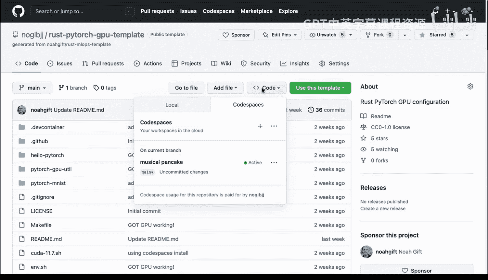
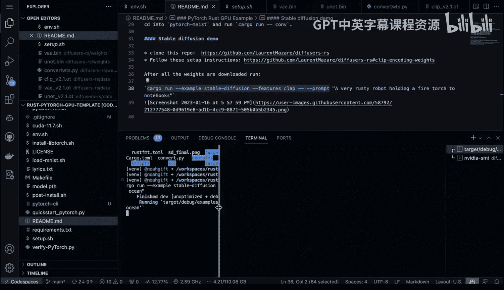
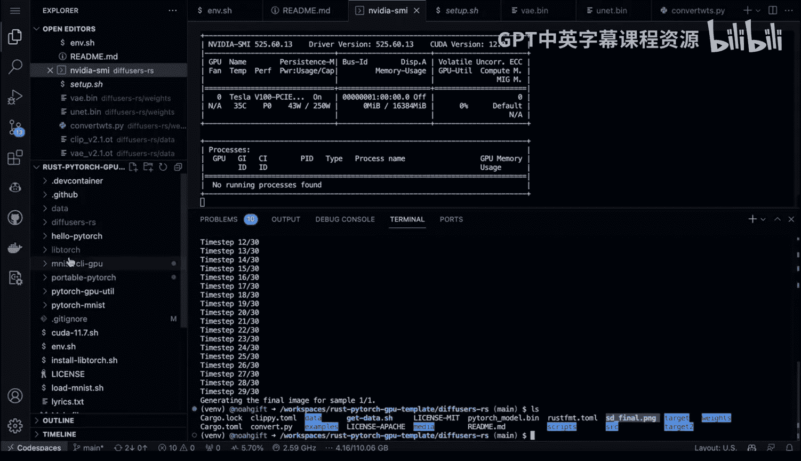
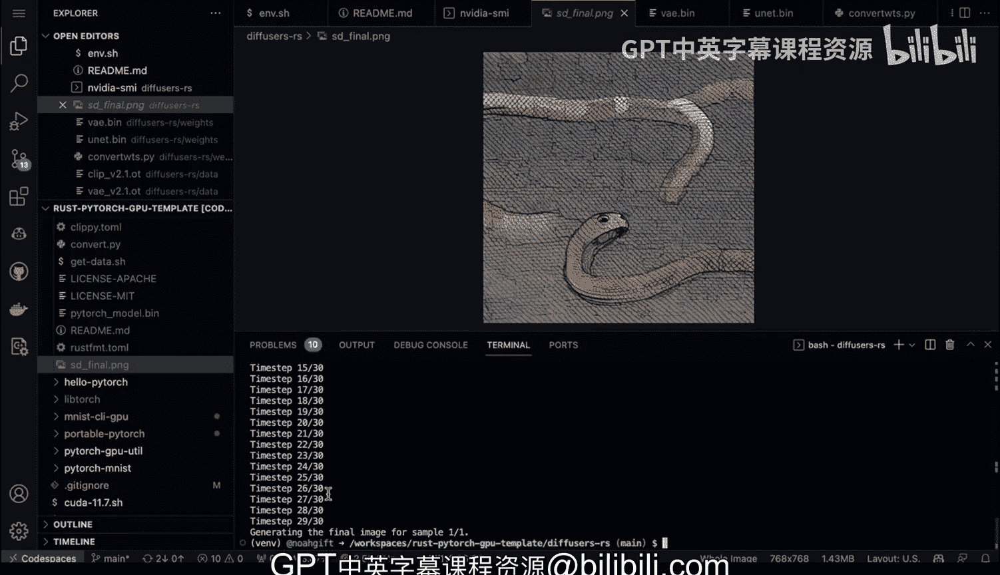

# 杜克大学｜机器学习运维｜DevOps⧸DataOps、Azure、MLFlow和抱脸｜MLOps ｜ Machine Learning Operations p65 72_05_04_Rust-GPU-PyTorch-Stable-Diffusion.zh_en -BV1yE421c7uA_p65-

One of the more exciting things that's happening in machine learning is deep learning。

 You can see all of the really amazing technologies from large language models to doing， for example。

 text to image generation with stable diffusion and a lot of the Python programmers have been having a lot of fun with this but one of the things that is interesting about rust is that you can use pytorch and you can use huggingface with rust。

 and in fact， it can be 70 times at least faster， and if you do care about portability， performance。

 packaging together maybe a pretrained model and then giving that to somebody there is no other option in many ways than rust because rustk and package all that together and you can use the amazing packaging tools like cargo and also use cargo to execute different iteration。

 So in a way， if you want a highper research environment for deep learning， and my opinion。

 there is no better tool。😊，And rust。 And so what we're going to do is go through step by step how to actually use stable diffusion that has the Pythtor bindings in rust。

 It will also tap into a GPU and see how that GPU is used in Github code spaces。 All right。

 let's go ahead and get started。Here we have a repo Laurent Mazari。

 and inside he has a torch Rs package here。 and what's amazing about it is how well it works to bind rust with Pytorrch。

 including doing GPU operations。 I've been using it quite a bit。

 And let's go ahead and look at the highle overview。 So it binds down to the C plus plus APIpi。

 And if you take a look here， all you need to do is set an environmental variable。 In fact。

 this is the one that I set。 and it was able to actually just package it in for GPU。

 There's some other tricks that you can do。 But a nutshell you can use ptorrch。

 and you can train models， you can use pretrain models。 I've got examples of this all running。

 like I think this shows one of the really cool things you can do is use a pretrain model And then finally。

 if you want to you could even do stable diffusion。

 So what we're gonna to do is just briefly take a look at this stable diffusion example here where we can create images。

😊，I'm going to go to My Rea， which is Nogi BJJ Ru Pytorch GPU template。

 and I'm going to go ahead and click this icon code。

 and this is again where codespaces is so amazing is I've enabled GPU for this particular environment and really the biggest takeaway here is that inside of this setup here I have some setup code here that allows me to do things like。

Put that environmental variable for torch kuta inside of a bash or sea。 and once I've done that。

And I did a Pip install of Pytorch。 I was able to also get rest working with stable diffusion。

 So all I need to do is go into that stable diffusion directory and we can look at it here。

 we can see diffusers or rests And if we take a look at this。

 a few different things I did was I downloaded the data for all of the weights。

 and that was one of the trickier things to do。 And then I could just follow my notes。

 Let's go ahead and take a look at this。 Here's one of the things I can do。

 so I can make my own invocation here And in fact， what we can do is I can open up。😊。

A terminal to the side。And what I will do is do NVIdia。Dash Invidia S M I。Dash L1。

 And this just goes through and looks at how much GPU is being used right。

 And you can see here it's 0 right now。 And now all I need to do is go through here and run this command。

 And so I'm going to go through and do this。 I'm going to say cargo run example stable diffusion。

And then I'm going to put a prompt and say， rusty code。In the ocean。

Right let's go ahead and run that。And look what's going to happen。 It's going to go through。

 and it's gonna， it's going to pig this GPU。 Let's go ahead and take a look at it in action。

And we'll see that this GPU will get saturated in just a second。And this is what's fun。 There we go。

 Coud is available。There we go。 Here's the prompts。And。In fact， if I wanted to。

 I could even throw this。Up here， and we can see it side by side。

 So it's going to build the transformer。Is building the autoencor。 And so this， again。

 is why high performance code is so awesome is that I can go through here and build out。

 you know prototypes that use cutting edge libraries like stable diffusion that actually talk to a GPU And here we go。

 we're gonna to see this thing is going start hitting the GPU。

 And and we'll be able to get a a nice overview。 There we go。 It's fully saturating that GP。

 So we're able to to use high performance tools like GPs inside of Pytorch。

 you can see it's just cranking through and allowing us to build these images。

 And why is it able to do this because it's leveraging the pytorch bindings And we can， again。

 rapidly prototype different solutions。 And if we go through here and we look at this。

 it's going to have this image right here。 And if I just click it。And I go to that repo。

 which is the diffusers。

And I look at that file that was just created。 We should be able to take a look at it。 There we go。

 There's our rusty code in the ocean。 And， and I， again。

 I can just continually crank out different new different examples， right。

 I can just put a new thing inside of here and just say， you know。Python is so slow。

 but rest is so fast。Let's go ahead and see what happens。We do it again。Cud is available。

 and it's going to crank through here， and it's going to build out this example again。

 just allows us to quickly crank on things。 So even in many ways。If someone wasn't a rust expert。

 they could do what I did， which is recreate the stable diffuss you know link here and actually just build this as a prototyping tool to use stable diffusion。

 So I think there's even extensive ways that someone might want to leverage the rust ecosystem。

 even if they don't want to become a rust expert， although I would personally say you should try to dive into using rust it's I would say just to straightforward as Python。

 All right， this is a preview of some of the things you can do with rust and stable diffusion using the Pythage bindings。

 I hope you give it a try。

