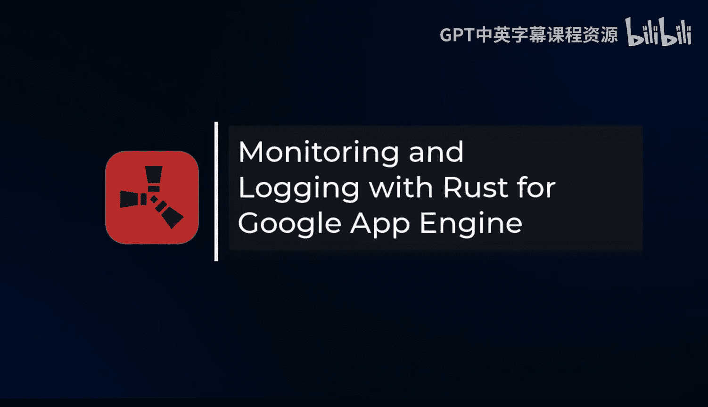
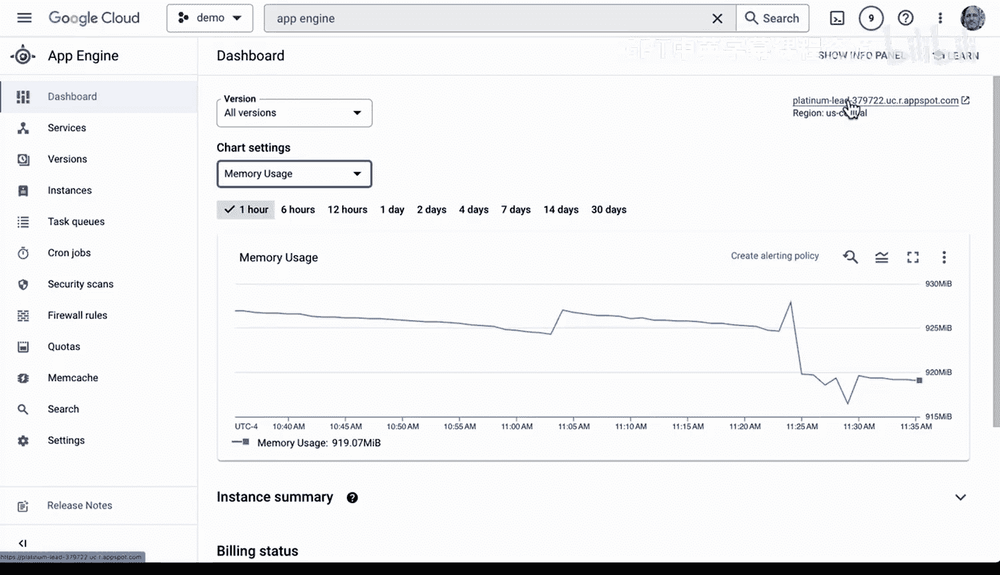
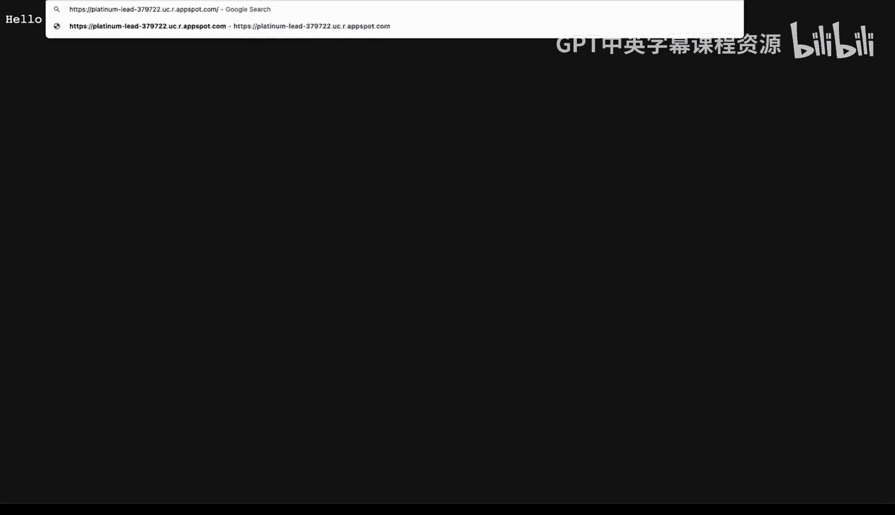
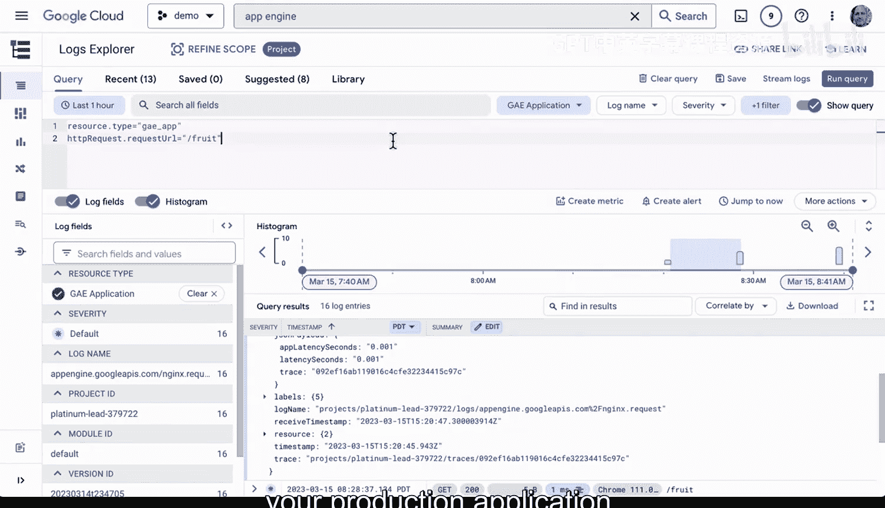

# 杜克大学｜机器学习运维｜DevOps⧸DataOps、Azure、MLFlow和抱脸｜MLOps ｜ Machine Learning Operations p72 79_05_05_Google-App-Engine的Rust监控与日志.zh_en -BV1yE421c7uA_p72-

Here we have a rust microservice using the Actics web framework。

 and you can see here that it has the route here fruit。

 It also has a function that returns hellello worldd。

 and we can actually look through this code to see how when we deploy into production what will happen。

 It's also containerized and so this containerized application works very well for app engine。

 So if we go over to the deployed version of it inside of app engine。

 you can see here that there's a dashboard that shows all of the different important summaries in this section。

 So we can see here that there's a number of requests here that we can look at we can also go into the billing status。

 look at errors if there were any errors。 we can also toggle through all the different settings。

 So request by type， for example， latency we can also go to loading latency as well。

We can go to errors， we can also look at traffic， how much traffic has been received as sent。

 we can also go to utilization and we can also go to the instances so how many instances are deployed。

 we can see there's two and we also can go down to memory usage which can be very important for microservices and we could even create an alerting policy based on that finally。

You can look through here and there's lots of different caching queries as well and if we want to look at the application pretty easy。

 we just go through here and again here's our random fruit rustbased microservice we say fruit and we can run this over and over again。

 So really it's a very straightforward and comprehensive monitoring service just from the dashboard alone and we also could go through here and look at versions and even see which versions are actually serving out traffic in this case we can see this is 100% of the traffic and we could even stop or start the service from this dashboard。

 So really a ones stop shop if you have a containerized rust microservice for Google app engine and the other thing that we can do that's also pretty handy is that we go over here and we go over and find logging。

We can even drill into the details even more。 So one of the ways that we could do that is we could actually create a customized query so we could even look through here and toggle just by resource type and get a good feel of everything that's happening。

 createate metrics， create alerts， those kinds of things and even do SQL queries。

 But I'm going to go through here and just look at something very simple。

 which is a query of that URL， right So we know that the fruit URL here is something that does get called。

 Let's go ahead and run a query。😊，And we should be able to see here of course it is。

 we can see that these are the app latency in seconds。

 we can see the name of the project and we can look at the timestamps of when those were actually called and if I wanted to as well I could go ahead and create some kind of an alert based on this for example。

 if it was maybe like call too many times we could do some kind of action based on it and we also can toggle through and look at different log names。

 look at severity so there's really everything you need to debug a rustbased microservice with app engine and a combination of the dashboard for Google app engine and the logs dis blur we'll give you everything you need to debug your production application。

