# 杜克大学｜机器学习运维｜DevOps⧸DataOps、Azure、MLFlow和抱脸｜MLOps ｜ Machine Learning Operations p73 80_05_06_Rust微服务负载测试.zh_en -BV1yE421c7uA_p73-

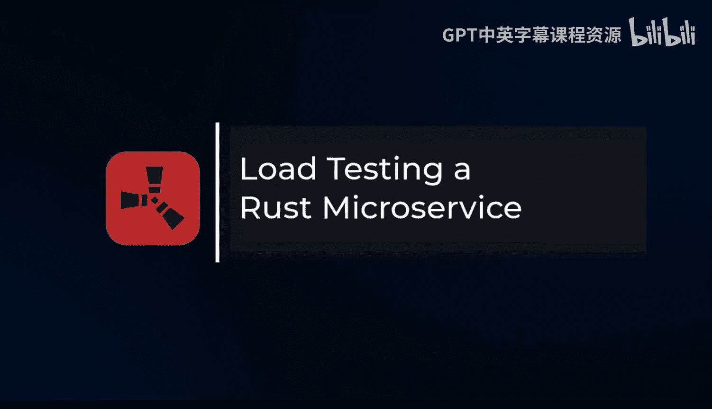

All right， let's get into load testing。 an important way to make sure that your application is going to do what you think it's going to do when you put it into production。

 you want to simulate what's happening。 look at the resources involved。

 maybe test auto scaling So we're gonna take a look at this tool called Locus here and to get started we can just select documentation And the first place to get into this is to look at installation here and notice we just do a Pip install。

 So if I go over to this environment here。 I notice I have a virtual environment source。

 and I just go through here and I say Pip install and install locust。 it's already installed here。

 And fact， we can double check we can say which locus。

 and you can see it's actually in this environment。

 the only other thing we need to do is actually go to writing a locus file and put something together where we actually map out the client git or post or whatever it is you're doing into the actual route。

 So this is a。

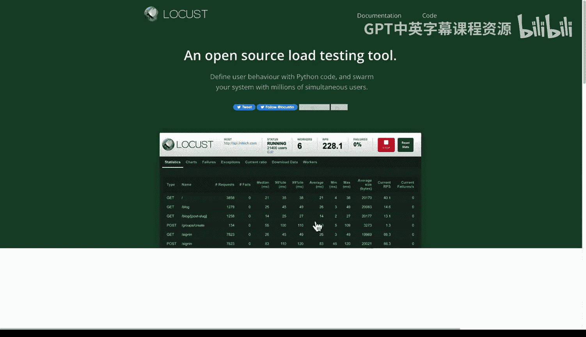

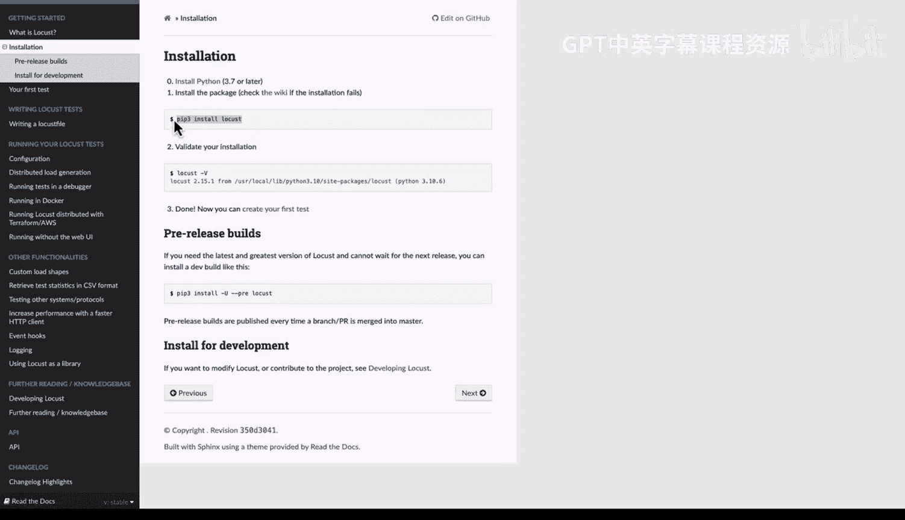

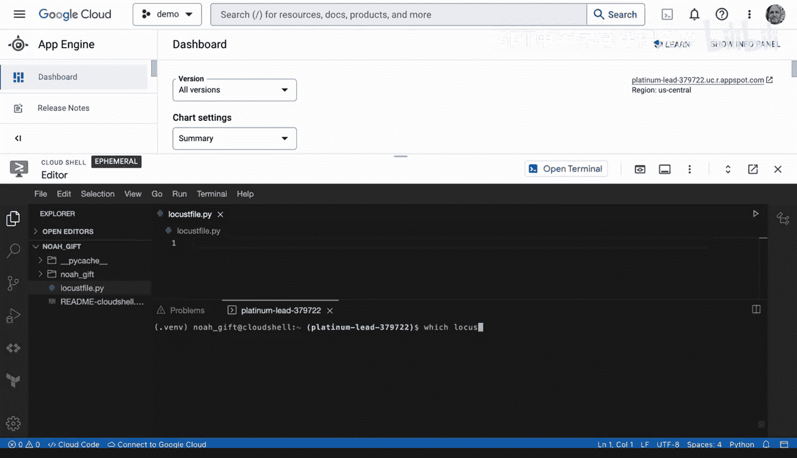

based app Engine project。You can see here the code allows me to look at the routes。

 We have a fruit route， default route， and I can test these particular routes。 In fact。

 I could even test the health route。Why don't we actually go ahead and test all three of these。

 So I'm going to take some code here that I've got laying around。

 and I'm going to go back to the cloud editor， Mo this up a little bit。

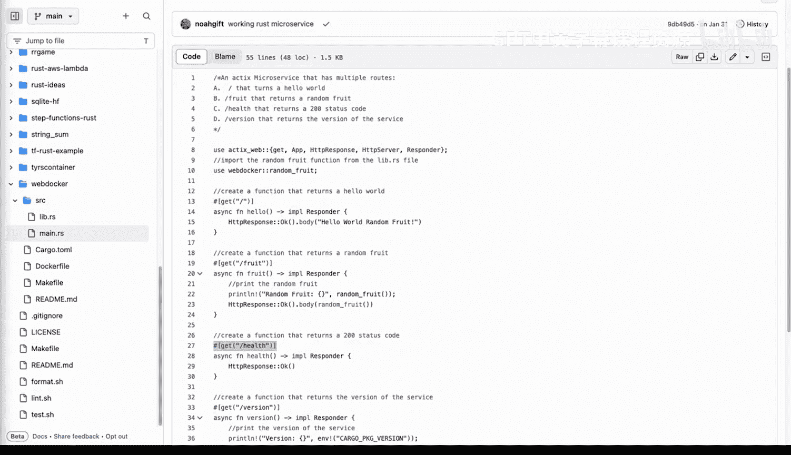

And actually go to this locus file and paste this in。 So we've got a quick start。

 We've also got a default route， a fruit route， and let's also add a health check route so we can we can test actually three routes。

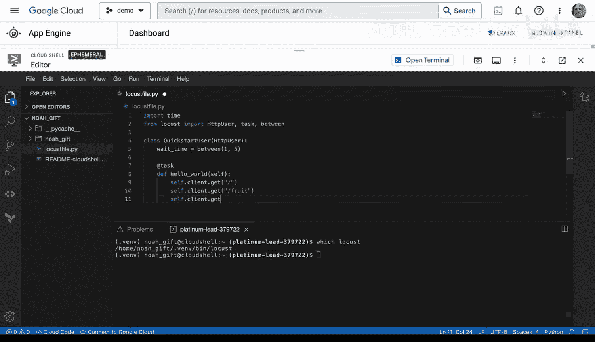

And let's just double check， it's always a good idea to look at the source code。

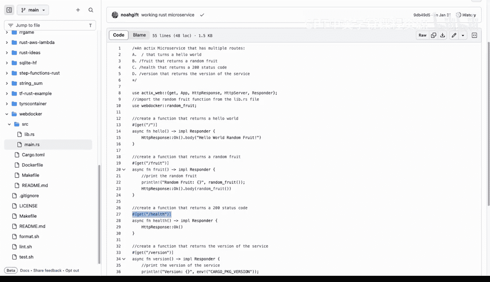

Great， yeah， that's exactly what we want。And now that we've got that all we need to do is type in the word locust and the Google cloud environment is actually very good for doing load testing because I've already got the app deployed here right here and there's the URL and all I need to do is just type in the word locus and this will spawn a local environment and notice that the URL here 8089 can be previewed So if I have a different port here I would just go ahead and change whatever port I wanted I'm going go ahead and pick this port 8089 and this will get me into the locust interface。

 We can start off with something really simple which which is like a number of users one spawn rate one just to really kick the tires now it's important to make sure you get the URL right So in this case we see this is the exact URL we want which is what is from app engine and I'm going go back here and paste it in notice that I don't want to slash here we want。

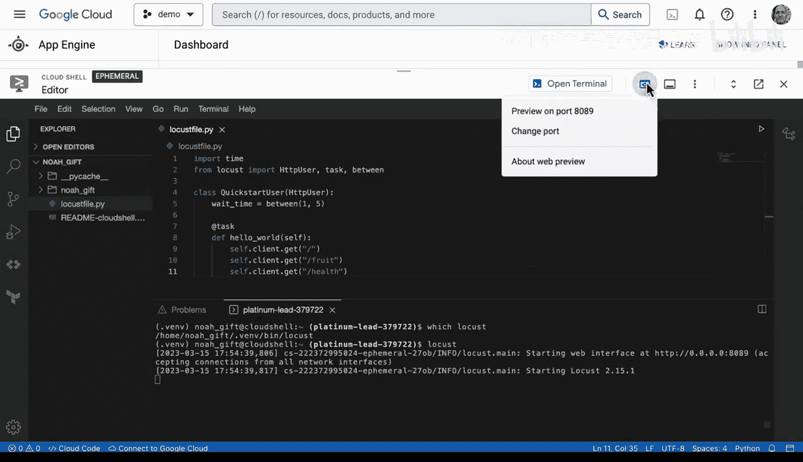

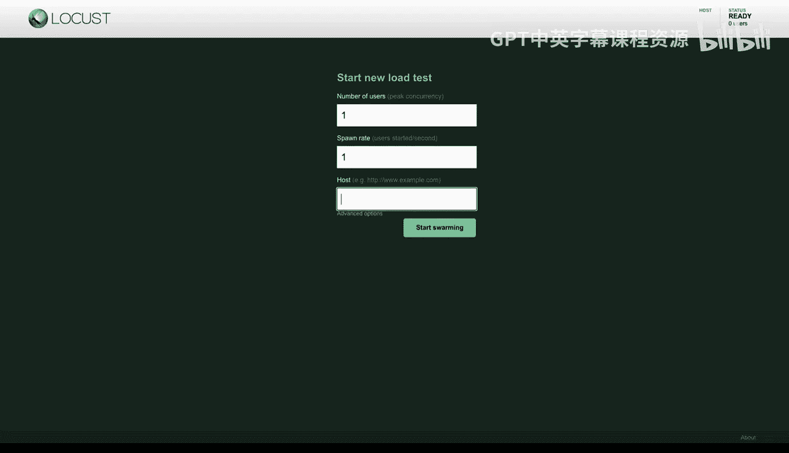

the the URL by itself because it's going to put the routes on top so once we go start here you can see it's going to make these requests to these three different routes that I set up and we can see an overall summary of how long things are taking in terms of milliseconds and in fact the maximum minimum average and in fact request per second we look at a chart we can even see it in real time we can see that looks like things are proceeding the way I would expect we don't have any failures at all we don't have any exceptions and we again can just watch it in real time now that's a reasonable test but let's actually kick up the pace a little bit here and stop it。

And then go to new Test。And under the new test， let's go ahead and test100 concurrent users and let's actually do a spawn rate of 25 new users per second。

 So within  four seconds， we'll get 100 users and again， we just look at the URL here。

 make sure that we don't have a slash because it's going to append those routes。

 let's go ahead and say start swarming。 and now it's gonna to be a very different load test。

 you can see here it's a significant ramp up in terms of request per second and now we can see that it's actually going through and having a little bit of errors。

 mostly successful。 we see a request per second，8084。 and there's only a small amount of errors。

 and look we see the response time that app engine is able to gracefully handle this workload。

 In fact， it's getting incredible response times here。

 you can see here that it's doing quite well and we can also see the number of users。

 we've been able to saturate at 100 users。 So this is a pretty。

successful load test for 100 users and we if we look at failures。

 very small you know amount of failures here that we're getting now if I go back to app Engine and we scroll down。

 we also can look at the chart and get more information about what's happening in terms of the total request we can see here how many requests are happening and we could toggle based on you know some interval based on how much load testing that we're actually doing here。

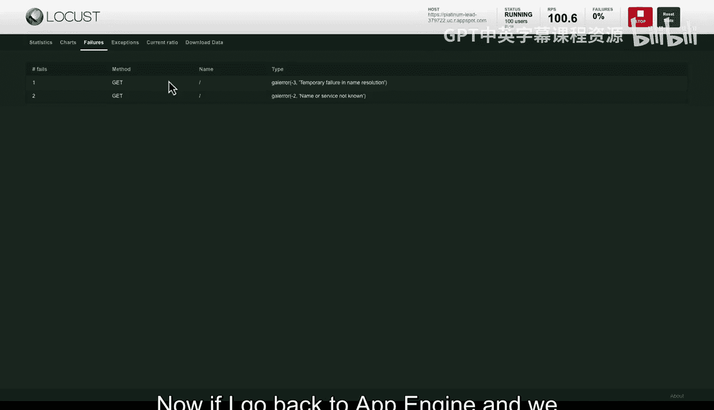

In addition， if I wanted to even go into logging， you know we could scroll down into logging and look at app Engine and even further go into some of the logs right here right so there's a lot of ways to use the load test as a way of essentially showing what's happening with the application in real time and again Locus is a very straightforward way to load test your application。

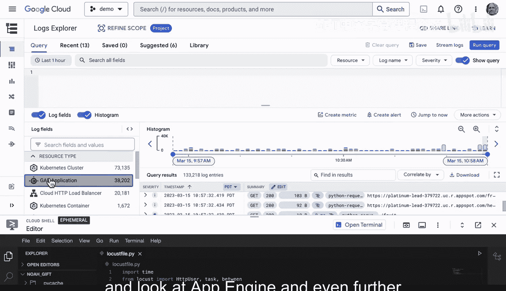

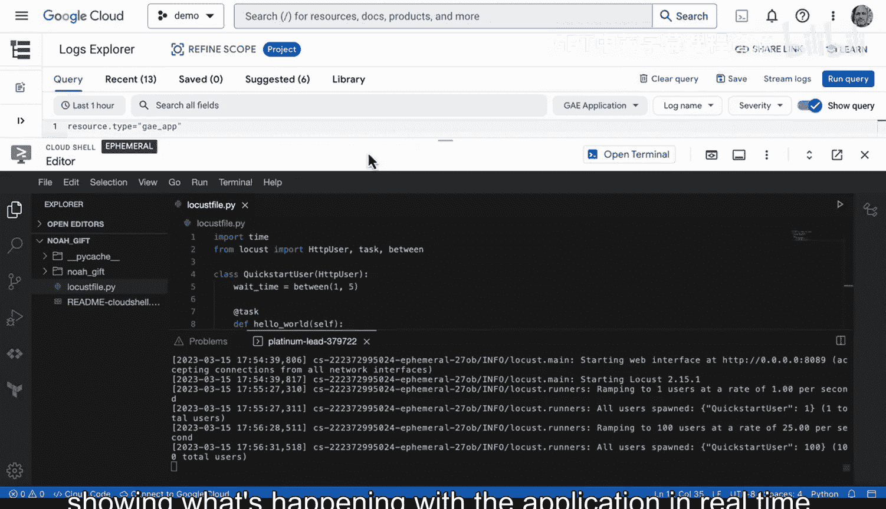

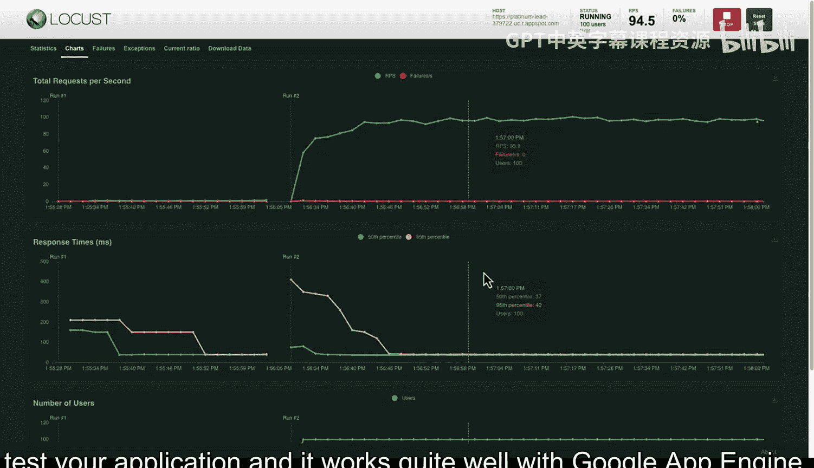

And it works quite well with Google App Engine。

