# 杜克大学｜机器学习运维｜DevOps⧸DataOps、Azure、MLFlow和抱脸｜MLOps ｜ Machine Learning Operations p74 81_05_07_在AWS上构建容器化Rust微服务.zh_en -BV1yE421c7uA_p74-

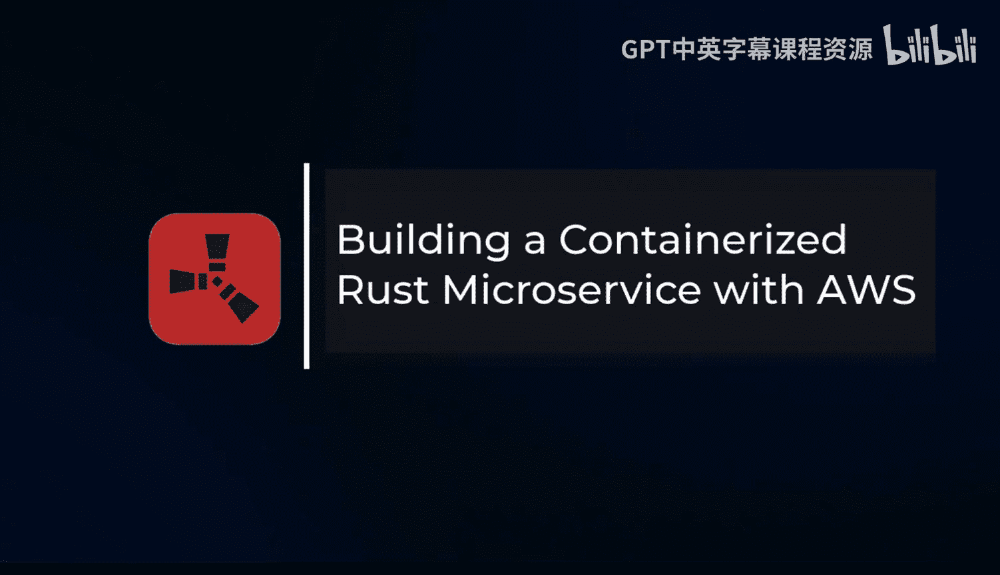

Here we have an overview of a containerized Acts microservice that will eventually be deployed to AWS。

 You can see a common structure here that's similar to many projects I work on。 I have a make file。

 I have a Docker file of a cargo do2 Ml file and I also have a lib and a main do R S。

 Let's go ahead and dive into it。 So here we have this rest tutorial that I've been hooking up here that's in the notes that you can linked to。

 and we see that it says containerized active。

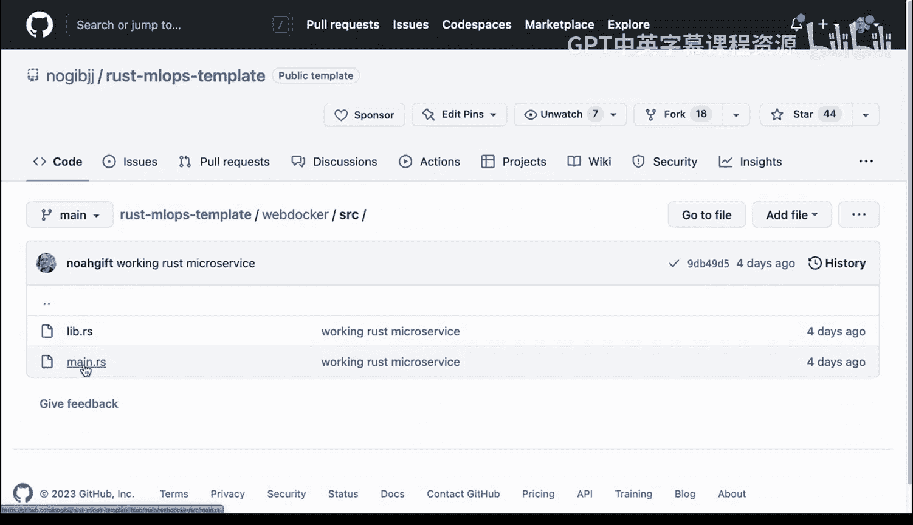

Microserv， I have a link to the project。 And then let's look at the Docker file。

 So this Docker file uses rust as a builder。 So what happens is that this environment is able to use all of the developer resources you care about。

 But then it pushes it into a new container。 So this is a nice slick way to build a very tiny container。

 And once it is able to be pushed into this new container。😊。

We expose 8080 and we set up an entry point that says web Docker。

Also we have a cargo2Ml file that has our dependencies。 there's a random and Actx web here。

 there's a Lib RRS here， and there's not a lot going on。

 We just have a random fruit that's delivered via this function and again this is a public function so it can be used in Maine and then the main is quite simple it looks a lot like let's say a flask or maybe a fast API app。

 I import some dependencies here and then I go through and I use my library。

And then I go through and I set up each of these entry points so I have a slash， I have fruit。

 get health， get version， and then in the main here we go through and we register all those services So pretty straightforward process and then finally when we deploy to apprunner。

 you'll see here it's actually this is a picture of the running service and then finally when you want to build this yourself if you go to this project。

 you just see the into web Docker and you can either use the make fileile or you can just run Docker buildt fruit and then Docker run and it'll run this once you push it then to ECR。

You can tell apprunner to do an auto deploy。 So this is one of the the key takeaways that's nice about ER is that once you push a container there and you have apprunner registered。

 it's ready to auto deploy。 All right， let's go ahead and see this in action。

 So we can go to this Docker file。

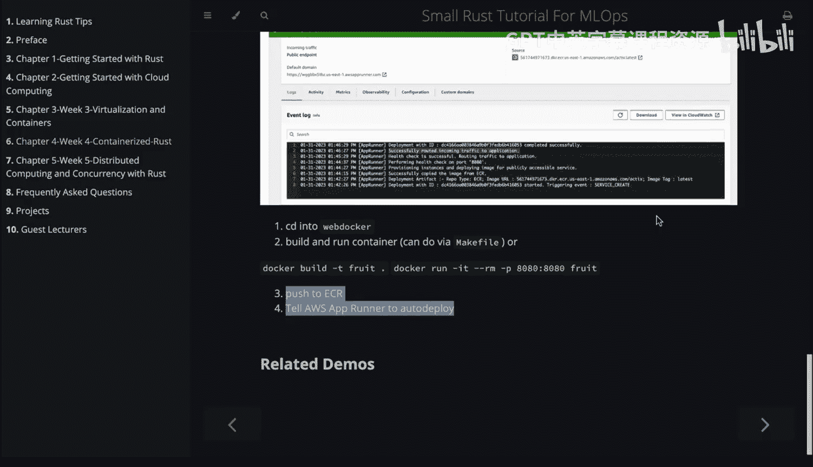

And we can do that。And then， instead of here。I refresh。We got a make file。 There we go。

 I'm going to say make format。It's going to compile it， run it。

 and I should see something show up to standard out and I and I should also be able to preview this thing。

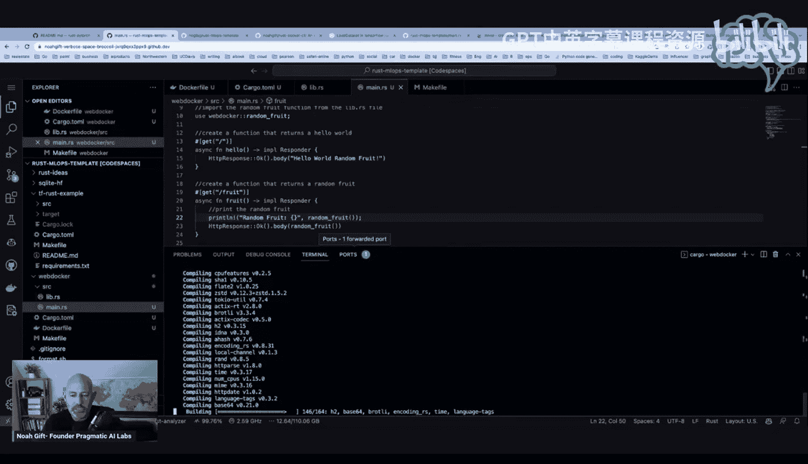

Which would be pretty slick。 Okay， let's open up in the browser。 Let's look here to look。

 running the service。 See， that's my message down here， right。

 So you can put prints inside of here and see what's going on with Acts and look。

 hellello world random fruit。 We see that thing。 And then if I want to go to What is it fruit or something like that。

 orange， right， So we can see like， hey， works not bad。 right I have a。

 I have a random fruit service。

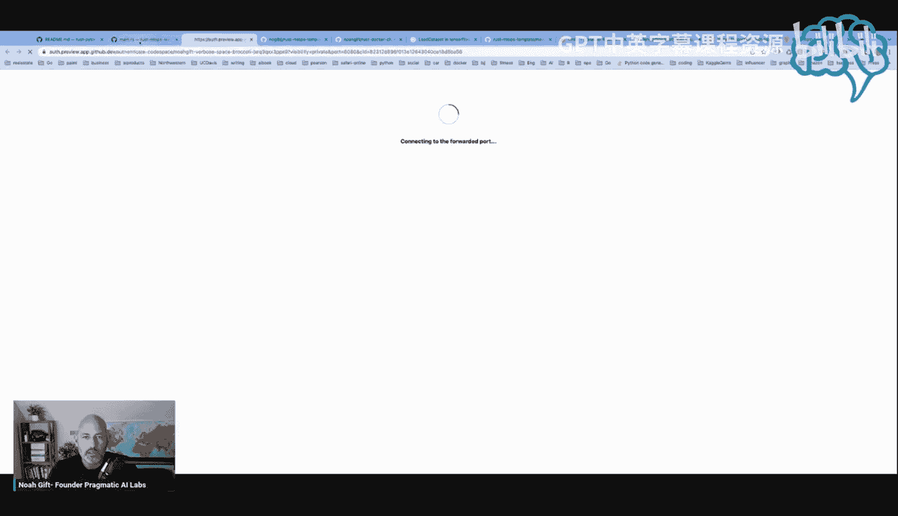

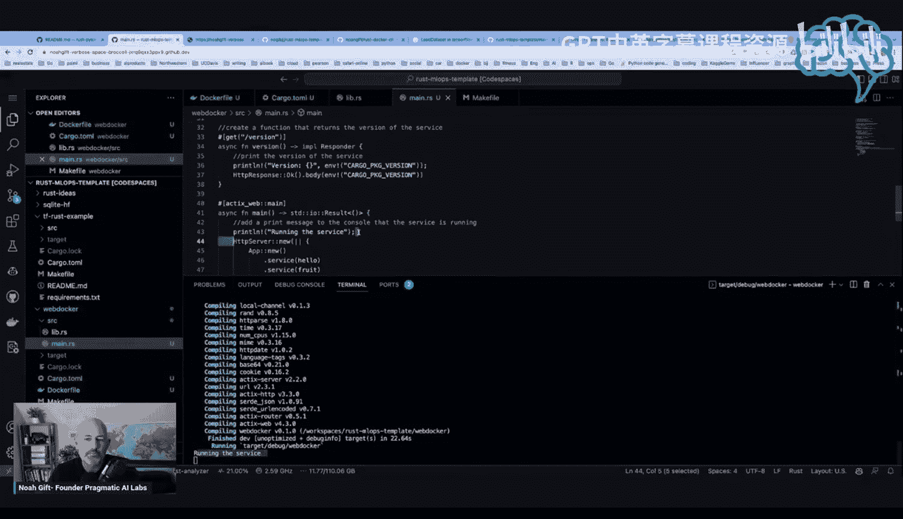

Pineapple， grapes， orange， watermelon， mango， right。 And look， this printing them out here。 So nice。

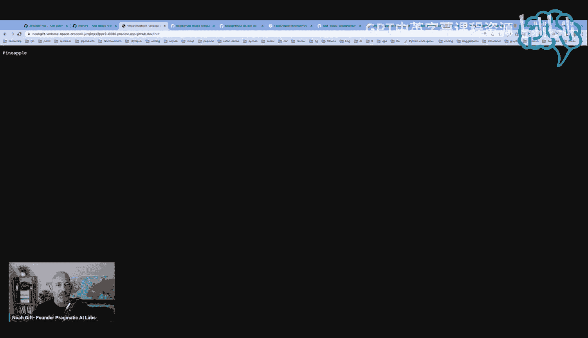

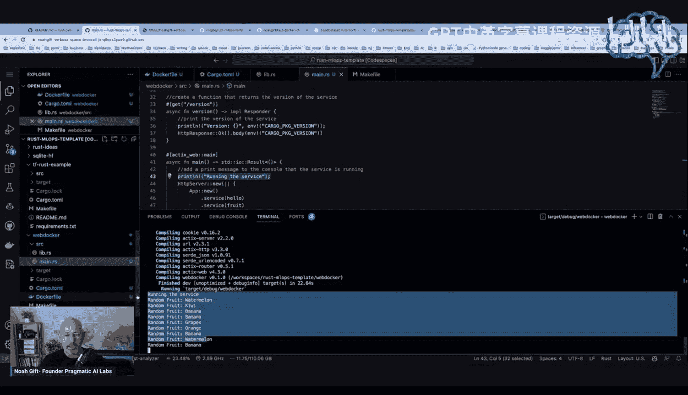

Hppy Ru up。 I mean， this shows you how ridiculously awesome。

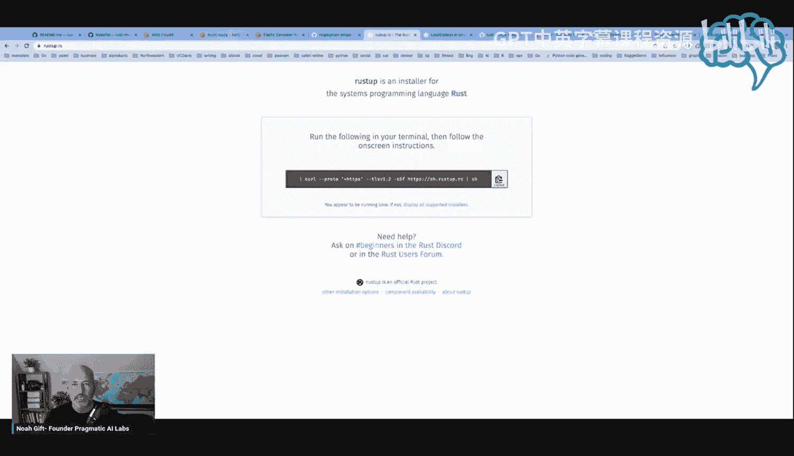

嗯。Rest is like I just run a command it just puts everything on there。

The only other thing I need to do is clone。This repo。

So it's going to compile or it's going to install rest real quick。

 and then I'm going to need to go over here。

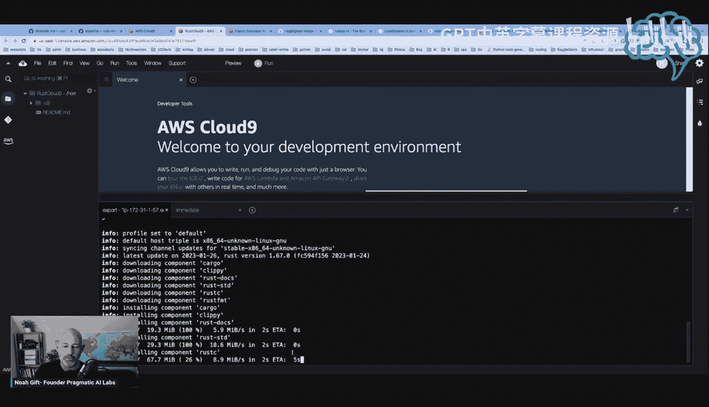

And I'm going need to clone this。 I'm going to clone as HtPS because I don't want to。

 I don't want to push anything。 I just want to clone it and and build a container。 There we go。

 So we're gonna， we're gonna。

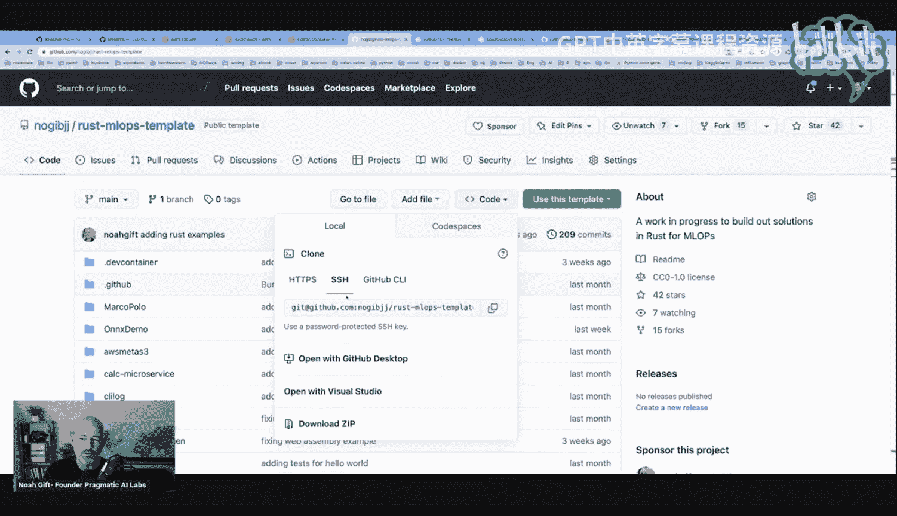

Do this。 We're going to store this variable， and I'm going to source cargo， and we're good to go。

 So So now all I have to do is say， get clone this one。Now I just seed into this， and I seed into。

Med something web Docker。And then。I just say。Inside of web Docker。A web docker。Here。

All I need to do is look at this make file here。And。Basically。

Just tweak the tweak the commands a little bit。 So so what I'm going to do is if we go back to it to this Acts thing here。

 check this out， I'm going to say view push commands and I'm I'm going to off first。

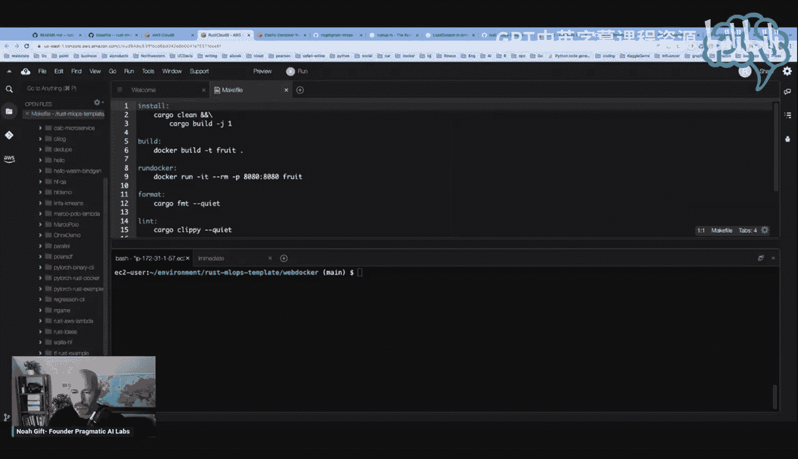

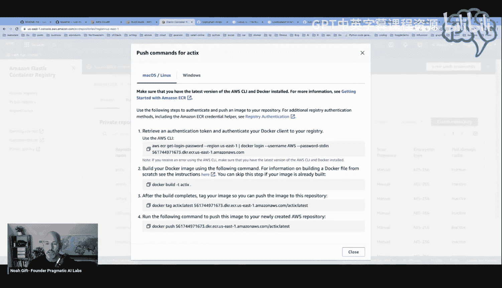

So we're going to off。There we go。And then I'm going to go to the next one。

 I'm going to say Docker build Acttics。This is just going to。Tag it with the name of this ECR。

So that I can actually push it there。And let's just let this thing go and this is why I think it is good to have a nice beefy machine。

You know， when you're when you're working with this。

 so it's going to do what I just did in codespaces， but it's going to put it inside of cloud 9。

 So I think this really shows as well。What's what's cooking。

 So let's go ahead and get this thing cooking， install web Docker crates。嗯。There we go。嗯。

Upd createsた内よ。And。Let's let this thing finish。Pretty exciting。Because where I see this headed。

Is I think I am going to get Arunner working properly。

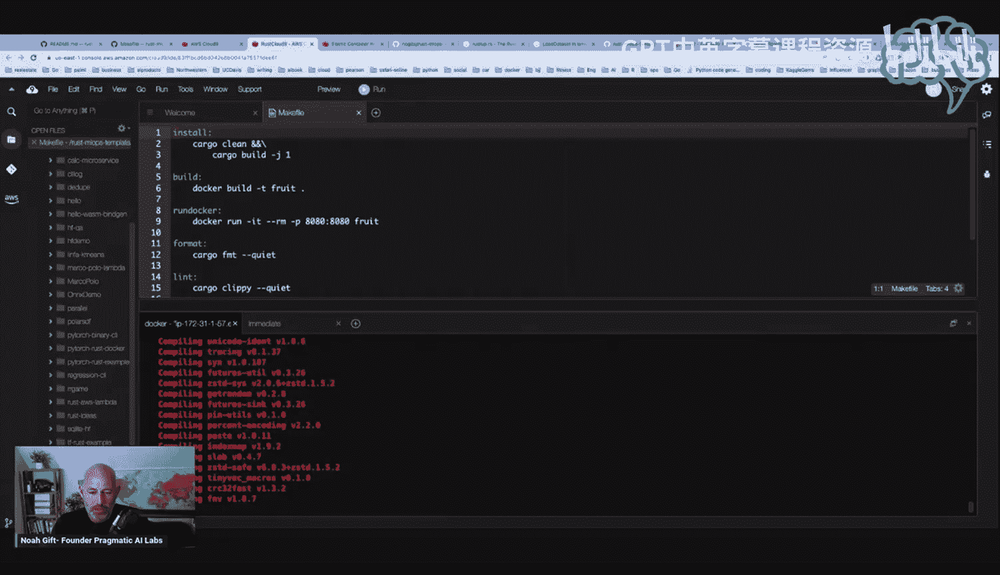

Okay， we got all that cooking。

And let's go。Here， so now we're going to push this ridiculously small container。

 not like gigs and gigs and gigs。 it's under 100 megabytes。 Look at this。 ridiculous， right。

 So if we say Docker image Ls。94 megabytes， what is going on？And now it's trivial to deploy this。

 all I have to do。

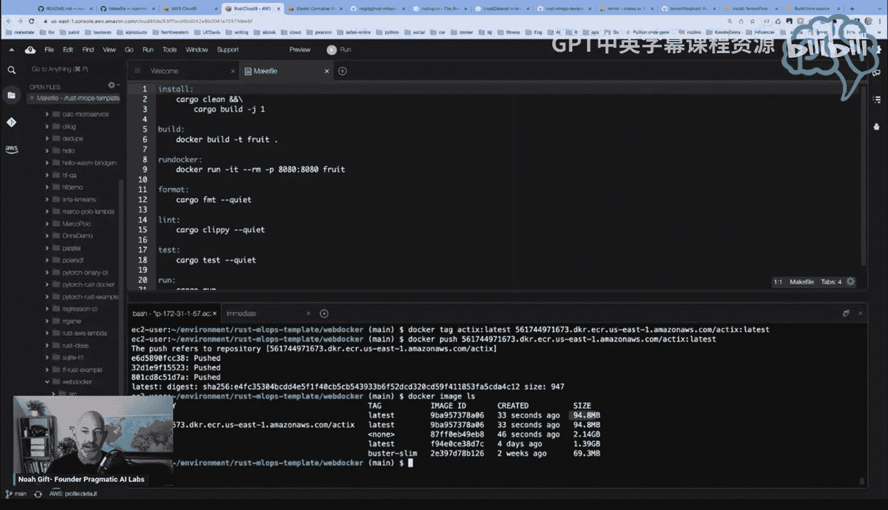

Is I go to apprunner and I say， hey， let's go， Let's build another service。

 I'm going to use container registry。And we're going to go here and we're going to find Actics。

And we're going to say。Manual， you could do automatic because right every time I push a new binary。

 you could， you know， that inside of that container， but let's just do manual to start with。

We're going to use existing service。And we're going to say next， we're going to call this rest。

Actics。Here。And let's go。Let's see what happens。Lets let's check this out。

 I'm pretty confident this is going to work。And what's awesome about this is it shows。😊，Why。😔。

Many people should seriously consider。Using。Rust for microservices， right。

 because we know that the binary is just massively small。Successfully routed incoming traffic。

Deployed with Id。

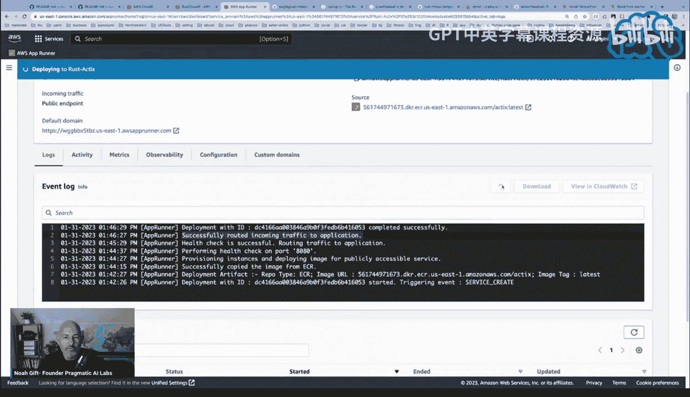

How about now。😔，There we go。 Look at this。 Whoa， After a minute， I'm impressed with myself。

So we can go here and we can say fruit。Apple， check this out。 Look at this， awesome， awesome。

 awesome， awesome， super high performance。😊。

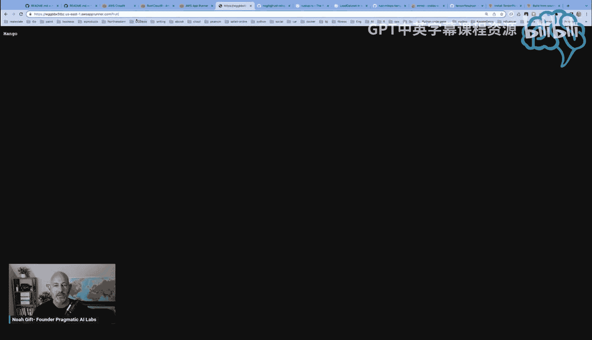

嗯。Out here， if we do health， we got a health check here as well if we go to the main page。

 we've got this so。

InMy opinion， this is a worldbeer right here is Acts。

 and I'm going to take a little screenshot of this thing。

And let people play around with that a little bit， but really， really slick stuff here。

 and I think I'm going to call it today， this is a massive victory。

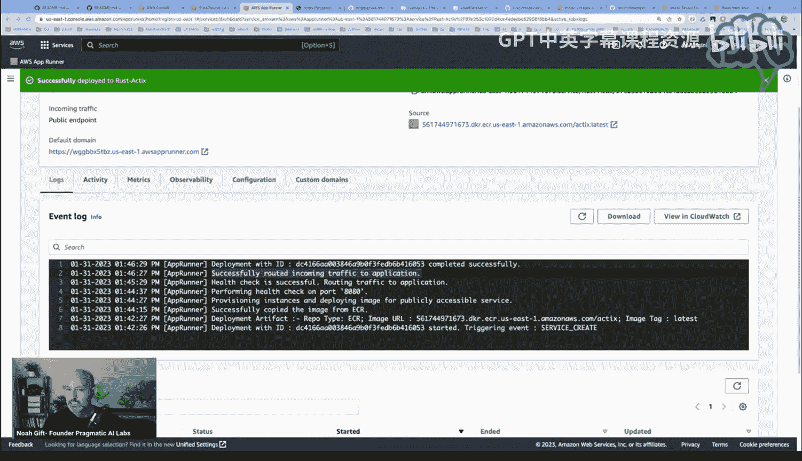

