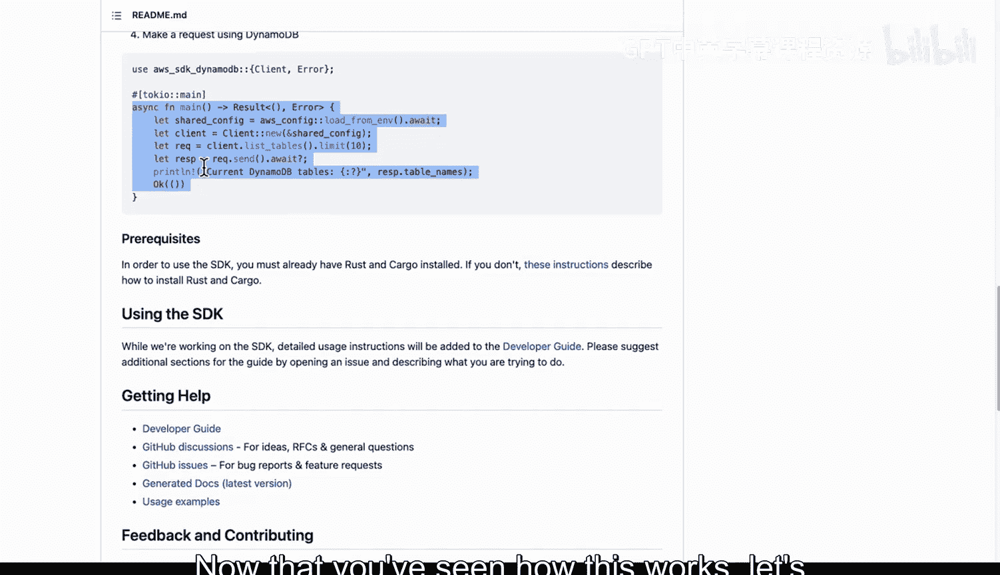
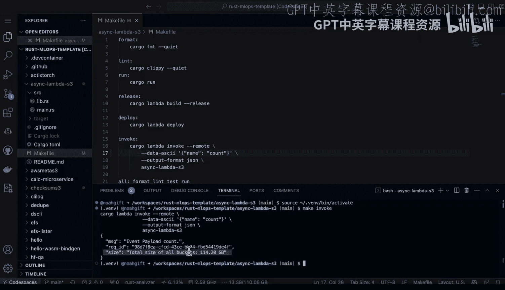
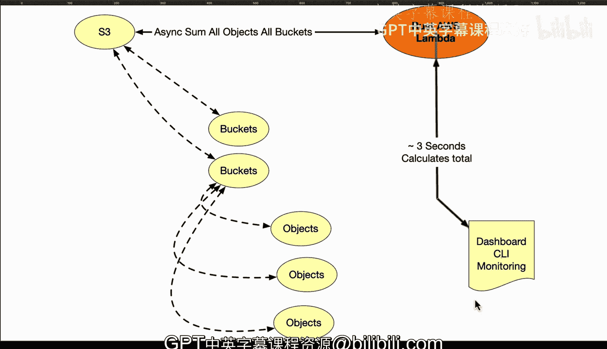

# 杜克大学｜机器学习运维｜DevOps⧸DataOps、Azure、MLFlow和抱脸｜MLOps ｜ Machine Learning Operations p77 84_05_10_AWS-S3容量计算器.zh_en -BV1yE421c7uA_p77-

Here is the architecture of an AWS rust Lambda that is a systems programming type Lambda。

 What does it do Well， it is able to asynchronously communicate with S3 S3 could contain thousands or tens of thousands or hundreds of thousands of files and it could asynchronously go through go to all the buckets。

 look inside of each bucket for each object and then do some kind of operation in this particular lambda which is a monitoring Lambda I calculate every single object and put in a total and this case it takes about three seconds to run my particular bucket configuration and then I'm able to later put that into a dashboard。

 a kmelan tool， perhaps some kind of monitoring or billing system and it's all done through the power of the async rust SDK So let's go ahead and take a look at how this would work。

 First up we have the AWS SDK here， and you can see an example of what it looks like。 is that。

You first use whatever particular component of the SDK you use Tokyo。

 which is async library and this particular environment here。

 you can show how it will asynchronously list potentially all the tables inside of the AWS environment now that you've seen how this works let's go ahead and look at the code itself so if we go into Github code spaces I've got a async Aws Lambda here and you can see some of the code where I say use AWS SDK S3 I make a AWsS3 client first then I make a list of all buckets function here。

 you can see I say pub async list all the buckets。 so again。

 the async gives us the ability to run this in a network async way and then finally I am able to calculate the size of the bucket by summing every single object in the bucket which is nice。

Finally， what I do here is I use the list buckets to get a list of all the buckets in the account and then this goes through and creates the bucket sizes。

 Now if I go to the main here， all this does is use Lambda to create a human readable helper method and then in terms of the function handler here。

 the function handler is able to run that code that we set up previously and then return back the response。

 Now inside of this particular main method here， it then goes through and calls those other methods。

 So let's go ahead and take a look at the cargo file as well。

 So inside this cargo file you can see here I've got some decserilization library I have the async library I have AWS and I have that human size library。

 That's it。 And then in terms of the make file we can see here that in order to invoke it I can just go ahead and run this make file。

 so let's go ahead and do this we'll actually change the name to be something a little bit slicker。

I'll just say run or how about count， let's go and do that。And we'll say make invoke。

And then in this particular example O， I don't have cargo Lambda enabled， easy to fix。

 let's go in and source our virtual environment here which is how I have cargo Lambda installed now if I run it itll take about three seconds and it will synchronize inside and count the total storage in this case 114 gigabytes across all the buckets that I have。

Now， let's go ahead and take a look at the Lambda itself。 If we go over to Lambda。

 you can see here that I have this async Lambda。 I can also test it inside of here。

 I just go to test here。 You can see a previous invocation。 In this case。

 I just have a payload that says name run。 It's really an empty payload。

 I go ahead and click test and you can see it run in action。 So this is a great pattern。

With rust is to have high performance systems monitoring Lambdas again。

 this one does something where it calculates all the bucket sizes。

 but you could see how you could build things that talk to other components like EFS or maybe also the EMR or maybe to all your EBS storage or some kind of systems monitoring tool that is able to run very。

 very efficiently and also at a low duration in this case this only took me about two and a half seconds to run and I'm able to run it at the lowest level as well。

 so it's a very low memory usage Lada so in a nutshell。

 it's easy to build high performance systems tools using rust in this case。

 we are able to hook it into a Lambda and I can invoke it from a Kamelan tool invoke it on a terminal invoke it inside of a event。

 let's say a timer once a day and or put it into a dashboard。

