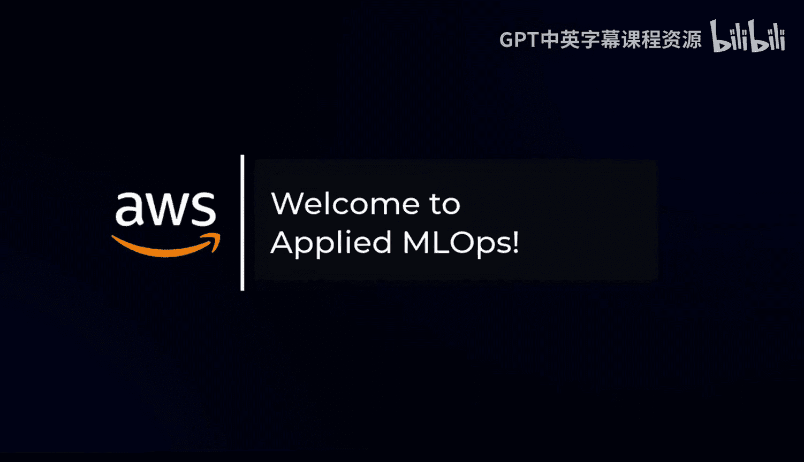

# 杜克大学｜机器学习运维｜DevOps⧸DataOps、Azure、MLFlow和抱脸｜MLOps ｜ Machine Learning Operations p78 01_01_01_认识课程讲师诺亚·吉夫特.zh_en -BV1yE421c7uA_p78-

Welcome to Appli MLops。 My name is NoAah Gift， and I'm your instructor for this course。

 I'm an adjunct professor at Duke。 My official title is Exeive in Reside。

 and I teach in both the MIs program， the interdisciplinary data science program as well as AIPI or artificial intelligence for product innovation and this course in particular it' very exciting because it covers many of the foundational skills that are necessary to put something into production using a cloud platform in the first really section of the course we cover data engineering with AWS technology。

 and this covers things like getting started with machine learning technology on AWS also creating data repositories for machine learning。

 then also how to identify and implement solutions for data ingestion and transformation solutions。

 So this weekly applies to the official AWS machine learning certification。

 but also a better way to think about it。😊，I that is going to help you build solutions that get put into production on the AWS platform The next week what we're going to cover is exploratory data analysis and using AwS technology for exploratory data analysis some of the things that come up with exploratory data analysis include sanitizing and preparing data performing feature engineering also analyzing and visualizing data for machine learning So in many ways the previsualization step。

 the cleaning of the data is one of the more important aspects and what's nice about the AW platform is there are many serverless solutions that help you build out that infrastructure really you want to do as little as work as possible that's one of the goals of MLopses to go for efficiency and that's why using serverless technology on AWS for doing preprocessing is so important。

Next up in week three， we cover how to do modeling with AWS technology。

 and so this includes things like how do you select the appropriate model for the task at hand。

 Is it a deep learning problem， for example， or is it a simple linear regression what are the different hyperparameters that you want to pick should you pick a full solution like let's say AWS Can or some kind of autopilot solution from SageMaker these are some of the tradeoffs that are important to be aware of when you're using a vendor like AWS we'll also talk about how to train machine learning models on the platform and also how to evaluate machine learning models Next up in week four we get into MLops with AWS So really this is going to the final phase of what you're going to do to put something into production So how do you make it efficient and how do you actually operationalize a machine learning model what are some different choices that you could consider when you're putting something into production for example。

 the choice of language could be one or the choice of deploy。artOr the compute target， is it a CPU。

 a GPU Is it using technology like Onyx to operationalize the model itself to make it more efficient for inference。

 a lot of different designed considerations go into operationalizing your model into production and then finally how do you deploy it and maintain it and make sure that it's going to be able to handle the load that it's put into a production system。

 So this course is a great resource for people wanting to really jump in。

 roll up their sleeves get right into it with the 80bu platform for machine learning And if you go through the course it also can help you study for different iterations of the 80bu machine learning certification。

 All right， go ahead。