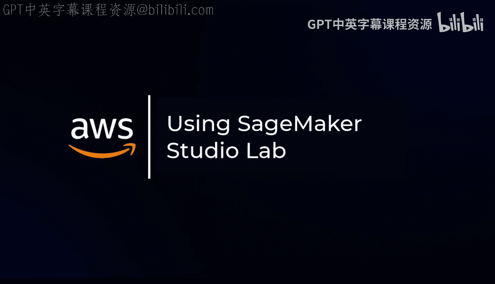
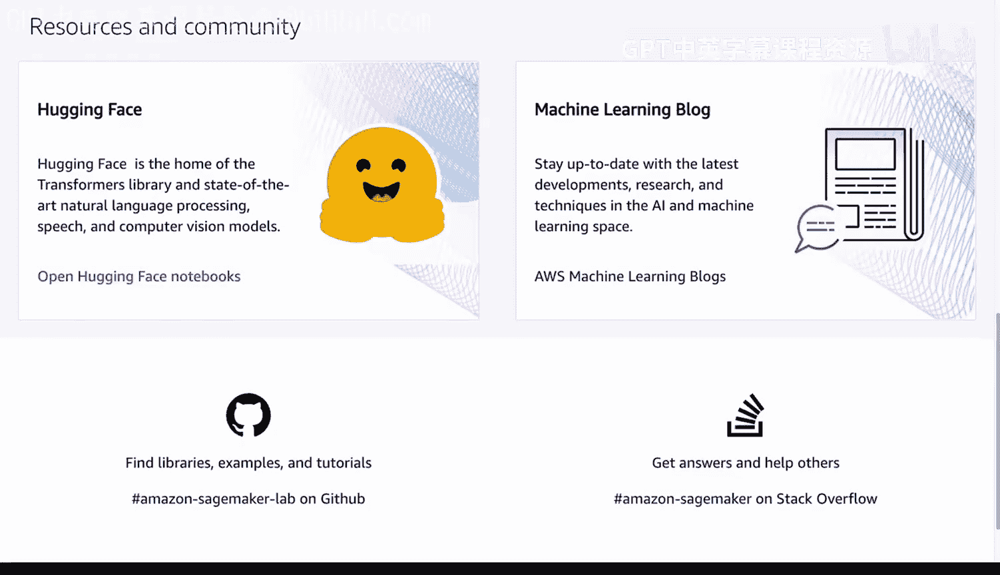
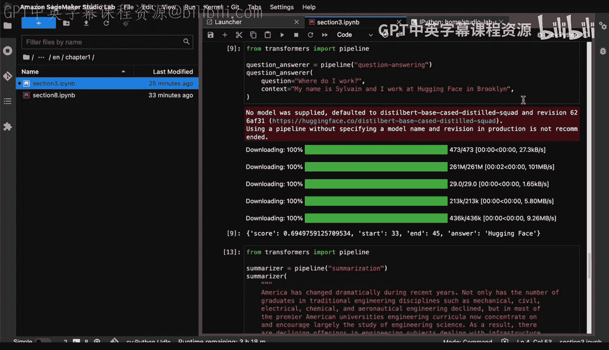
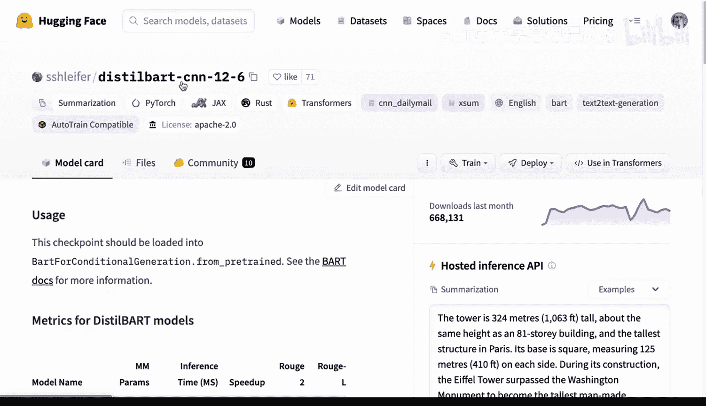
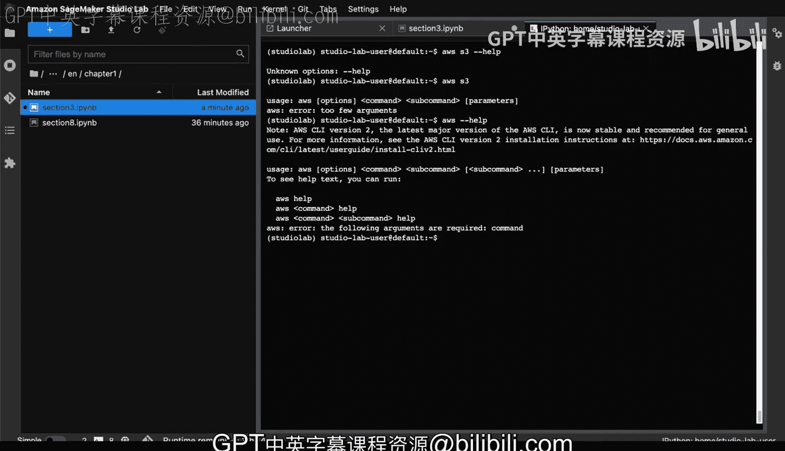

# 杜克大学｜机器学习运维｜DevOps⧸DataOps、Azure、MLFlow和抱脸｜MLOps ｜ Machine Learning Operations p79 02_01_04_使用SageMaker Studio Lab.zh_en -BV1yE421c7uA_p79-

Amazon Sagemaker Studio Lab is a free environment for prototyping out machine learning projects。

 It's based on Jupiter Note Lab。There are a couple different options。

 you can see here there are CPU options， as well as GPU。

 The GPU option is one of the more compelling for doing modern machine learning workflows。

 especially things around pre trained models。If you go through here and take a look。

 there is a course that you can follow AWS machineine Learning University。

As well as resources like a hugging face integration here。

 and you can see if you select open Huging face notebooks。

 it'll prompt you to copy this project into your SageMaker studio lab environment already got that running。

And so if I go over here and I take a look at sageMaker Studio Lab。

 I can go through very quickly all of the resources that are copied over from the tutorials and also dive into some of the other features。

 so let's go ahead and first look at the features of sageMake Studio lab here on the left you have the file system if I want to just browse the file system here you can see everything that I've got I've got a bunch of directories with notebooks in them if I select this icon。

 what this does is it shows me all the available notebooks that are running and terminals that are running。

 you can see here's a terminal right here。

If I go to this icon it says this is the git integration utility and so you can actually go through here and integrate with Git I also can look at the table of contents of Jupyter notebooks and then enable experimental features over here Now let's take a look really quick at this terminal one of the things that can be useful is if you wanted to look at your Conda environment list here if I typed in Conda EV list you can see all of the different environments if I needed to either create my own or toggle between different environments。

 I could do that right here。Another thing that I could do from here is a monitor of the GPU。

 This is very helpful if you're doing， let's say， local hugging face transfer learning， for example。

 or doing some kind of a local machine learning job。

 how would I actually do this if you type in NviDdia。SMI。Dash L1。

 it'll actually cycle through and monitor what's happening with this local NviDdia driver as well as the chip and you can see here that the driver version is listed。

 the coUa version， it shows you how much of the GPUs being utilized in this case I'm going doing any GPU utilization and then also it tells me the type of GPU in this case。

 a Tesla T4， which is a nice highpowered GPU so I could leave this running if I wanted to and actually take a look at all of the different things that are happening on my GPU。

Now， the other thing that we can do now that we know a little bit about the structure is go back again to。

The file system， and if we look at the notebooks， there's a bunch of different notebooks here。

I'm going to go to the hugging face course and the hugging face course in English。

 You can see there's different chapters here。 So this is corresponding to the O'reilly book around hugging face。

 And if I go to chapter 1， I can go to section 3 here and just open it up Now what's nice about this particular notebook。

 it' it really kicks the the tires on the concept of what a transformer is and allows me to play around with it inside of a curated environment。

 So the first thing that we can do is say Pip installst data sets evaluate transformers right here。

 and this would go through and install the transformers library from hugging face。

 Once we've got that， we're ready to actually start doing highleve things including doing sentiment analysis and this pipeline pulls in the pretrained models from hugging face and lets our GPbased environment run these。

 which is really nice。 And so in this case it says no model will supply defaulting to a。

model that's available on Huging F。In fact， if we want to go and take a look at these particular models。

 we can actually see this if I go to hugging face。And we go ahead and we take a look at models and I go to a particular category for NLP for example and I look at something inside of here like summarization。

 I could go through here and pull up for example， this model right here and even play around with it。

 but because this environment is using the transformers pipeline。

 I can actually pull right into some code and play around with it。

 in this case if we go through here and we classify it it goes ahead and does that classification。

We also could do zero shot classification， which is pretty nice because it allows us to pick some particular candidate label and then go ahead and select what it is that's actually most correlated with in this case it says this of course about the transfer formers library you would think it would probably pick education as the category in fact it does and it shows it's most likely this label we can also do text generation which is kind of cool so you can actually use this to generate text and in this case it says right here in this course I will teach you to create effective WordPress admin files right？

Another one we could do is we could use another model like Dis till GP2 which is also kind of neat。

 we also could do masking right so if you go ahead and you put mask right here you're gonna say fill mask and it will actually autocomplete in something as well so all of these are nice because it can use this local GPU and also lets you play around with the library so you get this stuff working locally inside of sageMaker Studio lab and then later you can push this maybe into your AWS account as well now you also if you need to。

You can actually go through here and you can type in AWS S3 for example。

 and play around with potentially some S3 command if you've got that the credentials set you can do all kinds of other things as well by looking at the help menu here and you can see here that the latest version of the CLI is now stable and recommended right I've got this AWS integration as well so there's a lot of really interesting features that are available with SageMaker Studio lab that are designed to really push you towards machine learning and it's a great experimental environment for doing machine learning on the AWS platform。

