# 杜克大学｜机器学习运维｜DevOps⧸DataOps、Azure、MLFlow和抱脸｜MLOps ｜ Machine Learning Operations p82 05_01_07_在CloudShell中原型化AI API.zh_en -BV1yE421c7uA_p82-

Okay， let's get started here with these AI services。

On AWS we have everything from advanced text analytics， automated code reviews， chatbots。

 forecasting， document analysis， you name it， there's a lot of things。

 What I like to do is I like to start with the Cloudhell and what's awesome about the Cloudhell is that you can try out and prototype ideas and if you want to look at some of the examples are fully baked you can go to NOAAgi donet AWS comprehend and you can see some of these examples here I'm going to go ahead and get started here and paste in the AWS comprehend detection so to start out with I'm going to say AWS and then I can say comprehend。

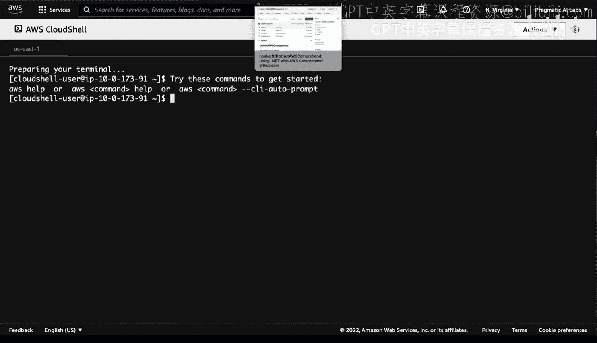

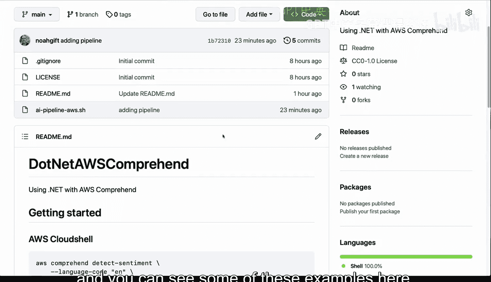

And what's nice is if I go through here and I just do a help。

 it will show me more about what this service can do and notice that it says these are the available subcommands so I can do batch detect。

 dominant language， classified document， all these really cool things here and all I need to do is just put this different subcomd inside so。

To get started with I'm going to go ahead and just paste an entire document inside and notice when you do a paste it tells you that it's gonna to give me a safe paste here and it says AWs comprehend detect sentiment and I have these new line characters that allow me to put each you know option here on another line I think this is a good way to build out really complex commands is to have these new line extensions here because it just makes it a lot more readable so here we go I say language code is English and then I say for the text I love C sharpp it's going to tell me whether this is negative positive or neutral。

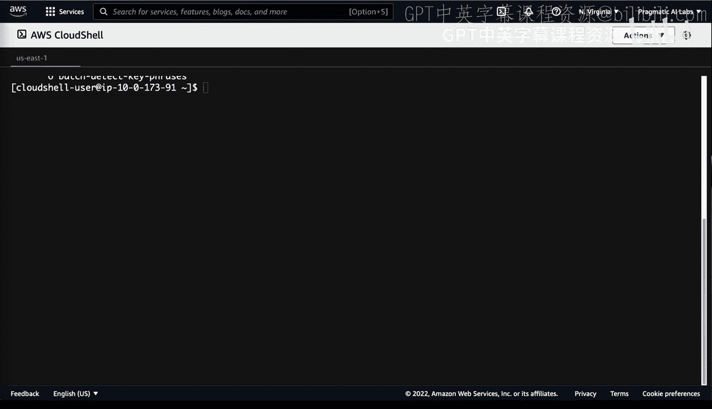

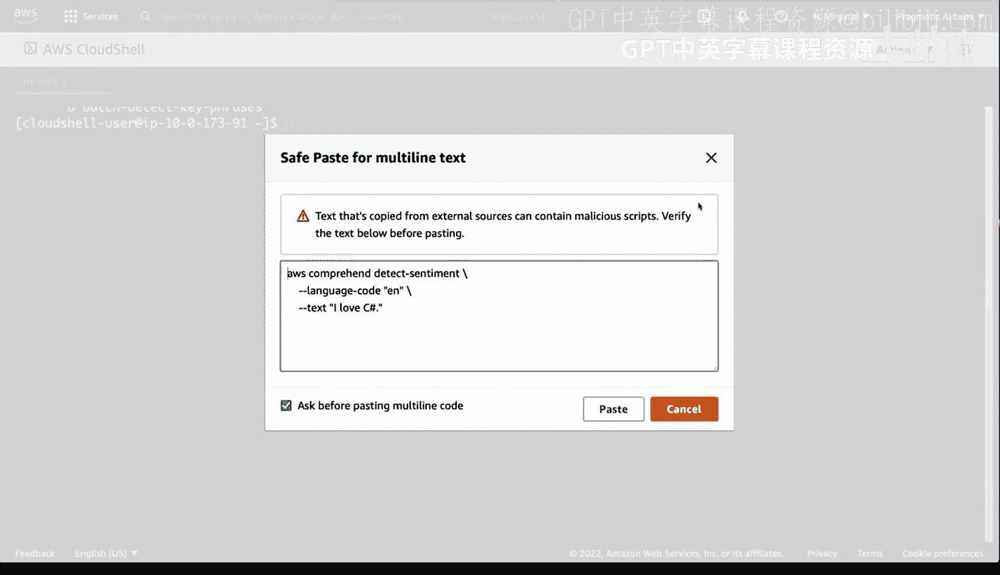

Here we go。 it says sentiment positive， so very， very straightforward in fact。

 and if you want to do AI work， I mean， why even getting into a language you can just get started and start pacing stuff inside of here now there are a couple things here that are a little bit tricky。

That are subtle and one of them is how do I get text into this if I want to play out with some more complex you know website or some other data source。

 and that is a problem and we're going to solve it。

 And then the other thing is how much can I pass into here So if we type in AWS comprehend。

One of the things that's nice is that it does do really good tab completion。

 so I can start to partially type something， it goes through and it does this。 Now if I do help here。

One of the cool things is it shows me all of the descriptions of the things I can do so I can。

 for example， change you know the text input， I can change the language code， all these things。

 So one thing to be aware of is that each string that you pass in at least from this particular tool must be fewer than 5000 bytes。

 So if you are going to pass in a huge quantity of text， you have to be aware of that so。ThatThat is。

 in fact， what we're going to do next， and what I'm going to do is I'm going to install a tool called links。

And this is really way back in the day， something that a lot of people used and what Linkx does if I do pseudo Yumman install links is it gives me the ability to browse websites from a terminal so this was actually the way many of us used to browse the internet back in the late 1980s and early 1990s in fact I definitely have done this in my life and what's cool is we can also use it to do data science and so what I'm going to do now is I'm going to grab a little bit of a snippet here of code that I have and I'm going to walk you through what it does。

All right， let's take a look at what this code does it we use links。And then we put in the word dump。

 and this will just dump the text out to the standard out of bash and what I do is I look at this website。

 so let's go ahead and browse it first。This is Wikipedia， Albert Einstein。

 you one of the geniuses of the last several centuries here。

 one of the top geniuses did theoretical physics work helped create the nuclear power revolution and one of the things that we can do is pipe this by using links into the less command and notice here now I can browse and look at things so even if you don't want to do data science。

 this is really cool to know that you can browse Wikipedia from the terminal by just using links and Wikipedia is fairly friendly with the Lix command line tool。

So what we're going to do next here now that we know we can grab some content is I want to just pipe out you know how many lines are inside of your7。

690， but what about bytes， how could we figure that out。

 well the word count command does give us the ability to grab it， so if I type in bytes？Here。😔。

Notice that it's way over what the AWS comprehend tool will take， it's 432，000。

 it can only take up 5，000， so what I can do here is I can create a variable because that variable can hold maybe an extraction of exactly 5。

000 bytes and so how would we do this well first up let's go ahead and build out a command line tool that pulls out 5000 bytes。

And let me walk you through it so I do that same dump command， but the head bash command。

 if you pass in dash C， it will actually pull out how many bytes you want and it'll stop right there。

 So we can actually use this and notice it goes through and it grabs some text out of here So it looks pretty good it looks like we're able to get a little bit of the article here and play around with it at least from a a teaching perspective here So now that I've got this。

 how would I use this with the previous command and if we look at the previous command one of the things that's complex about it is that it takes in a dash dash text right so if I go up back here and I look at the command notice that this is a little bit complicated because we can't pipe it in we're going to need to assign something to a variable Fortunatelyly pretty straightforward to do this and bash all we need to do is go to this command and and essentially put。

The right syntax around us so put this character here and put this other character here like these these inside quotes here or back ticks and then I can just type in text equals so these back ticks will put the output of this command into this text variable。

And now if I just type in echo dollar sign。Text。We've got this inside of a variable which is pretty cool Now in this case though I don't want to just get the word count。

 I actually want to get the entire text command and I want the raw text and so here we go I just swap it out。

Go through here， do the head dash， C， and then if I do the echo， there we go。

 we've got all the raw text in here， which is again， pretty pretty cool stuff。And。

What's awesome about this？Is that it gives us quite a bit of really awesome stuff here for us to play around with。

Okay， so now that I've got this thing here and we're able to play around with it。

 the next thing that I'm going to do is I'm going to put this into a more complex command。

 which is the AWS comprehend command so how do we do this well fairly straightforward here is that all I need to do。

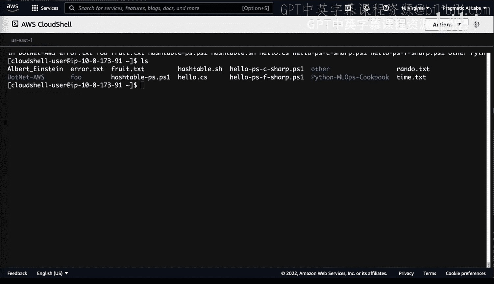

Is I need to just do AWS comprehend and so let's go ahead and grab just the parts we care about。

Which is this。 we need to say AWS comprehend a text sentiment， dash language， English。

 And then I just assign the text to this text variable。 Let's go ahead and paste it。 There we go。

 And we can see that that in general， people that write articles on。

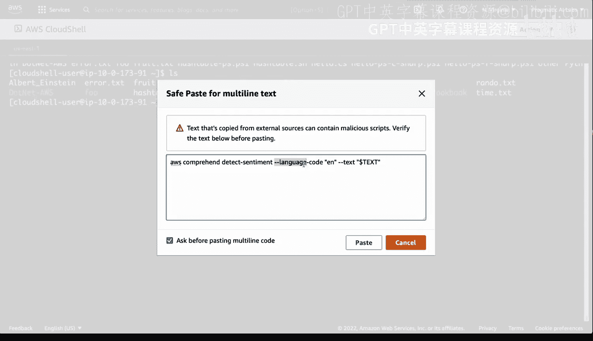

Einstein feel like they do a pretty good job of doing neutral， but in fact。

 there's a very positive slant。 So let's say around a third of the content is extremely positive for Einstein where in theory you would expect it to be more neutral。

 And so as a historical figure he's very well liked。

 So that's kind of an interesting from a data science perspective but。But what can we do beyond this。

 right， Like， are there other things that we could do。To make things a little bit more complex。

 Well we can。 So one of the things that I think is a fun thing to play around with is what if I go here and I use detect entities and then I say output as text though this time。

 So this time I want to use our bash capabilities to start to process something。

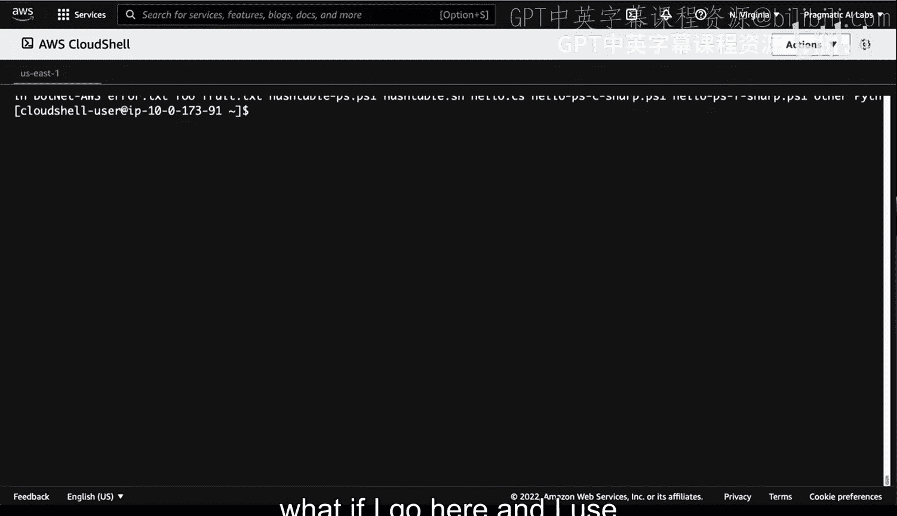

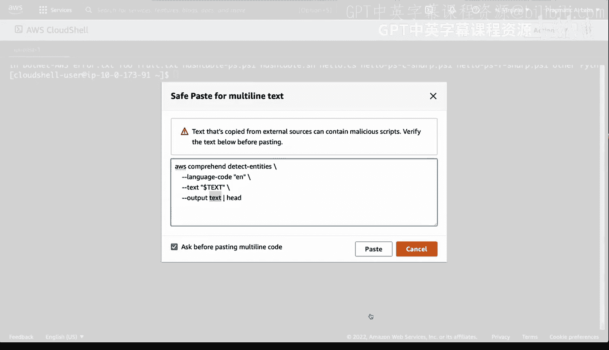

And notice what we find here is that we have Wikipedia， Albert Einstein， German。

 right if I just look at the first few characters here and we could even do more if I want to say let's say 25 entries right you can see that there's even more entries that these are the key you items or entities that are pulled out from this text and this again is just using a slightly different AWS comprehend subcommand and now this is pretty good。

 but what if I could actually just get this column the one that has the entities and then find out how many times that entities occurs。

 and I think this would be a really powerful way to get more information about what's happening in this Wikipedia article potentially to do more research or to build out something in another language so in order to do that。

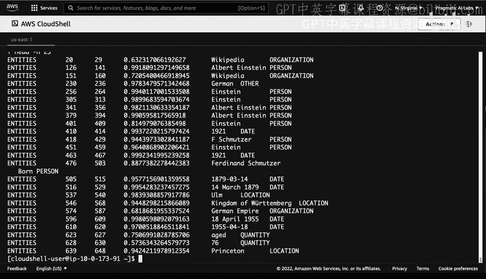

I'm going to go over to a command of God called AI Pipeline。

 and you can see here that this is a little more complex and essentially。

 let me just first paste it in。And it's gonna to ask the same thing you know and notice once I paste this and I'll explain what it does so we can go ahead and paste this first thing is we do the entity extraction。

 I then pass in the English code I pass in the text we've already done this I tell it to output text and now here's where we get into the bash pipeline what I say is I say grab that column where the entity lives so that's the first thing we do now that I've got the entity I want to convert everything into a cleaned up version so we remove spaces。

 only keep you know basically the alphabetical characters lowercase things and then also get rid of new lines once I've got that that should be pretty close I then sort it。

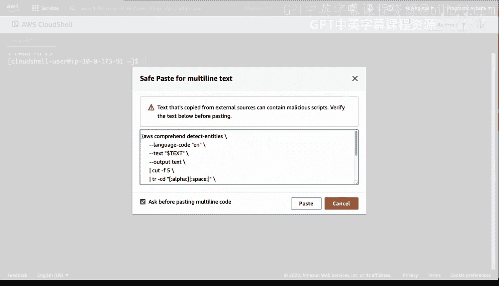

And the sortian allows me to then do a unique count， so count how many times a entity appears。

 I then do a sort by the first column。 That's what this does and I reverse sort it。

 And then I see just the first few items right because if there's a lot of matches。

 I only want to watch a few of the top entities。 so let's go ahead and run this。

And what's nice is that it's getting something that I would expect。

 which is it shows me the most important entities counts them out and so you would expect an article about Einstein would have the word Einstein quite a bit and of course it does University is also covered quite a bit。

 German is covered quite a bit。 Empire Albert Kingdom Zurich。

 So these are all things that are potentially interesting to me if I was going to do further data science on it。

 So you are not limited to using Python or using C sharpharp or using R some other language to do some very complex data science。

 if you use the Cloudhell and use bash at the same time。

 you can very very quickly at least prototype a solution using an AI API。

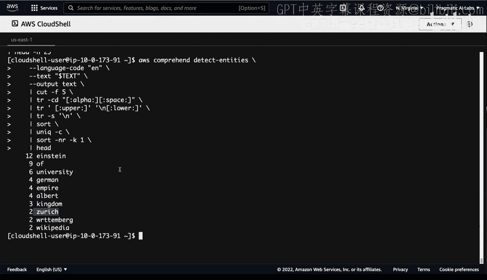