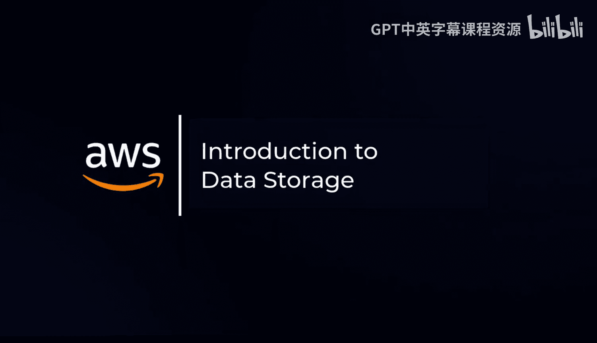
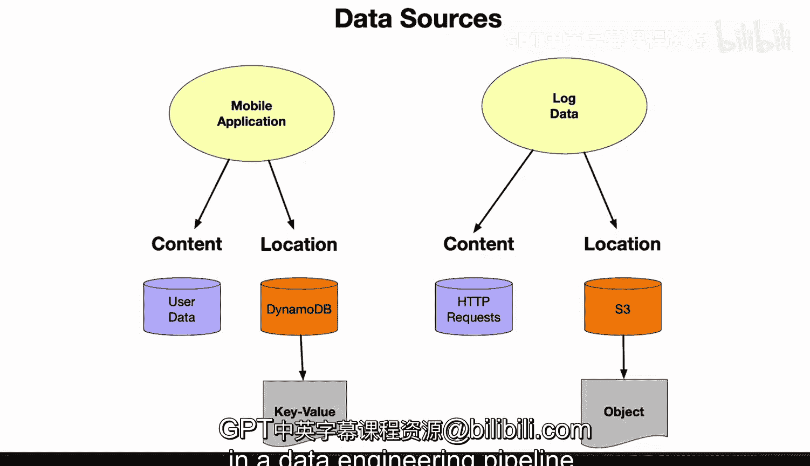

# 杜克大学｜机器学习运维｜DevOps⧸DataOps、Azure、MLFlow和抱脸｜MLOps ｜ Machine Learning Operations p84 07_01_03_数据存储简介.zh_en -BV1yE421c7uA_p84-

Here we have data sources when an organization is implementing a data engineering strategy。

 an important first step is to catalog all of the different data sources in the company。

 You may start with a mobile application and look at the user data and analyze where it's stored。

 for example， it could be commonly stored at a key value stored like dynamo Db and that user record with the information about the particular profile。

It would be one of the sources that could be catalogued so that later the data engineers could do something with it。

Likewise， if you wanted to catalog your log data， you could identify what it is。

 potentially in a spreadsheet that has all the other data sources in it。

 and you could catalog the content type， for example， HttP request so how many 200s。

 how many 400s what was the URL that was referring that request。

 those kinds of log messages and then you could identify the location as well so in terms of S3。

 it's a great location for storing raw log data and that would be objectbased storage and once you've got that cataloged inside of your data sources master list。

 you can then develop a strategy around how to actually process that data in a Danage engineering pipeline。

