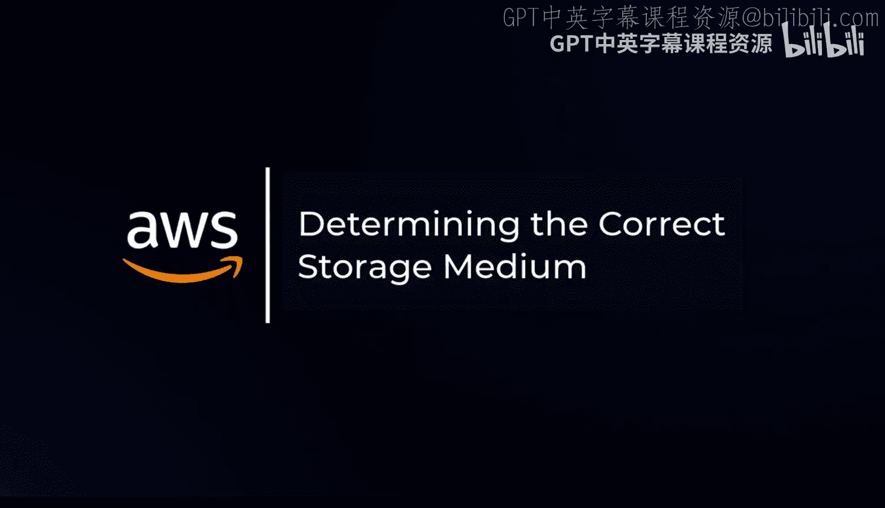
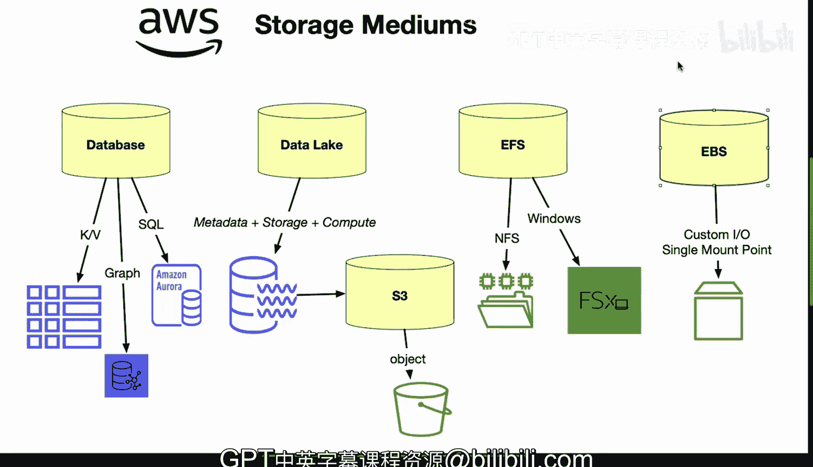

# 杜克大学｜机器学习运维｜DevOps⧸DataOps、Azure、MLFlow和抱脸｜MLOps ｜ Machine Learning Operations p85 08_01_04_确定正确的存储介质.zh_en -BV1yE421c7uA_p85-

AWS has a variety of different storage mediums， including lots of different databases。

 So if you look at the kinds of databases available， we have key value databases like Dynamo DB。

 which are ideal for user records or other game stats。

There are also graph databases like Neptune which allow you to do relationship building。

 and many times this could be an important part of a new data science workflow identifying who is the key figure in a particular social graph。

 and there are different descriptive statistics like centrality。In terms of SQL， there's also Amazon。

 Aurora， also RDS。These SQL databases are great for doing traditional transactional based queries。

Another type of storage medium is the data lake Now the data lake is built on top of S3。

 which is available from a compute and storage perspective at infinite scale or near infinite scale。

But the data lake adds metadata on top of it so that you can index the things that are inside of S3。

 A great example of this would be a tool like EW's glue， which can index a particular part of S3。

 and then you can later query it in Athena。Now S3 itself is obviously a great storage mechanism for object storage。

 so anything that requires you to have lifecycl management or store large files or files that it's okay to have an all or nothing approach where you pull it in or you put it back in all at once without having incrementally read it or write it is a great choice for S3。

Likewise， there's the EFS ecosystem， which has a couple of different flavors。

 one is the NFS flavored of EFS and what's great about EFS is it can grow disko incrementally so according to the load you put on top of it or how much storage you put inside of EFS it can grow and all of the cluster or the mount pointss can all be uniform across an ecosystem。

 this has been a utility that's been around for quite some time decades people have been doing network mount pointss but with a cloud now it's fully managed which makes it a huge advantage。

 there's also the FSX and Windows part of EFS and this can be very handy as well for many workflows that require centralized mount pointss。

 but allowing AWS to actually manage the storage for you。Finally， there's EBS。And E BS。

 one of the advantages of it is it has the ability to do custom disko。

 This means that if you needed to have potentially a very fast file system for you know some kind of transaction or machine learning training。

 you could customize it for a particular job provision it and then get rid of it， one of the。

Things to be aware of is that E BS is only available， though， by a single mount point。

 So really in summary， AWS has almost， you know every type of storage medium that you can think of。

 And theres subcategories under under each one of those storage mediums。

 and it's up to you as the data scientist or the machine learning engineer or the data engineer。

To correctly pick the right combinations of storage mediums for the job at hand。

