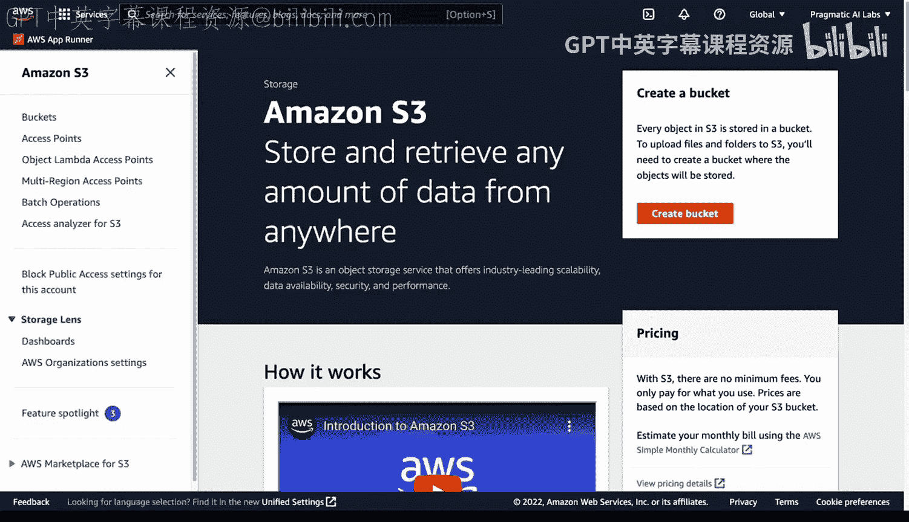
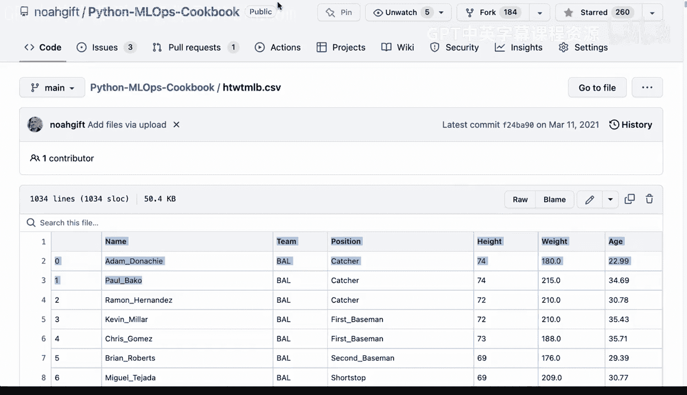
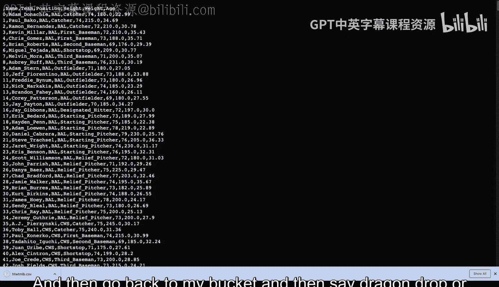
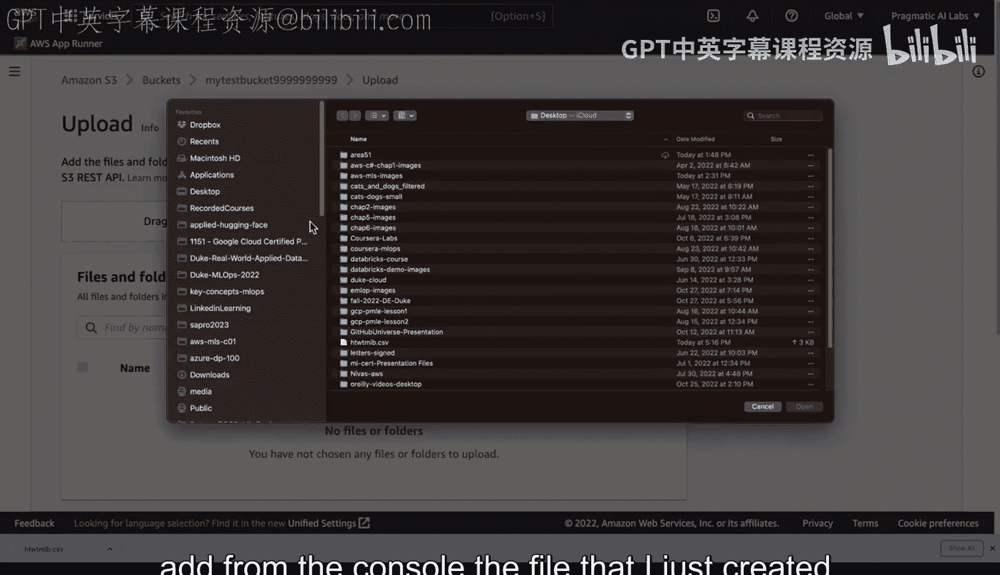
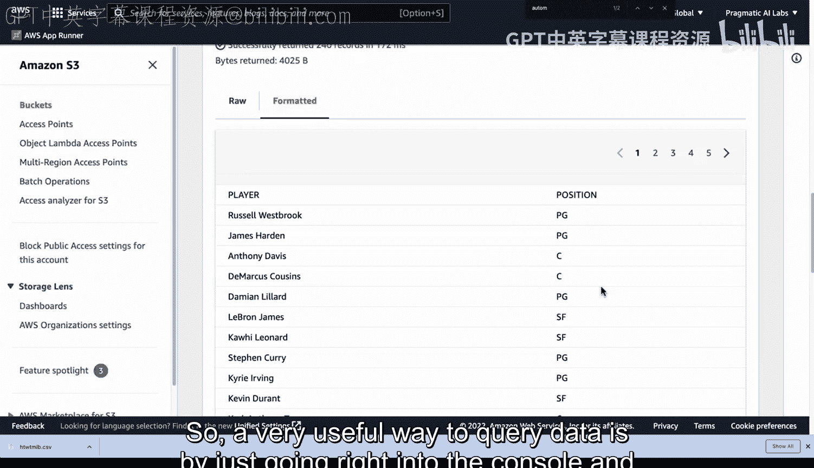
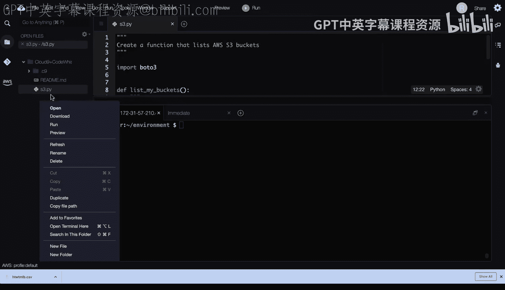
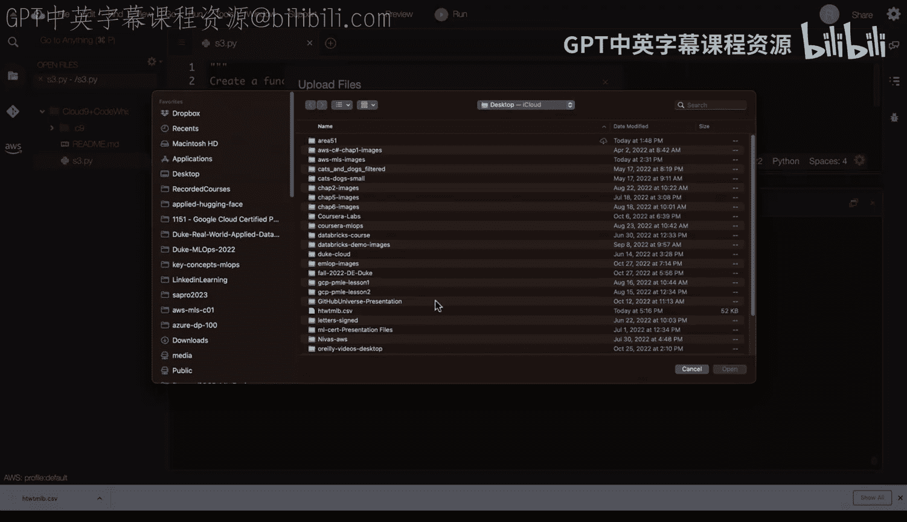
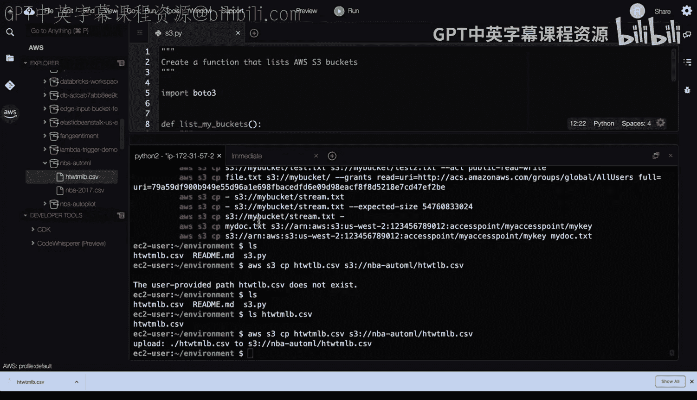
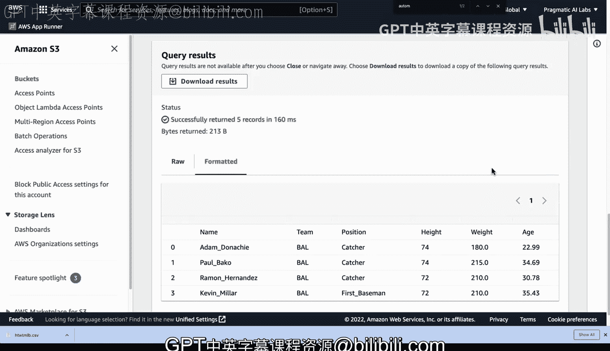

# 杜克大学｜机器学习运维｜DevOps⧸DataOps、Azure、MLFlow和抱脸｜MLOps ｜ Machine Learning Operations p86 09_01_05_使用Amazon S3.zh_en -BV1yE421c7uA_p86-

Amazon S3 is a core service that everyday engineer or machine learning engineer needs to know about。

 and fortunately， there's lots of different ways you can access it and get powerful interactions with it either from the console or from developer tool。

 So first up， I think a good place to start is to go over to buckets and notice how you can go in and get account of your buckets and just scroll through and look at different buckets and decide what you want to do with them。

One of the easier ways to get started is to create a bucket。

 and you can create this very simply by selecting create bucket in the console， calling this。

My test bucket。You know， one，2，3，4，5。Whatever it is I want to do。

 And then I also can go ahead and create that bucket。 Now， one thing to be aware of is。

That if you do create a bucket that's got a very common name。

 that you'll have a conflict because the buckets need to be globally unique。 So easily。

 what we can do to fix that is we can， we can actually just trout a long string。

And play around with a temporary bucket。 And once you've got a temporary bucket that you've got。

It's easy to then go in， as well。And put some file inside of there so you can upload directly from the console。

 In fact， I could go to a project where I have some baseball data。

 And if I wanted to go here and download this。

I could take this exact file here， put it on my desktop。

And then go back to my bucket and then say drag and drop or add from the console the file that I just created。

And what's useful about this workflow is that it immediately gives you access to advanced capabilities in the S3 ecosystem。

 And let's take a look at some of those advanced capabilities here if I go back to S3 and let's go ahead and take a look at a different bucket。

And this one， I have an NBAA data set here。And notice here that if I go ahead and select it。

 there's a lot of different options， including properties， permissions， versions。

 but one of the more interesting things to do is go to object actions。

And what we can do is query with S3 select。 So imagine you had a terabyte file with millions and millions of rows。

 it would be very difficult to understand what's happening， but with S3。

 you can query using the SQL language noticeice here it gives you some default CSV。

 you know CSV delimiter and also the output settings。

And it even gives you a default query so in this case。

 if I want to see the first five rows of the CSV file。

 I can say a run query and what's really nice about it is we can look at raw or formatted and I can actually get exactly the first part of this file。

 so this is invaluable when I want to query things as a data scientist。Now。

 another thing you can do is if you go to add SQL from templates。

 I also could take an example from one of these selections here and tweak it a little bit and and play around。

 So what I'm going to do here is notice that there was。Player names and also player positions。

 why I could just tweak this a little bit and say， I want to look at the players and I want to look at the positions here and let's go ahead and run this SQL query。

And there we go。 If we look at formatted， we've got all of the NBA players and the position that they've got。

 So a very useful way to query data is by just going right into the console and playing around with it。

 Now， also， you can use Ews Cloud 9。 And one of the really cool things that you can do with cloud 9 is you can also use it as an interface to upload and download data。

 So， for example， if I wanted to go to。😊。

This file menu here， and I wanted to right click and say here upload。 In fact， I can just say file。

 upload local files。

Select it and take that baseball data。

I've got that baseball data right here。 if I wanted to。

 I could actually copy that directly into my S3 bucket from the terminal。

One of the ways that you can do that。 That's a great way to get started with terminal is to type in AWS S3 C help。

 And this will give you the help menu of all the different things that can happen in this tool。 Now。

 I found one of the more useful ways to find the help menu is to actually search it for a particular type of action。

 So in this case， if I say AWS S3 Cp help pipe in into less and then Grep for a phrase like copying what's nice about this is that I can actually see all of the different documentation examples and see some patterns that I can follow。

 So here we go， this looks like a pretty good one to play around with。We see that in fact。

 to copy a file' it's pretty straightforward is you can copy from the local directory to the bucket so and let's go ahead and just paste this in so that we make sure we got it right。

And let's do this。Put this in there。And also put in this path。Great， now that I've got that。

We've been able to upload it。 And if I go back to AWS， and I go to the S3 tool here。

And I go to that directory that I copied。 We should see that file exists。 great。 Now。

 the final thing to do that would be kind of fun is to go back to this。

Particular bucket， refresh it， we see that files there， open it up。

 go ahead and then query it with S3。And see that we can also do those same really cool queries here where we can。

 we can actually drill， drill down。 So really， there's a great ecosystem between。😊。

Things like cloud 9 and the console。 And they work very well together。 And as a data scientist。

 the engineer， machine learning engineer， this is definitely a workflow I would recommend。

