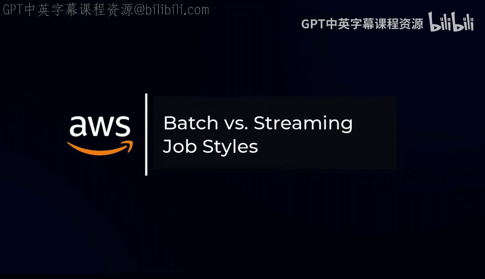
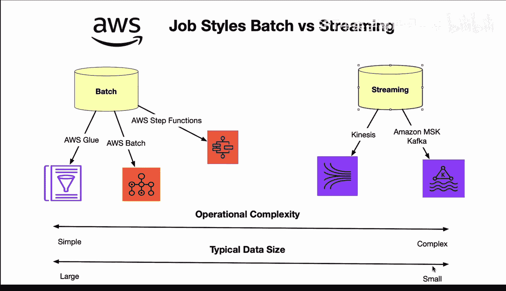

# 杜克大学｜机器学习运维｜DevOps⧸DataOps、Azure、MLFlow和抱脸｜MLOps ｜ Machine Learning Operations p87 10_01_02_批处理与流式作业风格对比.zh_en -BV1yE421c7uA_p87-

AWS has a couple different ways to think about jobs。 One is batch and the other is streaming。

 We take a look at batch three services that really take a lot of the batch terminology and put it together are glue AWS batch and AWB step function In the case of glue。

 What it does is it creates metadata that allows you to perform operations on something potentially that's in S3 or a database and also do transformations and this is a good example of how you could batch up something that's really large amount of data。

 AWS batch is really a general purpose batchbased framework where you can process anything at scale and it's really good at doing many things in containers as well as training models with GPUus。

ADBS step functions allow you to really parameterize and put together different steps。

And a good example would be orchestrating lambda functions with inputs that go from one to the other。

In terms of streaming on the AW platform， two of the popular types of technologies are kinesis and then also Kafka via Amazon MSK and the idea here with kinesis is that you can send it these small payloads and it can process them as it gets those payloads in terms of operational complexity。

 one way to think about batch versus streaming is that batch is a lot simpler， you take some things。

 you run an operation across it and then it gives you back a result。

 streaming is a little more complex in that you have to process things as they come in and so there's a lot more chance for things to go wrong。

Also， another way to think about the data size when you're comparing batch and streaming is that。

In terms of batch， it works really well with large data。

 it actually works well for small data as well， but a lot of times you'll batch something up to handle it at scale with a service like。

 for example，80 Bo batch。In terms of streaming。A lot of times you're dealing with smaller data。

 so you're processing it as it comes in， and this really is a good way to differentiate between batch and streaming。

