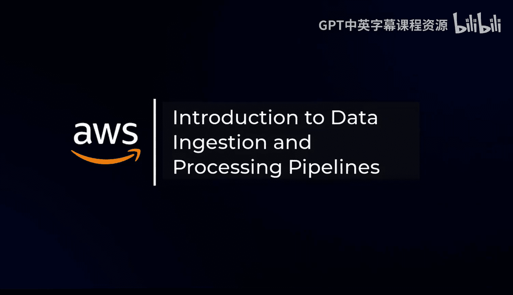
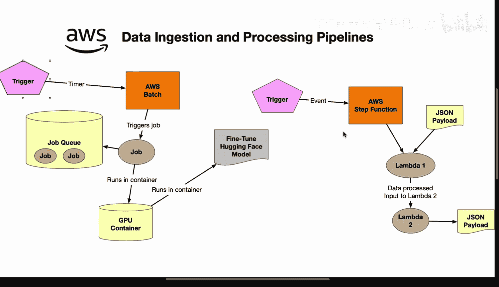

# 杜克大学｜机器学习运维｜MLOps：11_01_03：数据摄取与处理流水线简介 🚀

在本节课中，我们将要学习数据摄取与处理流水线的基本概念，并了解AWS如何通过其托管服务来构建这些流水线，以解决复杂的机器学习运维问题。

## 概述

AWS的数据摄取与处理流水线通过使用托管的服务来解决复杂问题。一个典型的例子是AWS Batch服务。它将解决周期性作业的许多复杂部分整合在一起。

## AWS Batch：托管批处理服务

上一节我们概述了AWS流水线的概念，本节中我们来看看AWS Batch的具体工作方式。它通过将多个组件组合在一起来处理周期性任务。

以下是AWS Batch工作流程的关键步骤：
*   **触发器**：流程的启动点。它可以基于定时器、代码调用或其他事件。
*   **作业创建**：触发器被激活后，会创建一个新的作业。
*   **作业队列**：新创建的作业被放入作业队列中。队列中可以容纳成千上万个作业。
*   **作业处理**：作业根据你为AWS Batch设置的并发处理数量进行处理。例如，可以启动200个不同的容器（比如GPU容器）来并行处理作业。

AWS Batch用途广泛，尤其适用于机器学习任务，例如基于组织内的事件计划对Hugging Face模型进行GPU微调。

## AWS Step Functions：无服务器编排服务

了解了批处理服务后，我们再来看看另一种流水线编排方式：AWS Step Functions。它同样是一项无服务器技术，由AWS托管。

当有事件触发时（例如一个API调用或某处数据到达的触发器），Step Functions可以将多个Lambda函数串联起来。每个Lambda函数接收一个数据载荷，处理其中定义的任务，最终在流水线末端输出结果。

Step Functions的显著优势在于其强大的内置编排能力。以下是它提供的主要管理功能：
*   **日志查看**：你可以清晰地查看每个步骤的执行日志。
*   **性能监控**：能够了解每个步骤的耗时情况。

这意味着你无需自己构建复杂的生态系统来实现任务编排，Step Functions已经为你构建好了。你只需要将业务逻辑组合进去即可。

## 总结

本节课中我们一起学习了数据摄取与处理流水线的核心概念。我们了解到，AWS通过像**AWS Batch**（用于大规模批处理作业）和**AWS Step Functions**（用于无服务器工作流编排）这样的托管服务，简化了复杂流水线的构建与管理。这些服务允许开发者专注于业务逻辑，而无需操心底层的基础设施和编排复杂性，从而高效地支持机器学习任务，如模型微调。