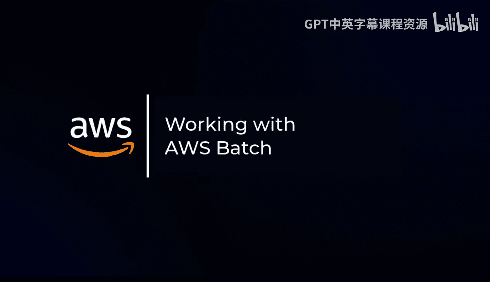
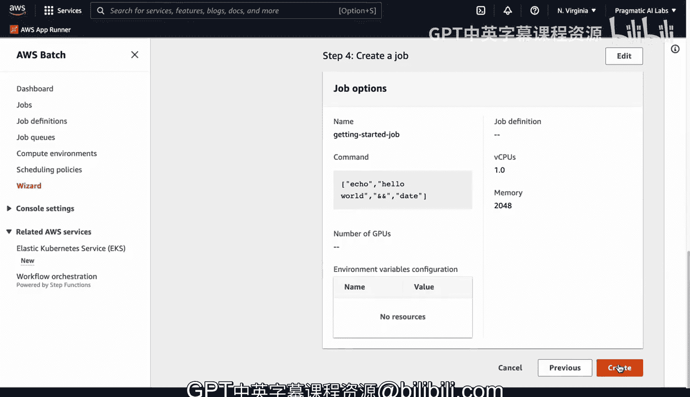

# 机器学习运维：12.01.04：使用AWS Batch 🚀



在本节课中，我们将学习如何使用AWS Batch服务在云端运行计算任务。AWS Batch是一个用于解决基本云端运行问题的优秀技术，它简化了批处理作业的提交、调度和执行过程。

## 概述 📋

AWS Batch的核心流程非常直观。它涉及创建一个计算环境、一个作业队列、一个作业定义，最后提交作业。整个过程无需管理底层服务器，特别适合运行容器化的工作负载。

## 创建计算环境 ⚙️

上一节我们介绍了AWS Batch的基本概念，本节中我们来看看如何创建计算环境。这是运行作业的基础设施层。

首先，在AWS Batch控制台启动向导，选择“开始使用”。第一步是创建计算环境。你需要决定作业的运行平台。

以下是主要的计算环境类型选项：

*   **Fargate**：无需管理服务器，AWS完全托管。强烈推荐此选项，因为它能自动处理所有后端基础设施。
*   **Fargate Spot**：基于Fargate的竞价实例，可获得高达70%的折扣。如果需要运行大量作业，这是一个非常经济的选择。
*   **EC2（按需或竞价）**：基于虚拟机的传统方式。在此场景下，你可以精细调整所需的虚拟CPU数量。

此外，你还需要配置网络设置，例如选择作业将在其中运行的VPC（虚拟私有云）。

## 配置作业队列与定义 📥

创建好计算环境后，下一步是设置作业队列和作业定义。作业队列用于存放等待处理的工作。

接下来是通用配置部分，你可以在此设置参数，例如作业的超时时间。你还可以指定一个不同的执行角色。如果作业需要与其他AWS服务（如S3、DynamoDB）或外部API通信，可以通过分配具有相应权限的IAM角色来实现。

## 定义作业内容 🐳

最后，也是最关键的一步，是配置作业本身。这定义了任务的具体内容。

核心配置是容器镜像。你可以使用公共镜像，但通常更好的做法是构建自己的Docker镜像，其中包含运行所需的一切依赖，例如特定的机器学习库（如Hugging Face库）。

然后，指定容器启动时要执行的命令。例如，我们可以从一个简单的“Hello World”开始，并加上`date`命令以记录运行时间。

```bash
echo "Hello, AWS Batch!" && date
```

你还可以配置为该容器保留的虚拟CPU数量和内存大小。此外，AWS Batch支持一些高级容器配置，例如挂载存储卷、配置日志记录选项等。

## 提交与运行作业 🚀

完成所有配置后，向导会汇总所有信息。确认无误，即可提交作业。AWS Batch会自动处理作业的调度，并在你创建的计算环境中执行它。

## 总结 🎯



本节课中，我们一起学习了使用AWS Batch运行云端批处理作业的完整流程。我们了解了如何创建托管计算环境（推荐使用Fargate）、设置作业队列、定义包含自定义镜像和启动命令的作业，并最终提交作业。AWS Batch提供了一种简单、直接且强大的方式，将计算任务扩展到云端，而无需操心服务器管理。