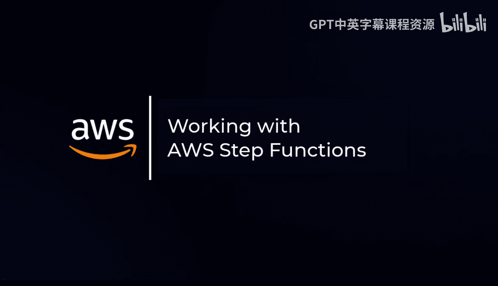
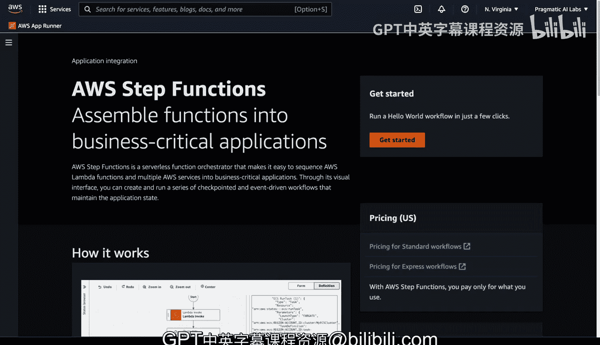
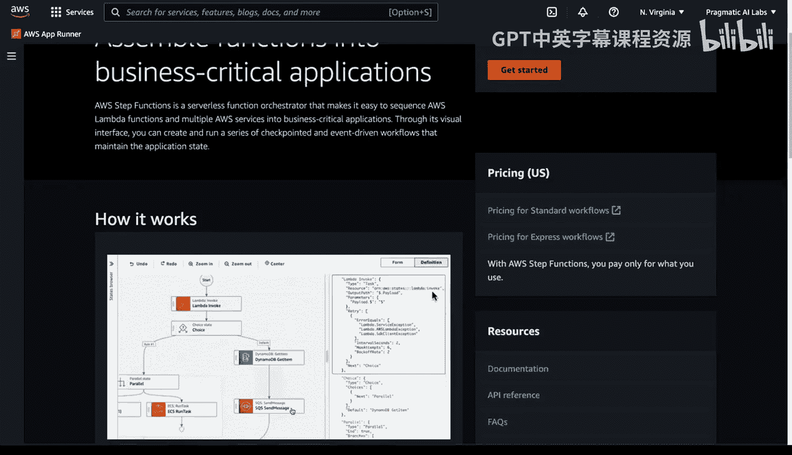
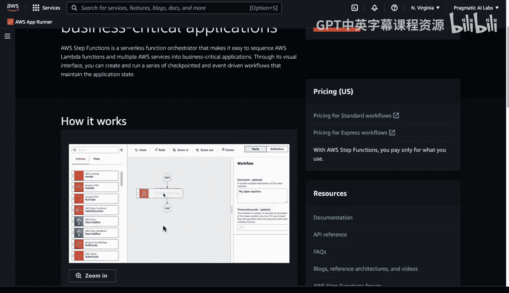
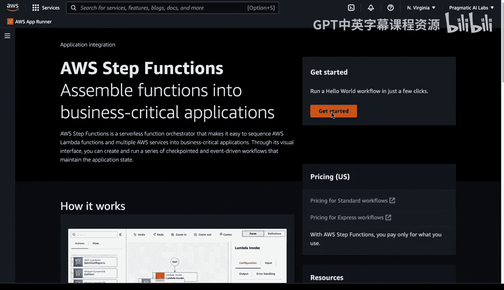
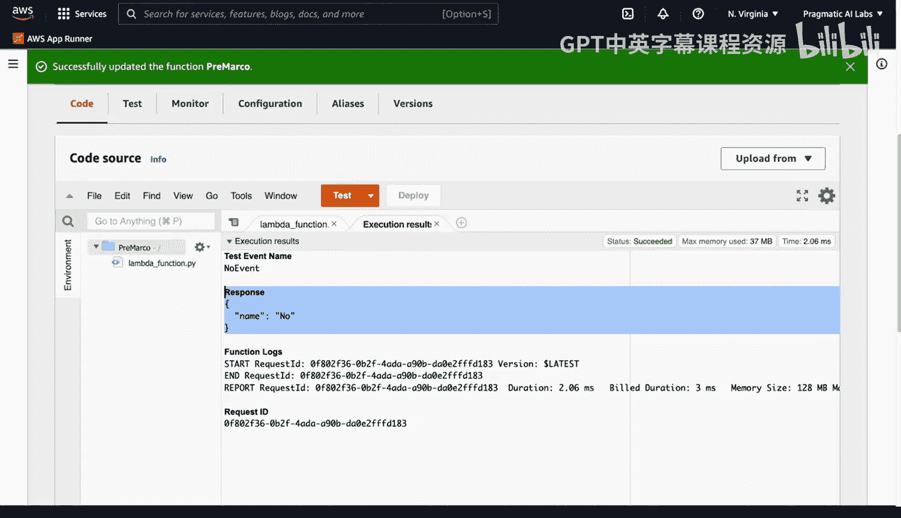
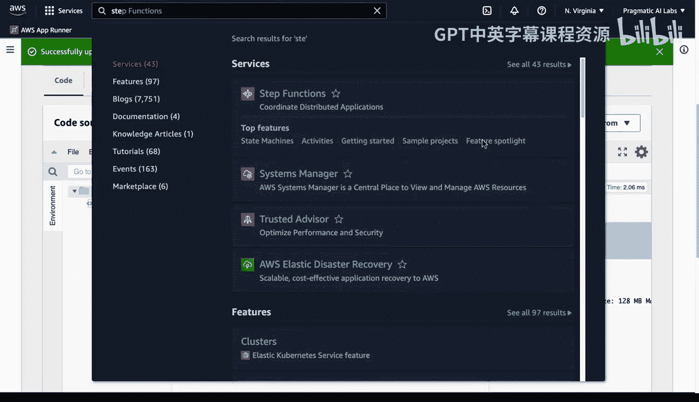
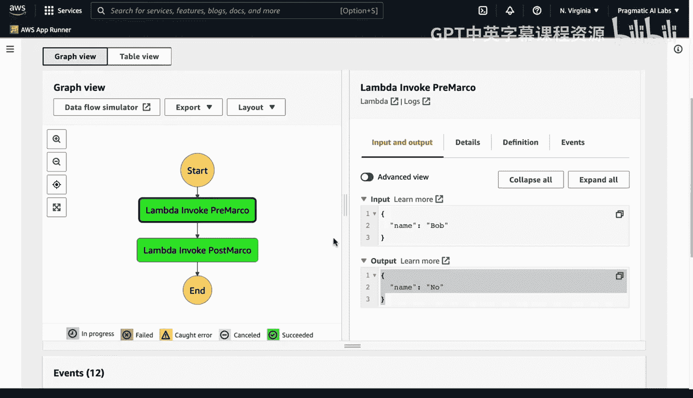

# 杜克大学｜机器学习运维｜DevOps⧸DataOps、Azure、MLFlow和抱脸｜MLOps ｜ Machine Learning Operations p90 13_01_05_使用AWS Step Functions.zh_en -BV1yE421c7uA_p90-

AWS step functions are ideal for orchestrating jobs， really many different parts of AWS。

 and you can see here how it works。 you can visually design a series of choices and then put that into a pipeline and then run it and get great instrumentation。

A good way to get started is to click on the Get started guide。

 and it gives you a hello world example。 in this case， you can see it actually is just Jason。

 and inside of here， you can see there's these different states。

And it starts with a pass。 And then you say hello world example。 Yes， you wait three seconds。

 you do hello world， and then you do your final state and go to the end。

 So if we go ahead and we run this pretty straightforward。 we can actually go through here。

 let's say， create state machine。 and then we run it。 and then it basically shows us。In each detail。

 exactly what is going to occur。 And there we go。 Its run through。 and in fact。

The results are actually printed right here。 So this is what's really nice about this is that gives you this great instrumentation。

 So it's nice to， to see this in a demo。 But what if we want to do it ourselves and build something from scratch。

 What we could do is orchestrate our own Lada functions together to build out a pipeline。

 So what I'm going to do is I'm going to start over with Ew Lada。

 I'm going to create a function here。 And we're going to call this one premarco。😊。

And I'll go through here and make it Python。And inside of here。

 what this function is going to do is it's going to essentially accept。

A payload that looks for the word Marco and if the word Marco appears it'll return back polo。

 so pretty straightforward function and if I go through here and I go into the editor。

 we can just swap this inside so you can see we have the function here， there's an event。

 I say if name Marco return polo otherwise return no。

Now we can actually configure a test event and in this particular test event。

 I'll just go ahead and do that。 I'll say， you know name。And will say， Marco。

 and this should return back。Polo。Let's go ahead and save it， call this Marco。And save， all right。

 great， let's go ahead and deploy this function。And now test it。 And in fact。

 it did return back Polo。 So that's great。 Now let's build a second function with Lambda。

 and this one will be post Marco。So， post Marco。And we'll again go to the runtime。 Python。

 We'll go ahead and say create。 And what this one will do is if the word polo appears。

Then we'll print out a message， otherwise we'll print out a keep trying message right so this will be essentially going through and simulating what a complex data pipeline would look like if I go ahead and deploy this real quick again I build a test event here。

 we'll call this you know postmarco。And I say if the word， if， if the word。The name Polo appears。

Then go ahead and。And print out a congratulations， so let's go ahead and format this。

And we'll return this back。In this case， actually what we actually want to do。嗯。

Is in this particular scenario。We can say return， great job。 That looks good。 Let's test it。 perfect。

 Now， I， I do want to make one small change to my other function here， which is。Premarco。

 let's go ahead and look for that， here we go。Premarco。

 and let's just tweak this so that it' match the signature of the other one。

 because in this particular scenario， we're going to have to call this。Name。

And we'll see polo like that。And let's go ahead and test this real quick， we'll deploy it。And tested。

 there we go。 So it's going to turn back names that way I can use it in my step function pipeline。

And then I also could go back here and tweak this as well and just add a name。No here。 in that way。

 we'll be parsing things according to the structure that is expecting。

 and we could even test this if you wanted to so we could go back to this and we could say configure test events。

And we could say create a new event。And we can call this no event。And we could just put in。

For example， Bob。Formatted。And if we， if we。Deployed。And then， test it。There we go。嗯。Responses， no。

 perfect。 So we got this thing working。 And now I can go over to my step functions section here and let's go to step functions and let's pipe these two states together。

 So we'll create a new state machine。

And we're going to visually define it。And then from here it's pretty straightforward。

 we would just invoke a lambda here。And then we would invoke another lambda right afterwards。

 And so this first Lada we'll just call this state。You know， lambmbda invoke。

And we'll say a description。Of what this is。And this will be process Marcopolo messages。There we go。

And then if we click on this Lambda。We can say， lambmbda invoke premarco。

And now we need to tell it which particular lambda to actually run。

 And so we'll go ahead and we'll need to grab it。 so we'll call this premarco。There we go。

And then this will actually pass the payload back down to the second one。

 and so we'll call this one Lambda invoke post Marco。And what we can do as well is we。

 we can actually say post。Marco。And that should be all we need。And if you notice here。

 now we can actually execute this function so let's go ahead and try it out， we'll call this one。

Pre post Marco。And let's go ahead and create it。And let's start an execution。

 So one of the things that we'll need to do is make sure that we put in the right payload。

 So we'll call the first one we'll say name。And this will be Marco。

 and this will start this chain reaction。 Let's go ahead and do it。And we can watch it。And look。

 we can even see what the input is and what the output point is， right， So that's great。

 And if we go to the the second lambda functions， we see less name polo。Out'llput great job， right。

 And now we can test the other formula as well， which is which is kind of nice。

 Let's go ahead and say new execution。 And then this one will say Bob。As the name。

 and then this should have a different outcome。Inside of this， so it's going to invoke it first。

There we go and it said nameam Bob， it said no， now we go here to the second one and if we look at the the second outcome。

Here， which is the execution state， it says keep trying right so a great way to kick the tires on step functions is to do this Marco Polo style and once you get your head wrapped around it。

 you can build more complex data ingestion and data processing workflows。

