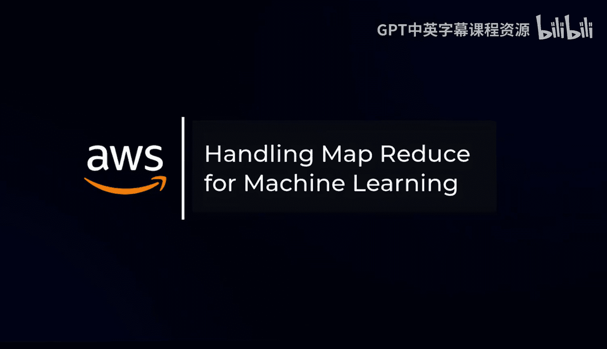
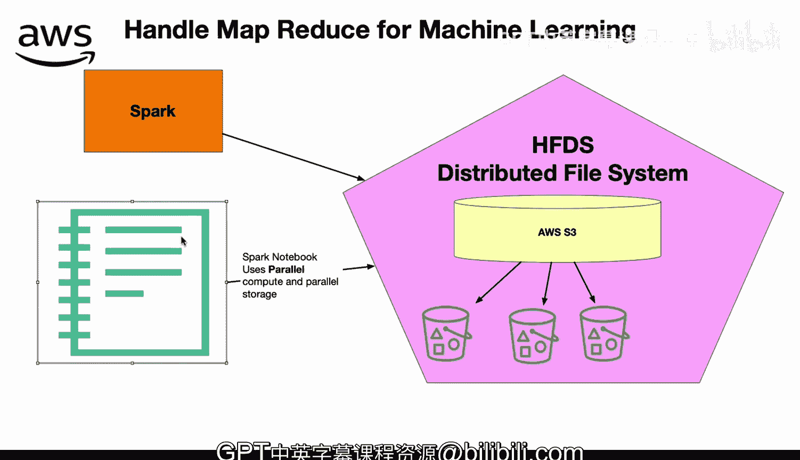

# 杜克大学｜机器学习运维｜DevOps⧸DataOps、Azure、MLFlow和抱脸｜MLOps ｜ Machine Learning Operations p92 15_01_07_处理机器学习的MapReduce.zh_en -BV1yE421c7uA_p92-

AWS has a great mechanism for handling map reduce for machine learning with the ability to run Spar。

 Spark can run in a third party platform like Databricks， or it can run inside of the EMR ecosystem。

One of the things that Spk does and really the core capability of Spk is it interacts with the Hadoop distributed file system and the Hadoop distributed file system sits on top of S3 and treats。

The file system as a distributed and parallel compute and storage mechanism。

 So what this means is that if you have a notebook。

And the notebook needs to have more and more diso behind the scenes。

 the object storage system of S3 will be able to really deal with all of the different operations in and out by spinning up virtual machines and it can distribute the compute and storage across each of those nodes inside of the cluster and what's great about this is it allows you to fairly seamlessly write a function for example。

 that applies some operation potentially does a maybe like a correlation or some other calculation and then the reduce would be that it would actually combine all that together and let's say create visualization and that's really the beauty of the spark ecosystem is behind the scenes here。

 distribution of jobs across this file system all through a notebook and you as the programmer go through and build your function and the function as a。

To actually seamlessly work without you needing to do any kind of explicit parallel coding。

