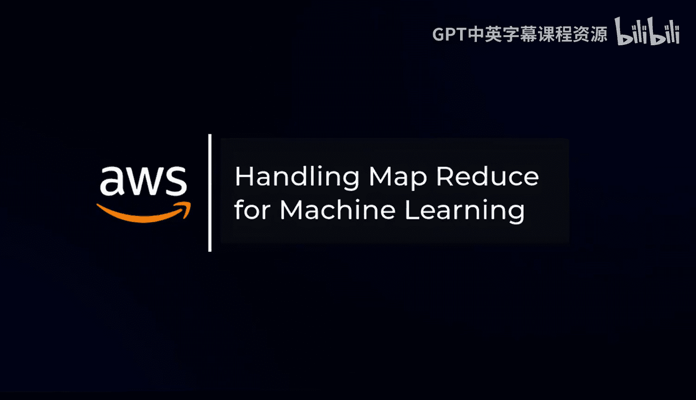
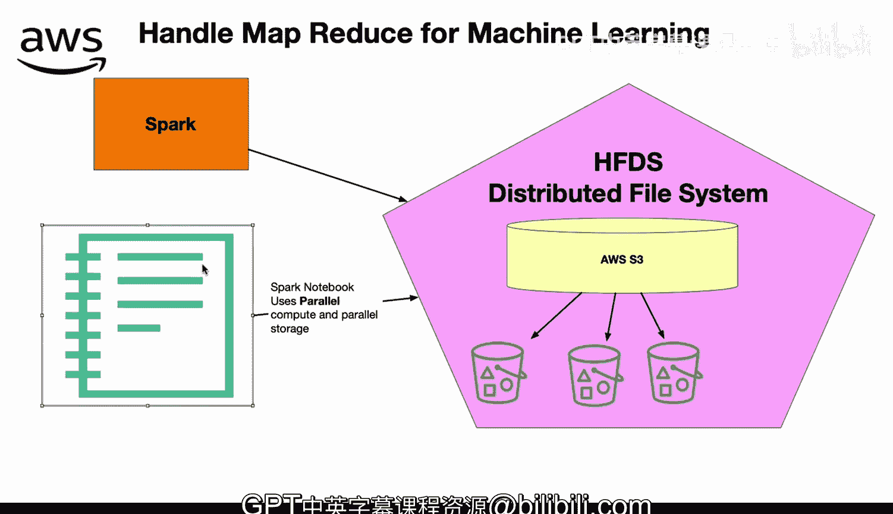

# 机器学习运维：第15章：处理机器学习的MapReduce

## 📚 概述
在本节课中，我们将学习如何利用AWS生态系统处理机器学习中的MapReduce任务，特别是通过Spark与Hadoop分布式文件系统（HDFS）的交互来实现。我们将了解其核心架构、工作原理以及如何通过编写简单的函数实现分布式计算，而无需显式进行复杂的并行编码。

---

## 🏗️ 核心架构与组件

上一节我们概述了MapReduce在机器学习中的应用，本节中我们来看看支撑这一过程的核心架构与组件。

AWS为机器学习的MapReduce处理提供了一个强大的机制，它能够运行Spark。Spark可以在第三方平台（如Databricks）上运行，也可以在EMR（Elastic MapReduce）生态系统内部运行。

Spark的核心能力之一，也是其真正的核心功能，在于它与Hadoop分布式文件系统（HDFS）的交互。HDFS建立在S3之上，并将文件系统视为一个分布式、并行的计算和存储机制。

这意味着，如果你有一个笔记本（Notebook），并且该笔记本在后台需要处理越来越多的数据，S3的对象存储系统将能够通过启动虚拟机来有效处理所有进出操作。它可以将计算和存储任务分布到集群内的各个节点上。

---

## ⚙️ 工作原理与优势

了解了核心组件后，我们来看看这套系统是如何工作的，以及它带来了哪些优势。

这套机制的优点在于，它允许你相当无缝地编写一个函数。例如，该函数可以应用某些操作（可能进行相关性计算或其他计算），然后“归约”（Reduce）阶段会将所有结果合并在一起，比如说用于创建可视化图表。

这正是Spark生态系统的美妙之处：在后台，通过一个笔记本界面，任务被分布在这个文件系统上执行。作为程序员，你只需构建你的函数，该函数就能无缝工作，而无需你进行任何显式的并行编码。

以下是其工作流程的关键点：

*   **函数编写**：开发者编写一个用于数据处理的函数（例如计算相关性）。
*   **自动分布**：Spark自动将该函数要处理的数据和计算任务分布到HDFS集群的各个节点上。
*   **并行计算**：每个节点在本地数据上并行执行相同的函数操作（Map阶段）。
*   **结果聚合**：各个节点的计算结果被收集并聚合起来，形成最终结果（Reduce阶段，如生成可视化）。
*   **抽象并行性**：整个复杂的分布式并行计算过程对开发者是透明的，无需手动管理。

---

## 🎯 总结
本节课中，我们一起学习了机器学习中MapReduce任务的处理方式。我们了解到AWS通过Spark和基于S3的Hadoop分布式文件系统（HDFS）提供了一个强大的解决方案。该方案的核心价值在于，它允许数据科学家和工程师通过编写普通的处理函数，就能自动利用后台的分布式集群进行大规模数据计算，极大地简化了并行编程的复杂性，提高了开发效率。