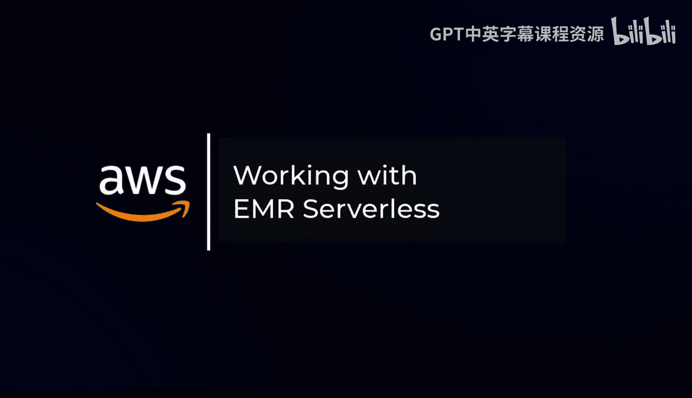
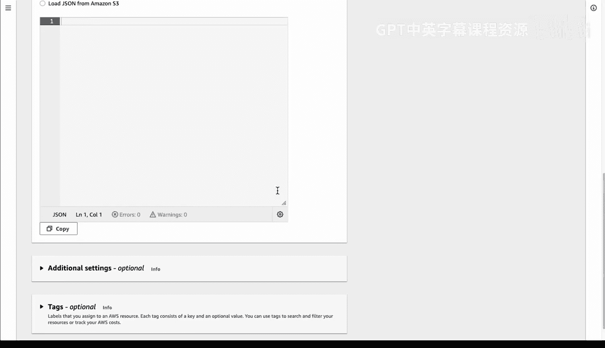

# 杜克大学｜机器学习运维｜DevOps⧸DataOps、Azure、MLFlow和抱脸｜MLOps ｜ Machine Learning Operations p93 16_01_08_使用EMR Serverless.zh_en -BV1yE421c7uA_p93-

EMR is one of the places where you could do map Red on the AWS platform。

 and you can see here from this EMR Studio interface。

 you could launch serverless applications and submit jobs。

 and you can use these fully managed Jupyter notebooks。

Attach those notebooks to clusters and then diagnose problems with your job。

 So let's go ahead and create a application that allows us to launch a notebook here。

 And I'm going to say I'm going to create a Sp application here。 And if I want to。

 I can choose the default settings。 let's go ahead and do that。All right。

 now that I've got this application here。What I can do is if I needed to。

 I could submit a job and what this job could do is is run a particular configuration that。

Except some arguments， and additionally I could configure this job as well with additional J payloads。

One of。