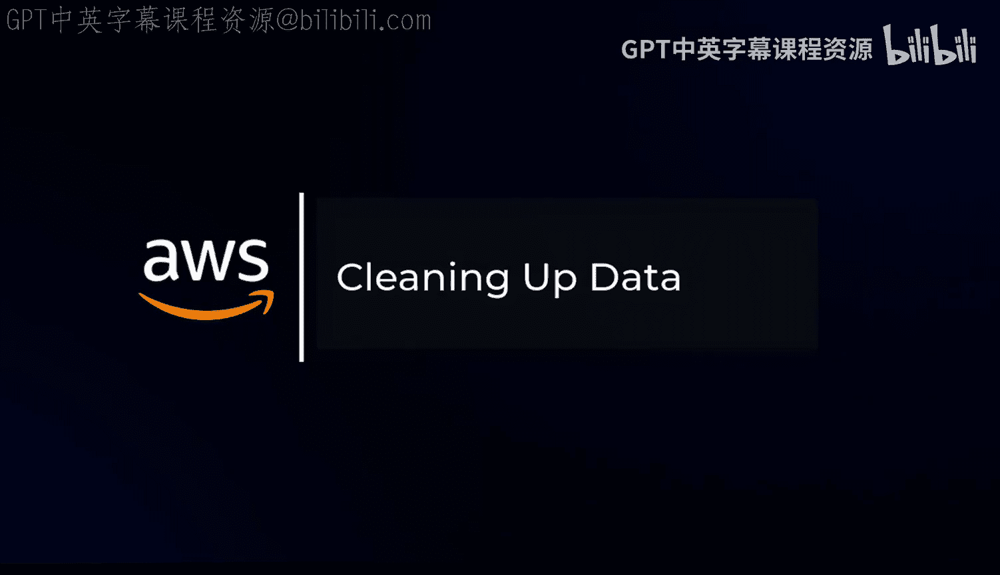
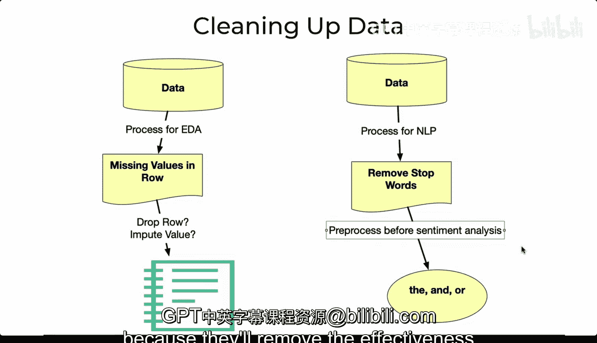

# 杜克大学｜机器学习运维｜DevOps⧸DataOps、Azure、MLFlow和抱脸｜MLOps ｜ Machine Learning Operations p94 17_02_03_数据清洗.zh_en -BV1yE421c7uA_p94-

One of the more common tasks that you'll find with dirty data is needing to pre process it before you can do anything useful with it。

Let's take this first scenario here where you have some data and you want to do some exploratory data analysis on it before you even get to that step。

 one of the things you could do is look for missing values， for example， if you ran inside of pandas。

 look for null values like DF do naA。If you did find them。

 you would be up to you as the data scientist to decide do you want to drop the row， for example。

 maybe you have so much data， it's better to just drop those rows or you have a small amount of data and you may want to impute the value。

 for example， maybe take the median value for the data set。And put that value inside。

In a second scenario for natural language processing， really common to do prepro like tokenization。

 removing stop wordss in this particular scenario， one of the scenarios that a data scientist would encounter is prepro before you do sentiment analysis。

 So， for example， removing things like the and or because they'll remove the effectiveness of something you're doing for NLP。

