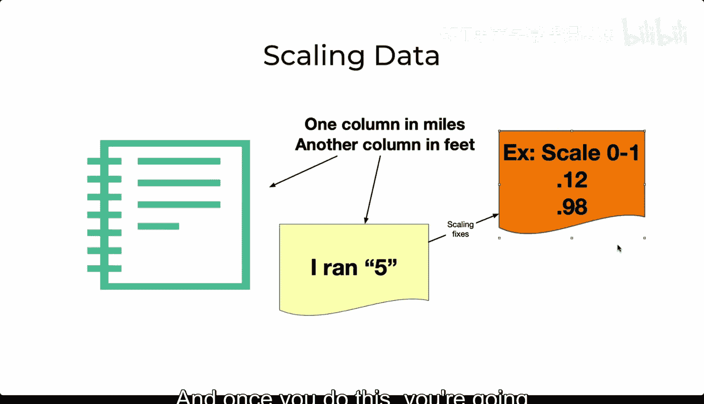

# 杜克大学｜机器学习运维｜DevOps⧸DataOps、Azure、MLFlow和抱脸｜MLOps ｜ Machine Learning Operations p95 18_02_04_数据扩展.zh_en -BV1yE421c7uA_p95-

Scaling data is one of the more interesting problems with machine learning。

Machine learning data in general will require scaling， not all。

 but majority of machine learning problems require you to scale the data。

 And there's a very simple intuition behind this。 Here's a good example。

 Let's say you have a data set and it contains a bunch of different columns inside。

And some is comparing a value they found in a column。 They said， I ran 5。Well， what do you mean。

 do you mean you ran 5 miles，5 kilometersm，5 feet。 really， the difference is significant。

 depending on what metric you're using。 And that's really the general intuition is one column could be in miles。

 another one could be in feet and by doing a comparison。

 it really is not a great way to do a machine learning problem。 Let's say， for example。

 your clustering the clustering would not come out correctly。

 So how you can fix this is through scaling。 And one of the things you can do is you could scale the values between01。

 And now you're doing relative comparisons versus this absolute comparison with the wrong metric。

 So majority of machine learning algorithms do require you to scale your data and the intuition is fairly straightforward。

And once you do this， you're going to be able to put this into， let's say。

 a Ka means clustering solution。

