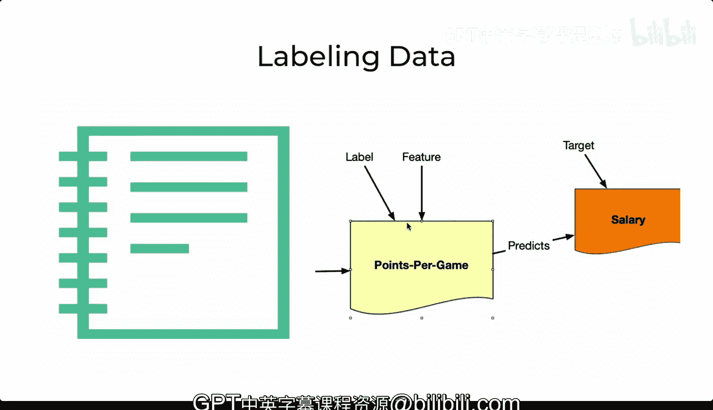

# 杜克大学｜机器学习运维｜DevOps⧸DataOps、Azure、MLFlow和抱脸｜MLOps ｜ Machine Learning Operations p96 19_02_05_数据标注.zh_en -BV1yE421c7uA_p96-

Here we can see an example of working with labeled data。

If I go through and grab some data out of a notebook。The points per game column would be the label。

 That label would be also a feature right So there's two different terms for this particular column and I could use this feature to predict a target the target could be the salary of an MB player。

 So one of the things I may want to determine is based on the points per game。

 what would be a salary that I could arrange for that MB player。

 let's say I was the owner of an MB team and the intuition here is fairly straightforward in that whatever it is that you're trying to use to predict a target as a feature and it will need to have a particular label。

 if you don't have the label， you may have to get the label using another approach you can either use human workers like for example。

 using mechanical Turk or you could use unsupervised machine learning to create natural groupings。

 which then you could use to label the data。In general， though。

 all machine learning problems will require a feature that has a label to it if you're going to do a supervised machine learning problem。

