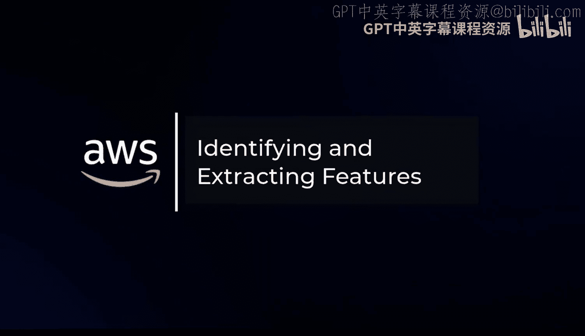
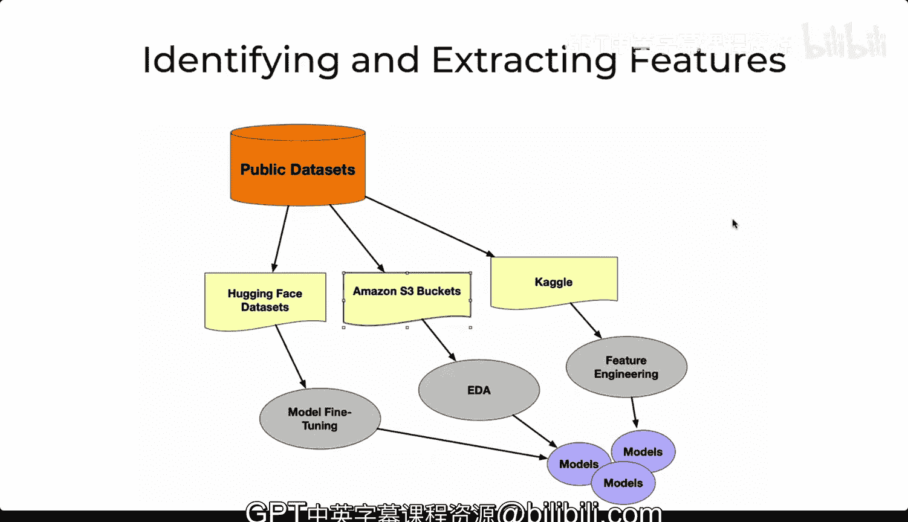

# 杜克大学｜机器学习运维｜DevOps⧸DataOps、Azure、MLFlow和抱脸｜MLOps ｜ Machine Learning Operations p97 20_02_02_识别与提取特征.zh_en -BV1yE421c7uA_p97-

A very common way to build machine learning systems is to use public datasets。

 Let's talk through a few of the common public datasets that are available。

 a very popular merg public data as the Hugingface datasets and you can use it to finet a model。

 So let's say you get a pretrained model from Huging face and you use an environment that has GPU enabled like Github code spaces or an Amazon SageMaker environment with GPU enabled。

 you can then take that hugging phase dataset and finetune it based on the new data that's available and then create a new model and put it either into production or back into Huging face。

 Likewise with Amazon S3。 It's a very common scenario to have a big public dataset and you can pull that dataset into。

 let's say a Jupyter notebook do exploratory data analysis on it。

 find out what it is you're trying to build and then create a model based on that S3。

Data set another common public data set is CAGle。And there are many examples of public dataset sets that have also had many feature engineering components added to it so you could build off of that。

 use that feature engineering solution to then create your own custom model。

 so there are many examples these are just three of public datasets that are useful in then building models that you can use either in production or for experiments that lead to further models either as a hobbyist or a production machine learning engineer。

