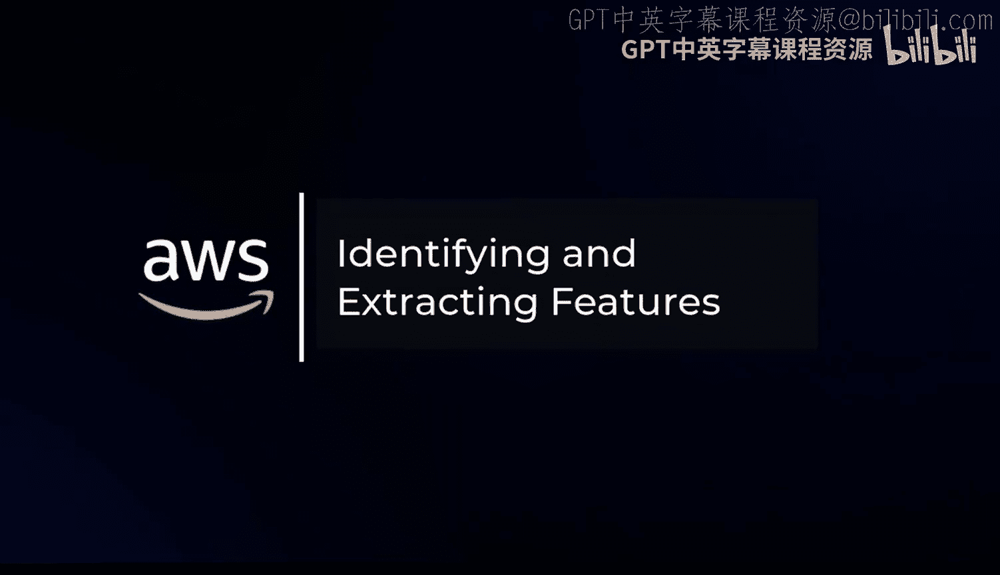
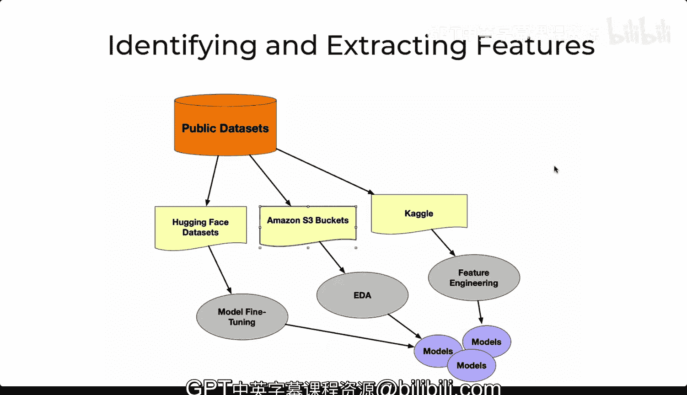

# 机器学习运维：P97：识别与提取特征

在本节课中，我们将学习如何利用公开数据集来构建机器学习系统。我们将介绍几种常见的公开数据源，并探讨如何在这些数据的基础上进行模型微调、特征工程和模型开发。

---

构建机器学习系统的一种非常常见的方法是使用公开数据集。

我们来介绍几种可用的常见公开数据集。

一个非常流行的公开数据源是 Hugging Face Datasets，你可以用它来微调模型。假设你从 Hugging Face 获取了一个预训练模型，并使用一个启用了 GPU 的环境，例如 GitHub Codespaces 或启用了 GPU 的 Amazon SageMaker 环境。然后，你可以基于可用的新数据，使用该 Hugging Face 数据集进行微调，创建一个新模型，并将其部署到生产环境或重新上传回 Hugging Face。

Amazon S3 的情况类似。拥有一个大型公开数据集是非常常见的场景。你可以将该数据集拉取到，例如一个 Jupyter Notebook 中，对其执行探索性数据分析，明确你想要构建的目标，然后基于该 S3 数据集创建一个模型。

另一个常见的公开数据集是 Kaggle。此外，还有许多公开数据集的例子，它们已经附加了许多特征工程组件，因此你可以在此基础上进行构建，利用这些特征工程解决方案来创建你自己的定制模型。

这样的例子有很多，以上只是三个有用的公开数据集示例。利用它们，你可以构建用于生产环境的模型，或者进行实验以开发出更进一步的模型，无论你是爱好者还是生产环境下的机器学习工程师。

---

本节课中，我们一起学习了利用公开数据集构建机器学习系统的基本流程。我们了解了 Hugging Face Datasets、Amazon S3 和 Kaggle 等常见数据源，并探讨了如何在这些数据上进行模型微调、探索性数据分析和特征工程，最终创建可用于生产或实验的定制模型。