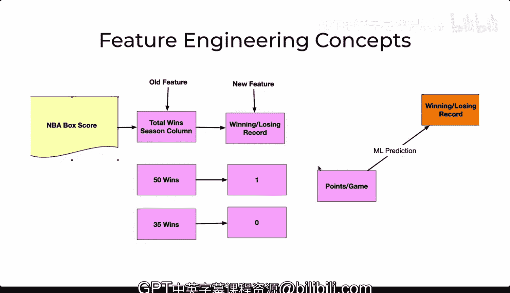

# 杜克大学｜机器学习运维｜DevOps⧸DataOps、Azure、MLFlow和抱脸｜MLOps ｜ Machine Learning Operations p98 21_02_03_特征工程概念.zh_en -BV1yE421c7uA_p98-

Here we have a traditional feature engineering problem。 In this case， I have the NBA box score。

 and it has a column with the total wins for the season。

 One of the things we can do is repurpose this old feature and convert it into a new feature。

In this case， we could look at the total wins and determine if it's over a threshold。

 So depending on how many games there are in a season， you could say， for example。

 if you have 50 wins， you would have a winning season and that would be a new value called one if you had 35 wins depending on how many games are in the season again。

 this could be a zero that would go into this new column called winning and losing record once you have this new feature now what you can do is use it for a prediction so we could use that as the label that we're trying to predict and we would say。

 for example， can we use how many points a team with average and use that to predict whether they would have a winning record or losing record in the season。

 let's say that you wanted to create this prediction model。Based on this attribute。

 this would be one way to go about it and you could also create new features as well。

 but the core idea here is that by reusing old features or combining old features together you can create a new feature and then use that in a machine learning prediction system。

