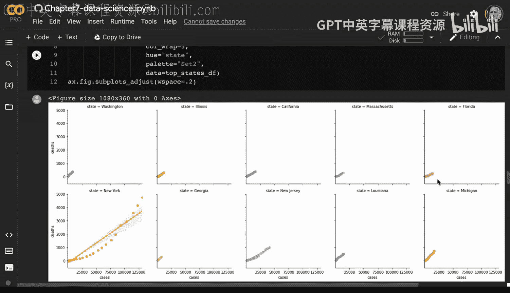
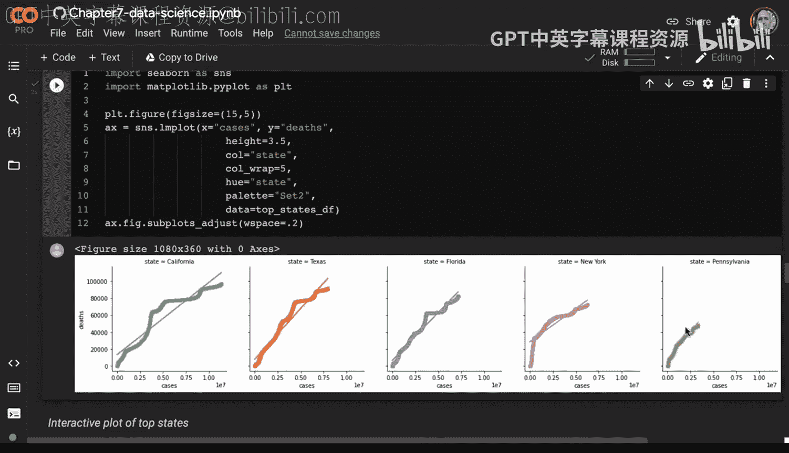

# 杜克大学｜机器学习运维｜DevOps⧸DataOps、Azure、MLFlow和抱脸｜MLOps ｜ Machine Learning Operations p99 22_02_02_数据可视化.zh_en -BV1yE421c7uA_p99-

Let's take a look at a traditional data science project here。

 One of the things that I would recommend in dealing with the data science project is to create a structure that follows an ingestion and exploratory data analysis。

 a modeling and the conclusion phase So each of these four segments includes the key components that you need and you can actually go back and forth between them。

 So first let's look at the exploratory data analysis and ingestion phases and instead of here I can grab some data directly from the New York Times and this is the state by state CoVID data and one of the things that I typically do is look at the last records here to see what are the current state of the data and you can see this is very current data and then if I look at the columns we also can see the columns and also the shape so this is really kind of kicking the tires for the data now when you go to exploratory data analysis really what that means。

I you want to look at both the descriptive statistics in a numerical form。

 so if I go through here and I say describe， one of the things that we can do is we can look at the cases。

 the deaths， for example， 50%， we could say that the median state， for example。

 the deaths would be 4，345。But the max would be 96960。

And if we look at the cases and deaths in the US in Covid-19。

 this is where we could go directly into the plotting。

 What I would do is I would plot one column versus another。

 so we say cases and death and I could even add a hue here that would give us some more data about what's happening。

 So you can see here there's a direct linear correlation between the amount of cases that are reported with Covid-19 and the amount of deaths that are occurred so this is a kind of a classic problem I notice that I pass in that data frame right here to deaths。

 now if I wanted to manipulate the data a little bit more one of the things I could do is change around maybe and do things on a date by date basis and then let's say filter the results by a date range。

 So here we go I've grab just a couple days of data and if I look at the recent data you can see here that there are patterns that I could find Now the other thing that we can do is we could also。

sort it and find values by sorting and I also could do maybe a state by state analysis as well and look at maybe the unique states that have the top values in terms of the states that have the most cases you can see California Florida。

 New York Pennsylvania， Texas obviously these are very large states as well and then if I want it to plot that out we could go through here and we can plot that out so the core idea here with doing data science is that you have an ingestion phase you have an exploratory analysis phase and you look at both the numerical data and also the graphene of the data so you can find patterns and one of the things that we can see here is that with the state California you can see that it does appear that there's potentially a logarithmic results and you can see in here as well there're starting to be a logarithmic result and New York is probably the most。

Pronounced version of this。 And this is what happens with exponential growth is eventually it'll start to taper off。

 And so this may mean that there will be a plateau in the terms of the deaths that have occurred。

