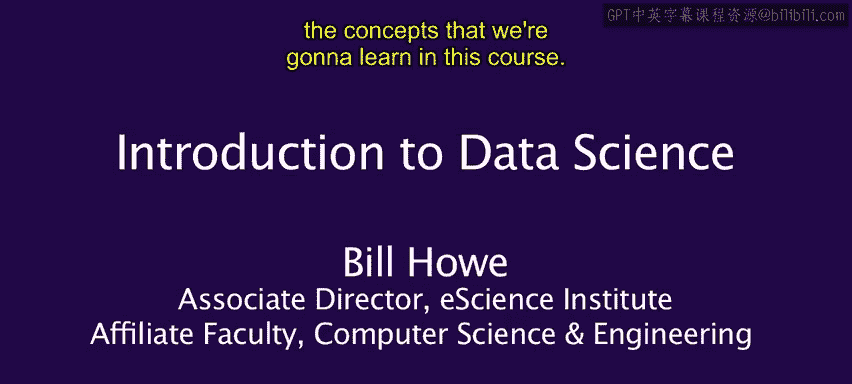
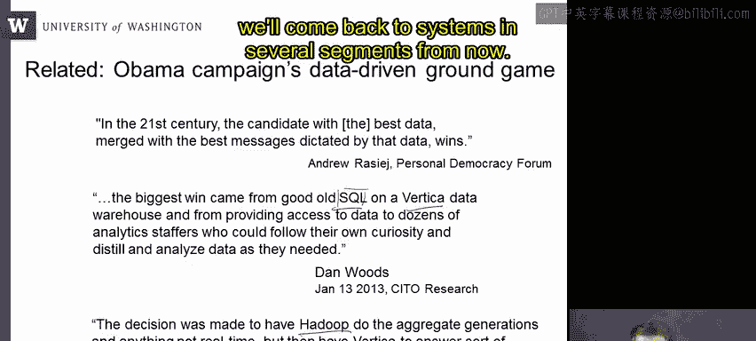

# 大规模数据科学（第1课/共3课）📊：激发胃口：政治案例

## 概述

在本节课中，我们将通过几个真实的政治案例，初步了解数据科学的核心活动与价值。这些案例将展示数据科学如何从简单方法中提取强大洞察，以及如何通过有效的数据处理和呈现来影响现实世界。

---

## 案例一：2012年美国总统选举预测

上一节我们概述了课程目标，本节中我们来看看第一个经典案例：2012年美国总统选举。

这是一张选举人团地图，每个州根据赢得选举人票的候选人着色，数字代表该州拥有的选举人票数。当时，这张地图之所以引发广泛讨论，是因为Nate Silver及其博客“538”在选举前完美预测了这张地图的结果。

媒体讨论常将Nate Silver描绘成天才，并强调他使用了复杂的数学方法。但有趣的是，Nate Silver本人第一个指出，他用于预测的方法实际上相当简单。

以下是他在当时博客文章中的一系列引述：

*   第一段引述来自10月26日：“这背后的逻辑应该非常简单。奥巴马先生在俄亥俄州和其他州的民调中保持领先，这足以让他赢得270张选举人票。”
*   几天后，他的表述变得更加直白：“我们提出的论点极其简单，如下：奥巴马在俄亥俄州领先。这不是魔术。”
*   选举结束后（11月10日），在他被证明正确并做出完美预测后，他在解释最初为何创建“538”博客时写道：“竞争对手设定的门槛低得诱人。一个人只需对政治竞选活动中真正具有预测能力的东西进行一些相当基础的研究，就能看起来像个天才。”

在这个案例中，真正具有预测能力的是**各州民调数据本身的聚合**。历史上，聚合的州民调数据在预测大选结果方面表现相当不错。他确实在量化不确定性和呈现结果方面做了一些复杂的工作，特别是创建了许多精美的交互式可视化图表，以向公众传达这些想法。

这正是我想强调的一点：在某些情况下，得到答案可能是容易的部分；而**解释结果**，并通过可视化等方式**说服他人相信结果**，往往是困难的部分。这也是我们将在整个课程中反复提及的主题之一。

**总结**：**简单方法 + 足够多的优质数据**，在许多情况下胜过更复杂的方法。这是我们将要回归的另一个主题。

---

## 案例二：奥巴马竞选团队的数据驱动系统

在转向其他话题之前，另一个与竞选相关的案例是奥巴马竞选团队使用的数据驱动地面战系统。

该系统能够针对特定类别的用户进行精准信息推送。他们建立并维护了一个非常庞大（海量）的选民数据库，并利用它来为非常具体的群体设计高度定制化的信息。

例如，一位住在俄亥俄州小镇、有两个孩子的母亲，她在推特上谈论环境问题，在Facebook页面上提到有机蔬菜，在2008年投过票，并在奥巴马网站上注册过但从未捐款。这样，她可能会收到米歇尔·奥巴马发来的信息，重点强调巴拉克·奥巴马的环境政策。

为了设计这些信息，你需要对各种可能有效或无效的方案进行**临时的假设检验**，并且需要以**交互速度**对数据进行切片和切块分析。

这引出了我们将要回归的另一个主题：对这种**临时的、交互式分析**的需求。用于此目的的系统也很有趣。这是一个SQL数据库，一个名为Vertica的非常快速的数据库。我们希望在课程后期讨论一下Vertica的特殊之处。它是一个SQL数据库，在数据科学语境中，SQL有时名声不佳，被视为可能无法用于分析、在当今时代已不合时宜的旧事物。

但请不要相信这种说法。在许多情况下，SQL都有一席之地。在这个案例中，他们确实使用了Hadoop来进行非实时的批量数据生成。但对于需要快速思考的数据查询，他们使用了这个Vertica数据库。我们将在后续的课程中再次讨论这些系统。

---

## 总结

本节课中，我们一起通过2012年大选预测和奥巴马竞选团队的数据运营两个政治案例，初步领略了数据科学的实践。我们了解到，**优质数据结合简单方法**往往能产生强大效果，**数据的解释与呈现**是关键挑战，而**临时的、交互式的数据分析**在现代数据驱动决策中至关重要。同时，我们也看到传统工具如SQL在特定场景下依然发挥着核心作用。这些主题将在后续课程中深入展开。