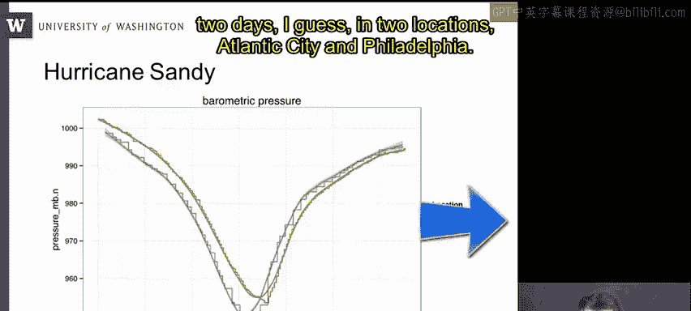
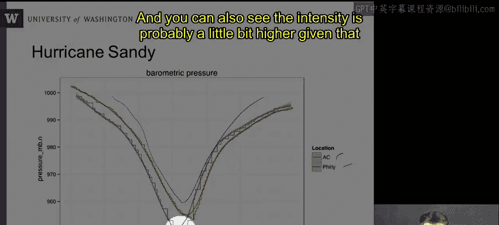
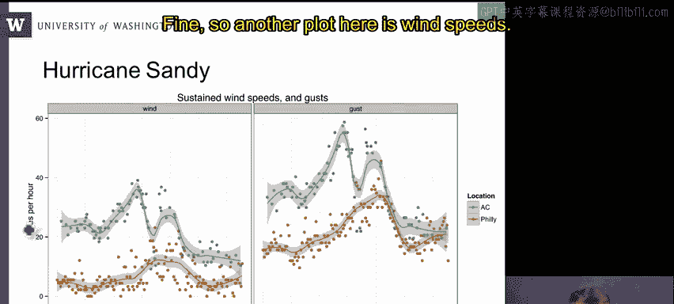
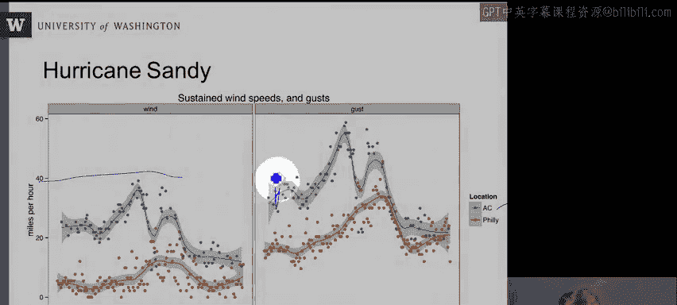

# 大规模数据科学（第1课）🌪️：激发胃口 - 极端天气数据分析

在本节课中，我们将通过分析飓风“桑迪”的案例，了解数据科学如何实时处理与可视化公开数据，以应对极端天气事件。我们将学习数据获取、重利用和可视化的基本流程。

---

大约在飓风“桑迪”登陆的同时，一个引人注目的现象是，针对这场风暴的实时数据可视化开始涌现。

以下是人们利用数据进行实时分析的两个例子。

*   有人利用推特数据，分析并绘制了停电区域的地图。
*   约瑟夫·鲁威尔从本地气象站获取了公开数据。

上一节我们看到了数据应用的例子，本节中我们来看看约瑟夫的具体做法。

他仅使用了两个不同气象站（大西洋城和费城）的数据，并进行了简单的绘图。

这张图显示了几日内的气压变化。你可以看到巨大的气压骤降对应着风暴过境，同时也能观察到风暴在大西洋城和费城之间的时间差。由于大西洋城的气压下降更显著，其风暴强度可能也更高。

---

所以，这里有几点值得注意：一是从网络获取数据并近乎实时地（或至少在短时间内）进行重利用以生成可视化图表，然后将其发布回网络。我认为这非常具有数据科学活动的特征。

在这个特定例子中，虽然不一定是大数据集，但**重利用为其他目的收集的数据**是我们将反复遇到的主题。此外，我们也再次看到了这种分析的**临时性**特点。

---

接下来，我们看看同一组数据的另一个变量。

以下是风速数据图。大西洋城的风速峰值达到40（绿色线），确实更为剧烈。图中的灰色部分表示误差范围。

---

所以，这又是对同一组数据的另一种变体分析。

---

本节课中，我们一起学习了如何利用公开的实时数据（如气象站数据）进行简单的可视化分析，以理解极端天气事件。我们看到了数据重利用和临时性分析在数据科学中的实际应用，这为后续处理更复杂、更大规模的数据集奠定了基础。