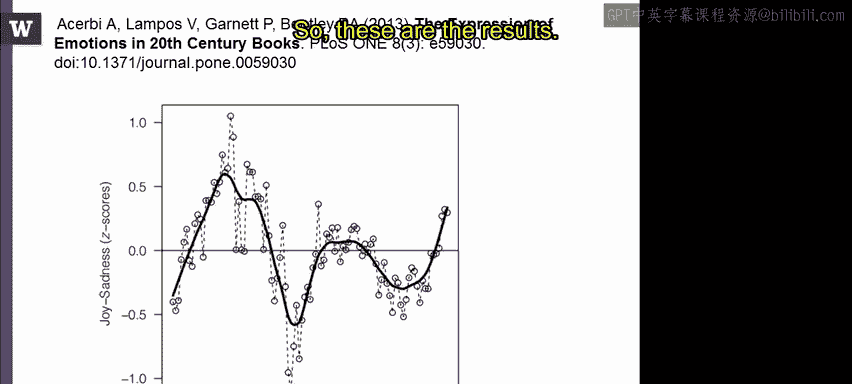
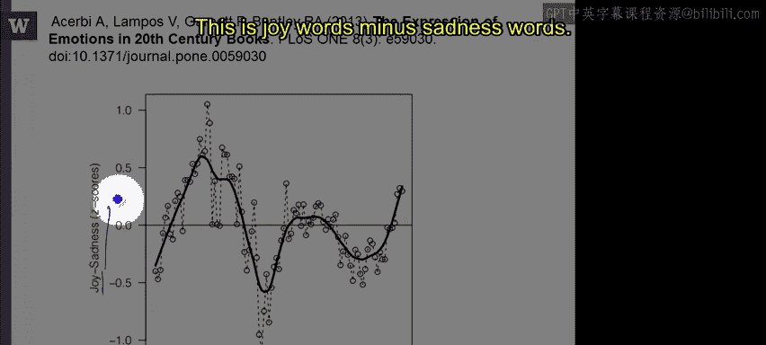
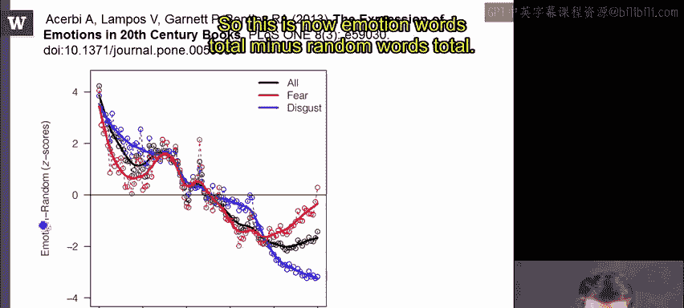
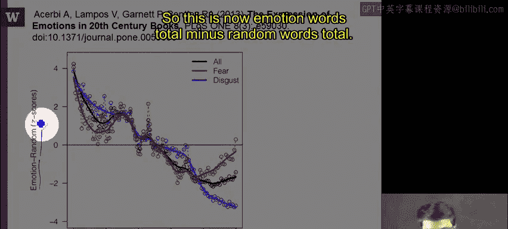
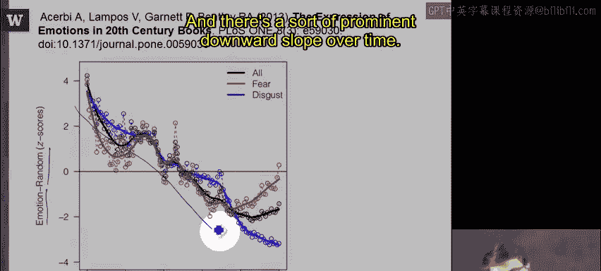
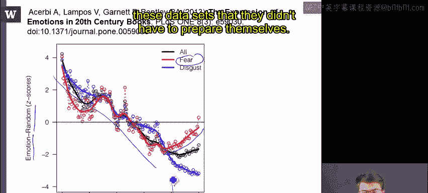

# 课程1：大规模数据科学 - 激发胃口：数字人文 📚

在本节课中，我们将通过一个具体的“数字人文”研究案例，来了解如何利用大规模数据和相对简单的方法，揭示文化趋势的变迁。这个案例分析了20世纪书籍中情感词汇的使用变化，其方法直观易懂，非常适合初学者理解数据科学的核心工作流程。

---

## 研究概述：20世纪书籍中的情感表达

上一节我们提到了数据科学的广泛应用，本节中我们来看看一个来自“数字人文”领域的生动例子。这项研究的标题是“20世纪书籍中的情感表达”。研究者感兴趣的核心问题是：我们集体文学作品中选用的词汇是否随时间发生了变化？这种变化最终是否能告诉我们一些关于文化或文明的信息？

这项科学探究本身非常引人入胜。但最引人注目的是，他们所采用的方法相当直接。即使没有深厚的技术、统计学或语言学背景，你也可以自己尝试完成类似的分析。

## 研究方法解析

以下是他们完成这项分析所采取的具体步骤。

### 第一步：数据获取与数字化

第一步看似艰巨：将20世纪所有书籍数字化。这对个人而言几乎不可能完成。但幸运的是，谷歌已经为我们完成了这项工作，并将数据公开在了一个可访问的网址上。谷歌不仅扫描了书籍，还进行了字符识别，并生成了“n-gram”数据集。

这些数据集本质上是结构化的数据表格。其中，每一行包含一个n-gram、对应的年份以及该n-gram在该年份出现的频次计数。数据已经被处理成易于使用的形式。

**核心概念解释**：
*   **n-gram**：指文本中连续的n个项（如单词）。在本研究中：
    *   **1-gram**：指单个单词，例如 “yesterday”。
    *   **5-gram**：指连续的五个单词，例如 “analysis is often described as”。

在这项具体研究中，作者只使用了**1-grams**（即单个单词）进行分析。

### 第二步：情感评分映射

接下来，他们从这些1-gram中选取了一个子集，并为每个单词赋予了一个“情绪得分”。你可以想象，某些单词带有特定的情感色彩，与快乐、悲伤或恐惧等相关联。其同义词也可能具有相似的情感关联。

这项分析听起来不简单，确实如此。但同样，这项工作也已经有了现成的资源。网络上有一个名为**WordNet**的数据库，它已经完成了这类情感分析。因此，论文作者可以直接利用谷歌的数字化书籍数据（已分解为n-gram）和WordNet的情感得分。

### 第三步：核心计算与分析

然后，他们进行了核心计算。其数学表达式可能初看令人生畏，但实际上非常简单。

**核心计算公式**：

他们首先计算某个特定情感类别（如“快乐”）的得分。对于每一年：

1.  **计数与归一化**：对属于该情感类别的每个单词，计算其在当年书籍中出现的次数，然后除以单词“the”在当年出现的次数。公式可表示为：
    `(特定情感单词的出现次数) / (单词“the”的出现次数)`
    进行这种归一化是为了消除书籍总量、数字化程度等因素的影响。之所以选择单词“the”而非总词数作为分母，是因为“the”更能代表散文性文本的比例，从而避免因书籍中图表说明、技术术语、公式等非散文内容增加而扭曲结果。

2.  **求和与平均**：将所有属于该情感类别的单词的上述比值相加，然后除以该情感类别中的单词总数，得到该年份此类情感的平均强度。

3.  **标准化（Z-Score）**：最后，为了便于比较不同情感随时间的变化趋势，他们对每年的平均强度值进行了标准化处理。即减去所有年份的均值，再除以所有年份的标准差。这在高中学过的统计学中很常见，目的是使数据符合标准正态分布。
    `Z = (某年值 - 历年均值) / 历年标准差`

**计算资源说明**：
这些数据集虽然庞大，但并非不可处理。它们的大小足以装入如今大多数笔记本电脑的内存中。因此，这是一个计算量显著但并非超级计算级别的任务。如果你有兴趣，完全可以在一个周末内尝试完成。

## 研究结果展示

我认为这些结果非常具有说服力。以下是论文中的部分发现：

上图展示了“快乐”词汇得分减去“悲伤”词汇得分后的**Z值**变化。可以观察到二战后出现了一个明显的低谷，这是论文中强调的一点。此外，在90年代后期，这个值似乎开始回升。

上图则显示了“情感词汇”总分减去“随机词汇”总分后的趋势，呈现出一个明显的**随时间下降的斜率**。这似乎论证了我们随时间推移，正在使用越来越少的情感词汇。不过，图中红色的“恐惧”词汇线自1980年代以来有所上升，其原因可以想象。

这项分析非常有趣，它是一项重要的研究，而完成它仅仅利用了他人已准备好的数据集。

## 数据科学的深远影响

关于这个案例，我还想指出另一点。下图是这篇论文所引用的一些其他研究的标题列表：

这些标题令我印象深刻：“利用数百万数字化书籍进行文化定量分析”、“量化语言的进化动力学”、“词汇使用频率预测印欧语言历史中的词汇演变速率”、“歌词与语言标记”等等。这说明了语言学、人类学、历史学、文化研究等领域，正在凭借数据驱动的方法转变为“硬科学”。从某种意义上说，**所有科学都在成为数据科学**。

因此，数据科学家在这个领域拥有巨大的力量。现在正是成为“数据极客”的好时代。

数据科学的影响也延伸到了新闻业。例如，当维基解密材料公布时，你不可能自己泡一壶咖啡然后逐页翻阅所有打印出来的材料。你会编写算法来进行分析，比如词汇使用分析、寻找邮件链和对话等。新闻业本身正在成为一种计算事业，一个数据科学问题，或者至少它非常适用于数据科学技术。

所以，作为一名数据科学家，世界是你的舞台。

---

本节课中我们一起学习了一个精彩的“数字人文”案例。我们看到了如何通过获取现成的大规模数据集（谷歌图书n-gram）、利用已有的知识库（WordNet情感词典），并应用基础的统计计算（计数、归一化、标准化），来揭示长达一个世纪的文化情感变迁趋势。这个例子生动地说明了数据科学方法的强大与可及性，即使初学者也能理解其核心逻辑。在接下来的课程中，我们将继续探讨更多数据科学的应用实例。