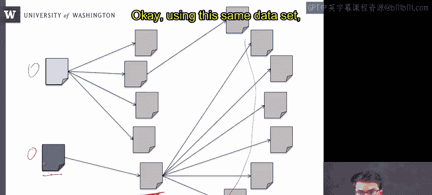
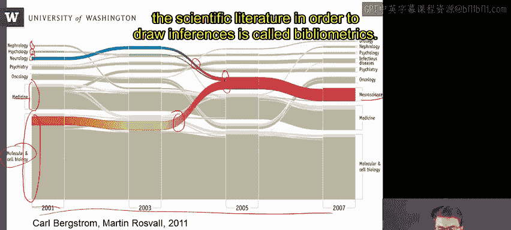

# 📚 大规模数据科学（第1课）｜ 文献计量学：从引文网络到科学发现

在本节课中，我们将通过一个具体的例子——文献计量学，来探索如何利用图（Graph）这种数据结构进行大规模数据分析。我们将学习如何评估科学论文的重要性，以及如何通过分析引文网络来发现新兴的科学领域。

---

## 🔍 评估论文的重要性

上一节我们提到了图数据结构的广泛应用。本节中，我们来看看如何利用图来解决一个实际问题：如何判断一篇科学论文相对于其他论文的重要性？

一种直观的方法是统计论文被引用的次数。例如，在下图中，蓝色圆圈标记的论文被其他四篇论文引用，而红色圆圈标记的论文只被引用了一次。因此，蓝色论文似乎比红色论文更具影响力。

然而，如果我们观察更长的时间（图中用深蓝色表示），情况可能发生变化。中间那篇论文可能会被更多后续论文引用。最终，我们可能会得出结论：这篇中间论文的影响力更大，因为它不仅直接影响了其他论文，还通过其引用的论文产生了间接影响。

那么，我们如何在两种解释之间做出决定呢？这个问题与判断网页相对重要性的问题非常相似。

---

## ⚖️ PageRank算法：从网页到论文

解决上述问题的一种方法是借鉴谷歌提出的PageRank算法。该算法的核心思想是：一个网页（或一篇论文）的重要性，取决于链接到（或引用）它的其他网页（或论文）的重要性。

以下是PageRank算法的基本思路：
1.  每个节点（网页或论文）初始被赋予相同的权重。
2.  每个节点将自己的权重平均分配给所有它指向（或引用）的节点。
3.  每个节点将所有指向它的节点传递来的权重相加，作为自己的新权重。
4.  重复步骤2和3，直到所有权重值收敛（即变化非常小）。

最终，每个节点收敛后的权重值就代表了其相对重要性。这个过程可以用以下公式化的方式描述：

**公式：**
`新权重 = 所有指向本节点的权重之和`

这个算法不仅适用于网页排名，也适用于任何具有链接或引用关系的图结构数据，例如我们的科学论文引文网络。

---

## 🧩 超越重要性：发现科学新领域

除了评估重要性，对引文网络进行数据分析还能揭示更深层次的模式。使用相同的数据集，卡尔·伯格斯特龙和马丁·罗斯威尔创建了另一种可视化。

这次我们暂时忽略重要性问题，只关注引文网络图本身。一种分析是判断重要性，另一种分析则是进行**聚类**。

聚类算法能够将相似的文档（论文）自动分组。研究人员将这些聚类映射到相应的科学领域。例如，一个包含《柳叶刀》和其他医学期刊的聚类可以 confidently 被判定为“医学”领域；另一个聚类则可能代表“分子与细胞生物学”。

将这种聚类结果按时间线排列后，一个惊人的发现出现了：一部分分子与细胞生物学领域和神经学领域的论文开始融合，形成了一个全新的科学领域——**神经科学**。

仅仅通过对这个图进行此类数据分析（即数据科学），我们就能揭示新兴科学领域的诞生。这个发现非常引人注目。

---

## 📊 文献计量学：研究科学本身

基于同一数据集，研究者们还进行了许多其他类型的分析。这种通过研究科学文献本身来得出推论的整体领域，被称为 **文献计量学**。

---

## 📝 本节课总结

在本节课中，我们一起学习了：
1.  **问题引入**：如何评估科学论文的重要性，并发现这与网页排名问题类似。
2.  **核心算法**：引入了**PageRank算法**，它通过考虑“被重要节点引用”来计算图中节点的重要性。
3.  **扩展应用**：对同一引文网络进行**聚类分析**，可以自动识别和跟踪科学领域的演变，甚至能发现像神经科学这样的新兴交叉领域。
4.  **领域概览**：这类研究构成了一个名为**文献计量学**的元科学领域，即用数据科学的方法来研究科学活动本身。

通过这个案例，我们看到了如何将抽象的图算法（如PageRank和聚类）应用于具体的、大规模的真实世界数据，从而获得有价值的洞察。