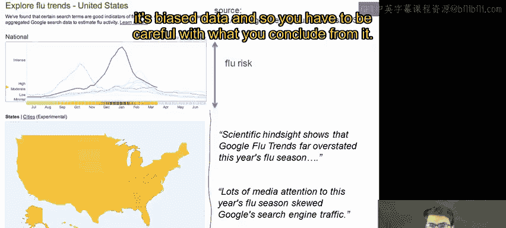

# 大规模数据科学（第1课/共3课）🍽️🎵🏥：激发胃口：食品、音乐与公共卫生

在本节课中，我们将通过三个具体案例，探索数据科学在食品搭配、音乐流派演变和公共卫生预测等非传统领域的应用。我们将看到数据驱动方法如何揭示隐藏的模式，同时理解数据本身的局限性。

---

上一节我们讨论了数据科学的核心概念，本节中我们来看看数据科学如何应用于一些意想不到的领域。

## 🍽️ 食品搭配的数据驱动分析

你或许认为食品搭配是一门艺术，难以用数据科学分析。然而，一项发表在权威期刊上的研究应用了数据驱动技术来分析食物配对。

以下是他们的研究方法：
1.  **构建食材关系图**：如果两种食材在某道菜谱中同时出现，就在它们之间绘制一条边。这形成了一个由**顶点（食材）**和**边（共现关系）**构成的图。
2.  **分析图结构**：研究者分析了这个大型图表的社区结构，寻找其中的聚类。
3.  **对比传统认知**：他们检查这些数据聚类是否与已知的烹饪流派或搭配方法相符。

研究结果显示，在某些情况下数据聚类与传统认知一致，而在另一些情况下则揭示了此前未被明确认识、但隐藏在数据中的搭配模式。这种数据驱动的方法，利用网络上大量的菜谱数据，将以往基于经验的“民间智慧”置于了更量化的基础之上。这是一个有趣且非常规的数据科学应用案例。

## 🎵 音乐流派的演变分析

接下来，我们看看数据科学如何用于分析文化趋势，例如音乐流派的演变。

这个例子来自Last.fm博客。他们分析了歌曲上的标签数据，用于研究音乐流派随时间推移的兴衰。

以下是他们的分析思路：
1.  **利用标签数据**：他们使用了歌曲上用户添加的标签（如“朋克”、“摇滚”）。
2.  **追踪流行度变化**：通过分析特定时期这些标签的流行程度，来推断流派的兴起。
3.  **可视化演变过程**：例如，图表显示“后朋克”（红色）在“朋克”（紫色）之后出现。你也能看到“摇滚”随时间兴起，并在近期略有衰退。

这个案例再次体现了**数据再利用**的主题。这些标签数据最初只是为了帮助用户搜索和发现相似音乐而收集的，现在却被重新用于推断整个音乐流派的演变历程。

## 🏥 公共卫生预测与数据偏差

最后，我们探讨一个更严肃的领域：利用数据科学进行公共卫生预测，并认识其中的挑战。

一个著名的例子是谷歌流感趋势。谷歌通过分析搜索日志中特定词汇的出现频率，试图预测流感爆发的严重程度和范围。

他们的工作原理基于一个假设：当人们患上流感时，会更频繁地搜索流感症状相关的词汇。通过监测这些词汇搜索量的激增，可以预测流感爆发的到来。

最初，这项服务表现得比美国疾病控制与预防中心的传统监测方法更早、更准确。谷歌因此发布了论文并提供了交互式可视化工具。

然而，近年来的科学回顾显示，谷歌流感趋势在最近一次预测中严重高估了流感季的规模。

研究者认为原因在于**数据偏差**：由于媒体对当年流感季的高度关注，导致人们更多地搜索流感相关词汇。这种搜索行为可能源于对症状的担忧、想了解更多信息、搜索相关新闻，或是担心自己的孩子，而并非完全源于实际患病率的上升。这种由媒体关注引发的二阶效应，最终导致了有偏差的数据和错误的预测结论。

这个案例的启示是：将搜索引擎的数据重新用于其他领域的预测固然强大，但必须谨慎对待这些数据中可能存在的**偏差**，并仔细审视由此得出的结论。

---

本节课中，我们一起学习了数据科学在食品网络分析、音乐流派追踪和公共卫生预测三个领域的应用。我们看到，通过构建关系图、分析时间序列数据和再利用现有数据，可以揭示出有趣的模式。同时，谷歌流感趋势的案例也提醒我们，必须警惕数据中的偏差，并审慎地解释分析结果。数据科学是一把强大的工具，但其有效性和可靠性高度依赖于对数据本身特性的深刻理解。