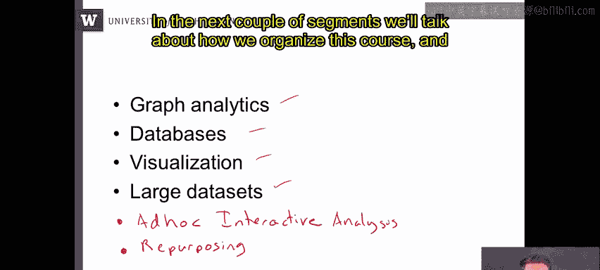

# 大规模数据科学（第1课／共3课）🚀：激发胃口：公共卫生、地震与法律案例

在本节课中，我们将通过几个具体案例，探讨数据科学在不同领域的应用与挑战。这些案例涵盖了公共卫生监测、地震预测的法律责任以及数据再利用等核心主题，帮助我们理解数据科学实践的广度与深度。

---

## 公共卫生：利用网络搜索数据监测药物副作用 💊

上一节我们看到了数据在公共卫生领域的初步应用，本节中我们来看看一个更具体的科学分析案例。

微软研究院的一些研究人员进行了一项分析网络搜索流量的研究。这项研究旨在发现与特定药物相关的副作用。

以下是该研究的关键发现图示与分析：

该图表展示了对约一百万用户（在获得许可的情况下）的网络搜索流量进行长期监测的结果。具体分析如下：

*   **药物A的关联性**：当用户搜索**药物A**（图中绿色部分）时，大约有**5%** 的时间他们也搜索了与高血糖症状相关的词汇。
*   **药物B的关联性**：对于**药物B**，这个比例约为**4%**。
*   **背景基线**：在一般情况下（平均案例），用户搜索高血糖症状的比例**接近0%**。
*   **联合用药的发现**：如果用户同时搜索了这两种药物，那么他们搜索高血糖症状的几率**上升到了10%**。

这项研究的惊人之处在于，高血糖并非这两种药物的已知副作用。然而，网络搜索数据强烈暗示了这种关联性，这种模式很难用巧合来解释。研究人员在论文中对此论点进行了更深入的阐述。

这个案例是数据再利用的典型例子。研究团队利用了一个为其他目的收集的大型数据集——网络搜索日志，并从中得出了关于药物安全的新推论。关于数据再利用，我想强调的就是以上两点，但这无疑是一个非常有启发性的案例。

---

## 地震预测：数据科学中的法律责任与预测不确定性 🌋

接下来，我们从一个不同的角度探讨预测问题，这个案例更侧重于预测行为本身及其后果，而不仅仅是数据。

回顾去年十月，有六名意大利地震学家因未能预测2009年4月发生的**6.3级地震**而被判过失杀人罪。当时当地居民对地震活动感到担忧，而研究人员被认为在评估风险时表现得过于 reassuring（让人安心）。

我想通过这个案例指出的核心点是**责任问题**。科学界对此事件感到震惊，我个人以及几乎所有能想到的人也是如此。让研究人员为未能预测一件已被公认且证实为无法预测的事情负责，这令人难以想象。全球没有任何地震学家会认为地震是可以预测的。

然而，法院的判决在某种程度上是因为研究人员给出了“错误的答案”。这固然糟糕，但它确实引出了一个重要议题：**当你做出一个预测时，无论有意与否，你都在为其赋予一定的可信度权重**。因此，理解你对该预测的信心程度，是数据科学实践中至关重要的一环。

---

## 本章核心主题总结 📚

本节课中我们一起学习了几个关键的数据科学应用案例，并从中提炼出了一些反复出现的主题。

以下是我们在案例中观察到的主要主题：

*   **图分析**：我们看到了几个图分析的应用实例。
*   **数据库的实用性**：在奥巴马竞选案例中，我们看到了数据库如何发挥作用。
*   **可视化与沟通**：我们看到了大量关于结果可视化和解读、传达这些结果的例子。
*   **数据规模**：我们看到了一些使用**非常大**的数据集的例子，也看到了使用**非常小**的数据集的例子。**并非所有事情都关乎“大数据”**。
*   **交互式分析**：我们讨论了即席的、交互式的分析。它不仅仅是速度更快，而且本质不同，因此支持这种分析模式非常重要。
*   **数据再利用**：我们讨论了数据的再利用，即使用他人为其他目的收集的数据，来推断其他事情。这是本课中一个非常常见的主题。

在接下来的几个部分中，我们将讨论本课程的组织结构，以及我们在创建课程材料时做出的一些设计决策。

