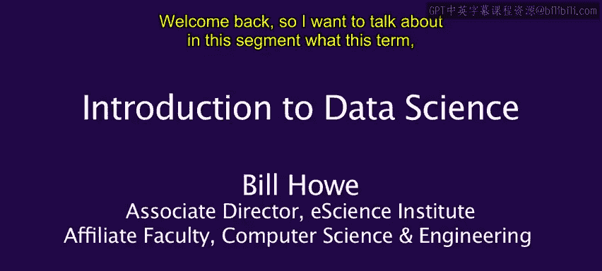
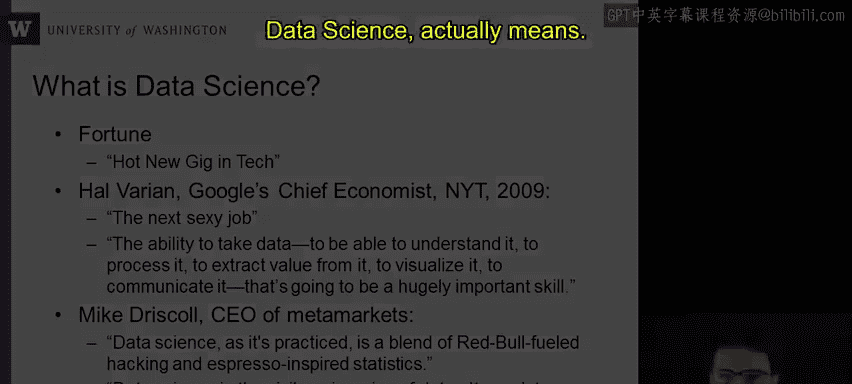
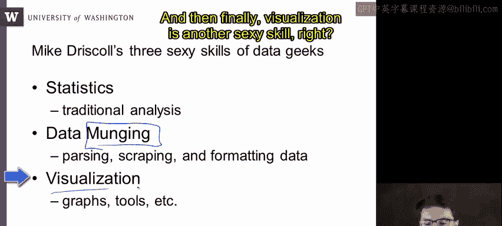

# 大规模数据科学（第1课/共3课） - P7：数据科学的特征 📊

在本节课中，我们将探讨“数据科学”这一术语的具体含义。我们将通过多位专家的观点，了解数据科学的定义、所需技能以及从业者的特征。课程将涵盖数据科学的核心构成、实践技能以及它在当今技术领域的重要性。

---

## 数据科学的定义与重要性

上一节我们介绍了课程概述，本节中我们来看看数据科学的具体定义。

《财富》杂志将数据科学称为科技领域的热门新职业。谷歌首席经济学家哈尔·瓦里安在2009年《纽约时报》的一篇文章中提出，统计学将成为“最性感的职业”。他将其描述为一种能力：**获取数据、理解数据、处理数据、从中提取价值并进行沟通**，并认为这种能力在未来将极其重要。

另一位在该领域有深入思考和著述的专家是Metamarkets公司的CEO迈克·德里斯科尔。他提出了一种通俗的观点：**数据科学的实践是“红牛驱动的黑客精神”与“浓缩咖啡启发的统计学”的融合**。

他还将数据科学比喻为“**数据的土木工程**”。从业者既需要实践知识，也需要理论理解。这种实用主义与理论之间的平衡，是我们后续会反复提及的主题。

---

## 数据科学的构成：德鲁·康威的维恩图

理解了基本定义后，我们来看看数据科学的具体构成。

另一个你应该熟悉的观点是几年前德鲁·康威提出的维恩图。他的核心观点是，数据科学可能是三个不同领域的混合。

以下是这三个领域：
*   **黑客技能**：指编程专业知识。
*   **数学与统计知识**：指学术层面的数理统计理论。
*   **实质专业知识**：指对数据的深度投入和领域知识。

典型的IT商店通常为他人构建数据分析工具，但自身不一定进行深度分析。相比之下，数据科学家可能参与工具构建，但也会**深入数据并亲自进行分析**。这是我对德鲁图中“实质专业知识”的一种解读。

康威还填充了这些领域之间的交集：
*   将统计知识应用于特定领域，可能构成了传统研究。
*   深厚的理论加上实用的编程能力，使你成为机器学习专家。
*   他称中间区域为“危险区”：你对领域知识和黑客技能略知一二，但不足以将分析建立在正确的理论基础上。我的同事常开玩笑说“计算机科学家不懂误差棒”，指的可能就是这种情况。

---

## 数据科学家做什么？

明确了数据科学的构成，接下来我们看看数据科学家具体从事哪些工作。

EMC公司（收购了Greenplum公司并大力推动数据科学计划）提出，数据科学家需要**在数据中寻找真理的“金块”，然后向业务领导者解释它**。我很赞同“向业务领导者解释”这一点，之前也提到过，**沟通结果是这个过程中至关重要的一环，而不仅仅是得出结果**。

数据科学家DJ·帕特尔提出了另一个有趣的观点：数据科学家往往是**硬科学家**（例如拥有物理学背景），他们具备强大的数学背景和计算技能，来自一个生存依赖于从数据中获取最大价值的学科。他们习惯于“拷问数据”，以榨取其最后一滴价值。DJ本人拥有应用数学背景，因此可能从这个角度出发。我认为参与数据科学的人群可能非常广泛，不一定非得来自硬科学，但这个观点值得考虑。

迈克·德里斯科尔还谈到了“数据极客的三项性感技能”。

以下是这三项技能：
*   **统计学**
*   **数据清洗**：这个词听起来有点古怪，我们稍后会详细讨论。你会看到很多这样的通俗语言，我也会谈谈我认为这反映了数据科学领域的何种现状。它指的是高效地解析数据、从网络抓取数据、在不同文件格式间转换，并且不被处理大规模异构数据集时遇到的“摩擦”所困扰。数据科学家就是能在这种环境中游刃有余、灵活工作的人，即使数据并不十分“干净”。
*   **可视化**：指通过可视化沟通结果的能力。

---

## 总结

本节课中，我们一起学习了“数据科学”的多维度定义。我们了解到，数据科学是**黑客技能、数学统计知识与实质领域专长的结合体**。它要求从业者不仅能从数据中挖掘价值，还必须具备出色的沟通能力，尤其是向非技术背景的决策者解释复杂发现。核心技能包括统计学、数据处理（清洗）和数据可视化。数据科学家通常需要在实用主义与理论深度之间找到平衡，并能够在不完美、大规模的数据环境中灵活工作。