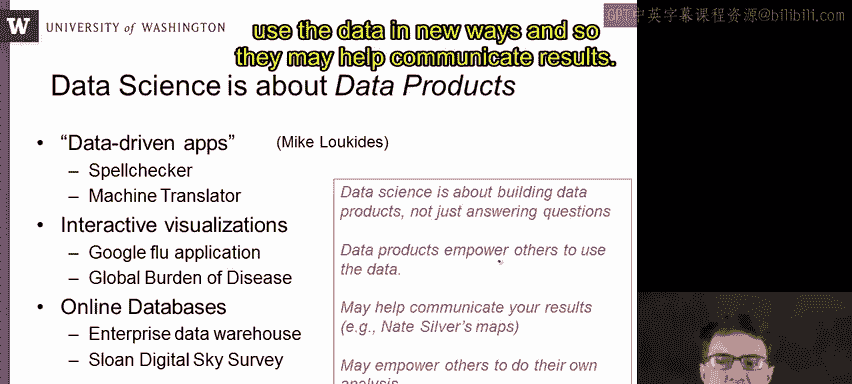

# 大规模数据科学（大数据操作，第1课/共3课） - P8：数据科学的特征（续）🔍

在本节课中，我们将继续探讨数据科学的特征，了解不同专家对数据科学范畴的定义，并深入理解“数据产品”这一核心概念。

---

上一节我们介绍了数据科学的一些基本特征，本节中我们来看看其他几位专家如何定义数据科学。

雪城大学教授杰弗里·斯坦顿参与了早期的数据科学项目，他将其定义为一个新兴的工作领域，关注大规模信息集合的**收集、准备、分析、可视化、管理和保存**。他的观点中一个有趣之处是包含了“保存”这个词。虽然准备、分析和可视化是数据科学中常见的三个支柱，也是本课程所强调的，但杰弗里更进一步，谈到了数据的长期保存问题。这源于他的图书馆学与信息研究背景，该领域非常关注数据的策展。虽然本课程不会过多强调这一点，但它无疑是完整数据生命周期的一部分。

该领域的另一位思想家、Bitly首席科学家希拉里·梅森认为，**数据科学家是能够获取、清洗、探索、建模和解释数据的人，融合了黑客技能、统计学和机器学习**。这与康威博士的维恩图观点一致。她进一步指出，数据科学家不仅擅长处理数据，还能将**数据本身视为一等产品**。这意味着能够组织数据，并产出可供他人使用的成果。

拥有一个**高质量的数据资源或数据资产**，让他人能用它来回答问题，是数据科学的产出之一。她还提到了“清洗”，即我们上一张幻灯片看到的“数据整理”。你会看到诸如“数据柔术”这样的术语，人们会说他们想雇用的数据科学家非常擅长数据柔术。在接下来的部分，我会谈谈我对这些术语的理解。

---

我们之前提到过，数据科学中反复出现的任务类型主要有三种。

以下是数据科学工作流程中的三个核心阶段：
1.  **准备阶段**：为运行某种模型做准备，包括数据清洗和整理。
2.  **分析阶段**：实际运行模型，进行统计分析。
3.  **沟通阶段**：向决策者解释和传达分析结果。

这里我们再次看到了数据整理的重要性。

---

我喜欢的另一个观点是，**数据科学本质上是关于创造数据产品**，这些产品可能供自己使用，也可能供他人使用。

那么，什么是数据产品？以下是几种主要类型：

**数据驱动的应用程序**
例如，拼写检查器不仅仅是一段代码或软件，它的功能依赖于一个单词词典，实际上还有一个拼写错误单词的词典。类似地，机器翻译能将法语句子自动翻译成阿拉伯语，这不仅依赖于巧妙的算法，更依赖于**庞大的法语和阿拉伯语文本语料库**。事实上，本课程中会贯穿一个观点（虽然现在不展开讲）：**大型数据集、大型信息语料库往往胜过精巧的技术**。

**交互式可视化**
我们在谷歌流感趋势应用中看到了这类例子。网络上还有一套与全球疾病负担相关的可视化工具（此处不展示），由华盛顿大学的健康指标与评估研究所制作。我喜欢这个例子，因为它展示了他们进行了大量研究，但产出不仅仅是研究论文（尽管他们也写了很多论文），还包括这些允许用户探索数据的交互式可视化。这体现了**产出不仅仅是答案或论文，而是可供他人使用的数据产品**这一理念。

**在线数据库**
另一种数据产品可能是某种在线数据库，他人可以查询并回答自己的问题。它不一定包含可视化组件，但投入到创建这些数据库中的工作，我认为也是数据科学的一部分。这涵盖了**企业数据仓库**的大量软件和努力，也包括商业智能工作。在后续部分，我会尝试区分这两者。这也包括了像**斯隆数字巡天**这样的项目。简单来说，这是一个天文学数据库，他们从天空图像中提取天体，将所有天体存入数据库并在网上提供。这个资源的创建对整个天文学领域产生了极其强大的影响。

---

再次总结，图中红色部分强调：**数据科学不仅仅是构建数据产品，更是构建数据产品，而非仅仅一次性回答问题**。数据产品是**数字资产**，能够赋能他人以新的方式使用数据。它们可以帮助传达结果（例如内特·西尔弗构建的地图），也可以赋能他人进行自己的分析（例如通过数据仓库或可视化工具）。

本节课中我们一起学习了不同专家对数据科学范畴的补充定义，深入探讨了数据科学工作流程的三个核心阶段，并重点理解了“数据产品”这一核心概念及其主要类型。数据科学不仅是分析数据得出洞见，更是创造能够持续产生价值的可复用资产。