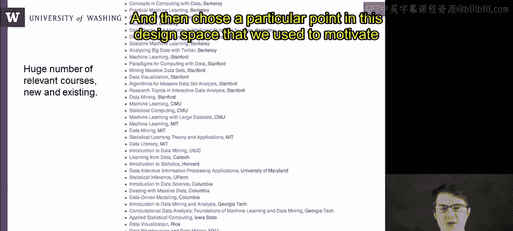

# 杜克大学《大规模数据科学》第1课：数据科学与其他领域的区别 🔍

在本节课中，我们将探讨“数据科学”这一术语与商业智能、统计学、数据库管理、可视化及机器学习等相关领域的核心区别。理解这些差异有助于我们明确数据科学的独特定位和工作范畴。

---

## 商业智能与数据科学

上一节我们明确了课程目标，本节中我们来看看数据科学与商业智能的区别。

商业智能系统通常与两个核心概念相关联：**数据仓库**和**仪表板/报告**。这些组件需要大量的前期设计和构建工作，因此在需求变化时缺乏足够的适应性。为商业智能设计的软件栈，可能并不适合那些以需求频繁变更为常态的数据科学问题。

另一个关键区别在于角色定位。商业智能工程师通常不直接使用自己的数据产品进行分析和商业决策，他们主要为他人构建决策工具。而数据科学家则需要同时承担数据产品构建和数据分析决策的双重任务。

---

## 统计学与数据科学

统计学方法是数据科学家日常工作的核心。然而，统计学家的一个典型假设是：他们遇到的任何数据集都能放入单台机器的**主内存**中。这是因为统计学诞生于数据稀缺的时代，其目标是从**稀疏、收集成本高昂且通常很小**的数据集中提取尽可能多的信息。

例如，如果世界上只有20名患有某种特定疾病的患者，你无法轻易找到更多样本，因此需要新的数学方法来从现有数据中“榨取”信息。但随着我们从“数据贫乏”转向“数据丰富”的时代，挑战也从需要新数学方法提取信息，转变为需要新工程技术来处理**非常庞大的数据集**。

不过，两者构建的模型和方法在许多情况下是相同的。

---

## 数据库专家与数据科学

数据库程序员和管理员为数据科学任务带来了许多重要技能。但他们的工作通常聚焦于特定的**数据模型**，尤其是**关系型数据模型**（即行和列）。

如果你的数据源是视频、音频、文本，甚至是图结构（节点和边，我们后续会讨论），那么关系型数据库可能并非合适的工具。甚至那些超越特定数据库系统的概念，也可能不完全适用。我们将在课程中探讨何时何地关系型模型是不合适的。

---

## 可视化专家与数据科学

可视化专家同样贡献了许多关键技能。但和统计学家类似，他们历史上较少关注分布在数百台机器上的**海量规模数据**。

---

## 机器学习与数据科学

机器学习或许是和数据科学最接近的领域。但我们需要明确一点：在一个数据科学项目中，选择正确的模型、算法或机器学习技术并应用运行，所花费的时间只占很小一部分。

以下是数据科学家花费更多时间的环节：
*   **数据准备**：获取和整理原始数据。
*   **数据操作**：转换数据以适应分析需求。
*   **数据清洗**：处理缺失值、异常值和不一致。
*   **数据整理**：将数据重组为更易用的格式。

对于这些环节，机器学习技术本身并不特别相关，这些工作更接近于数据库专家的领域。

---

## 课程定位与设计空间

市面上有许多可被视作数据科学的课程，有些在名称中使用了“数据科学”，有些是历史悠久的相关领域课程。我想花点时间描述一下定义这些课程的几个维度，并说明我们这门课程在设计空间中所选择的具体定位。

---

本节课中，我们一起学习了数据科学如何区别于商业智能、统计学、数据库管理、可视化和机器学习。数据科学是一个交叉领域，它融合了这些学科的技能，但特别强调在**大规模数据**环境下，解决从数据工程到分析决策的端到端问题。理解这些区别，能帮助我们更好地把握数据科学家的核心工作与独特价值。