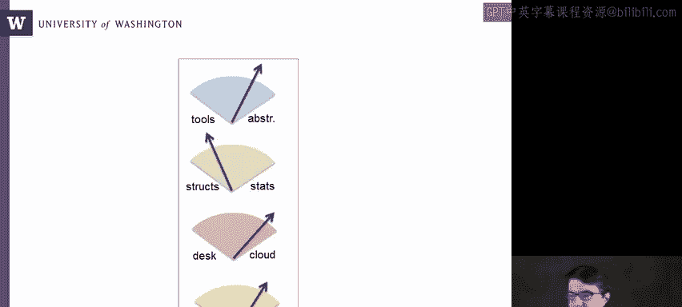

# 📊 课程1：数据科学的四个维度

在本节课中，我们将学习如何从多个维度理解数据科学这一领域。通过分析其广度、深度、规模与目标受众，我们可以更清晰地把握数据科学的核心要求与学习路径。

---

作为引言，请看来自Wey Data公司首席技术官Aaron Kimball的一段话。他表示，他担心数据科学家这个角色可能类似于90年代神话般的“网站管理员”。当时，网络公司知道他们需要在90年代中期接入互联网，但不知如何操作，于是他们说：“我们雇一个网站管理员，问题就解决了。”网站管理员需要为网站撰写所有内容、进行设计并管理用户体验、编写代码将网站与后端订单履行系统连接、实际构建页面并设计导航、进行必要的日志记录以确保网站持续运行并保持较高的可用性、设计用于存储通过网站提供的数据的模式等等。显然，期望一个人完成所有这些任务是不现实的。因此，互联网战略演变为需要一个更广泛的团队。

类似的情况可能正在数据科学领域发生。但对我而言，“数据科学”这个术语意味着：如果你是一名数据库管理员，且技能仅局限于关系数据库，那么当前趋势要求你学习更多关于非结构化数据和统计建模的知识。如果你是一名统计学家，你将需要学习处理无法装入内存的数据。如果你是一名习惯于直接构建系统和处理文件的软件工程师，你将需要学习一些统计建模知识，并学会如何向管理者传达你的结果；你需要处理这些数据集并实际使用它们来做出决策。如果你是一名接受过基于数据做出决策培训的业务分析师，你将需要开始更多地理解算法及其权衡，尤其是在大规模场景下。

这主要有两个原因。一是成本会根据你选择的技术而发生巨大变化，我们稍后会讨论云计算的发展以及这些算法的变化。你可能能够获得答案，但其成本可能与五年前大不相同。另一个原因是，随着我们越来越多地依赖算法进行“线控”业务（即我们越来越信任算法为我们做出某些决策），这些算法变成了不透明的黑盒。如果你不了解黑盒内部发生了什么，你很可能会误解结果。因此，不再安全的是简单地将信任完全交给某个算法，或者交给运行这些算法的员工。你可能需要自己理解并内化选择不同模型时的权衡。

---

以下是我喜欢用来描述这些不同课程的维度。

第一个维度是**广度**。我将广度分为**工具**与**抽象**。一门精深的课程可能倾向于侧重抽象，即希望传授超越任何特定实现的概念。然而，学生感兴趣的是能够获得使用工具的实践经验，这些工具他们明天在工作中就能用上。因此，这两者之间始终存在张力。例如，Hadoop（我们将讨论它）是名为MapReduce的抽象概念的一种实现，而MapReduce抽象概念本身当然超越了其在Hadoop中的特定实现。正如我将在下一部分提到的，我希望尽可能侧重抽象，但确保有作业能提供大家感兴趣的实践技能。

接下来是**深度**维度。我所说的深度是指**数据的结构性操作**与**数据的统计性操作**之间的区别。你可以将关系代数视为一种结构性操作的形式体系，而线性代数或许是进行数据统计操作的形式体系。在这里，我试图取得平衡，但实际上我更倾向于结构方面，我将在下一部分为这个立场进行辩护。

你可以思考的第三个维度是**规模**。规模的一端是数据可以**装入单台机器的内存**，另一端我称之为**云端**，意味着可能需要数百台机器来处理。我倾向于侧重云端，原因如前所述：不再能安全地假设数据能装入内存，并且只培训人们处理那种规模的数据是不够的。当你开始转向两台机器（更不用说一百台）时，整个世界都变了，如果不让你接触这种变化，将无法使你成为一名高效的数据科学家。

我使用的最后一个维度是**目标受众**，即面向**黑客**还是更面向**分析师**。这里的“黑客”指你已经拥有丰富的编程经验，并希望完善自己在某些数学领域的技能；而“分析师”则指更多是试图增加一些技术深度的技术决策者。在这里，我实际上喜欢取得平衡。我不希望本课程完全假设你是一名经验丰富的开发者，但我们也不能完全忽略编程。因此，我们将尝试在这两者之间取得平衡。

---

以下是我们为本课程做出的选择：我们倾向于侧重抽象，我们倾向于结构，我们明确侧重大规模，并且我说我们会取得平衡，但实际上我们更倾向于分析师一方。我们考虑到课堂上将会有不一定具有丰富编程经验的分析师。我已经收到很多人的邮件提问，他们说：“嘿，我平时不怎么做编程，我能从这门课中学到东西吗？”我认为答案是肯定的，尽管会有一些编程内容，所以请做好准备。

---

本节课中，我们一起学习了从广度、深度、规模与目标受众四个维度来剖析数据科学领域。我们了解到，成为一名高效的数据科学家需要在工具与抽象、结构与统计、单机与云端、编程实践与业务分析之间取得平衡。本课程的设计正是基于这些权衡，旨在为不同背景的学习者提供有价值的入门指导。