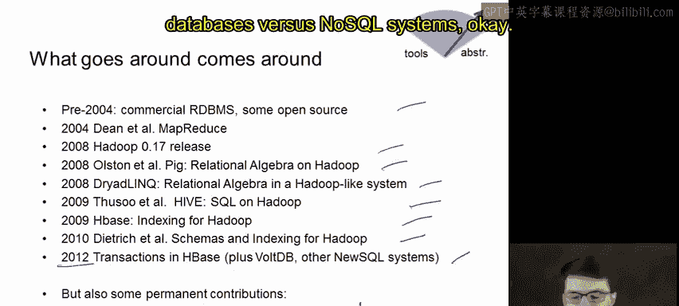
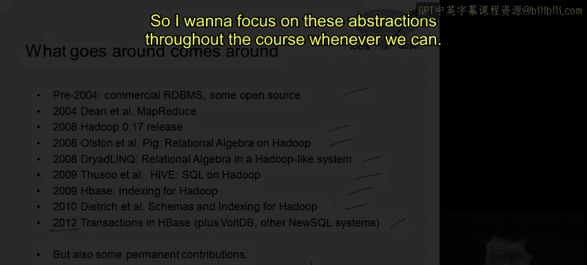

# 大规模数据科学（第1课/共3课） - P11：工具与抽象 🛠️➡️🧠

在本节课中，我们将探讨数据科学中的一个核心维度：**工具与抽象**。我们将通过回顾数据库技术的发展历程，来理解为什么掌握**抽象概念**比仅仅学习特定工具更为重要。

上一节我们介绍了课程的四个维度，本节中我们将重点讨论第一个维度：工具与抽象。

## 工具与抽象的维度

这个维度强调，我们应该关注**基础概念**，而非具体的工具。虽然许多学习者渴望获得实践经验，但理解底层原理至关重要。为了说明这一点，让我们回顾一下数据库领域的一个典型发展故事。

## 一个反复上演的故事：从关系型数据库到NoSQL

在2004年之前，数据库市场由三大商业关系型数据库供应商和一些开源方案（如MySQL和PostgreSQL）主导。

2004年发生了一个重大事件：Jeff Dean及其同事发表了关于Google **MapReduce** 的论文。MapReduce允许处理超大规模数据集，并重新定义了数据库的功能集。它专注于**横向扩展并行性**，而舍弃了传统数据库的其他功能。

这对许多人来说非常振奋，因为他们既无需处理不需要的数据库功能，也无需支付高昂的许可费用。MapReduce似乎是一个完美的解决方案。

几年后，基于该论文思想的**Hadoop** 开源实现出现了。

然而，有趣的是，Hadoop生态系统中最早期且最成功的项目之一，是一个名为 **Pig** 的系统。Pig本质上是Hadoop上的一个**关系代数**编程环境。关系代数是关系数据库的“秘密武器”。因此，在这个非关系型系统之上，早期就出现了对关系式编程的需求。

此外，还出现了其他竞争项目，如**Dryad** 和 **DryadLINQ**，它们也为大规模并行数据处理应用提供了面向关系代数的编程环境。

随后，人们甚至直接将 **SQL** 语言移植到了Hadoop之上。接着，Hadoop也开始引入**索引**、**模式**等传统数据库才有的更复杂功能。如今，**事务处理**也成为了NoSQL系统中一个非常重要的议题。

## MapReduce的持久贡献

这并不是说MapReduce毫无用处。它实际上做出了一些重要的持久性贡献，主要有三点：

以下是MapReduce带来的三个关键理念：

1.  **强调容错性**：其核心思想是，当你在数千台计算机上运行任务时，短时间内出现故障的概率极高。传统数据库通常无需担心此问题，因为它们假设查询通常很快，且并非运行在如此大规模的集群上。MapReduce强调在查询处理过程中的容错，确保工作不会因单点故障而全部丢失。
2.  **“读时模式”**：传统数据库要求数据必须符合预先定义的**模式**，否则无法处理。但很多数据（尤其是海量数据）并没有现成的模式。MapReduce的理念允许你在读取数据时再应用或推断模式，而不是在加载数据之前强制要求。
3.  **用户定义函数的更好实现**：虽然大多数数据库都支持用户定义函数，允许在SQL查询之外执行自定义代码，但编写和维护这些函数的体验并不好。MapReduce论证了可以直接为Java程序员等提供他们熟悉的编程环境（如Java），让他们能够编写可扩展的系统，而无需被迫使用数据库提供的复杂用户定义函数接口。

## 为什么抽象比工具更重要？

那么，我整体的观点是什么？如果我们过于关注**工具**，我们得到的只是某个时间点上重要工具的“快照”。我们会看到数据库的某些功能在流行度上起起落落，但它们在思考大规模系统时具有**持久的价值**。

同样，在关系型数据库与NoSQL系统的争论中，我们可能会迷失方向，看不清什么是真正新颖的。因此，在本课程中，我们将尽可能聚焦于这些**抽象概念**。

---

本节课中，我们一起学习了“工具与抽象”这一维度。通过回顾数据库技术从关系型到MapReduce再到NoSQL的演进，我们理解了掌握底层抽象概念（如容错性、读时模式、并行计算范式）的重要性，这远比追逐特定工具有更长远的价值。下一节，我们将继续探讨课程的其他维度。