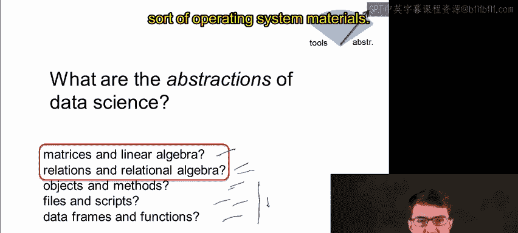

# 大规模数据科学（第1课／共3课）📊：桌面规模与云端规模

在本节课中，我们将探讨数据科学的核心抽象概念，并重点分析处理“桌面规模”数据与“云端规模”数据在思维方式与技术栈上的根本区别。

---

## 数据科学的抽象概念 🤔

上一节我们提到了关注抽象概念的重要性。那么，数据科学的抽象概念究竟是什么？

目前业界对此尚无明确定论。一个迹象是，人们常使用“数据柔术”、“数据整理”、“数据清洗”等模糊词汇来描述数据科学家的核心技能。这实际上意味着，我们尚未清晰地定义所谈论的内容。

如果必须列举数据科学的潜在抽象概念，可能有以下候选方案：

*   **万物皆矩阵**：这种观点认为，一切数据操作都可归结为矩阵运算和线性代数表达式。这是一个有效的视角。
*   **万物皆关系**：这种观点认为，数据处理主要是关系代数的各种变体，可能辅以用户自定义函数。即使你经常使用数据库，也可能不熟悉关系代数，但我们后续会讨论。我认为这是一个有潜力的、用于处理数据的通用抽象。
*   **万物皆对象**：对于熟悉面向对象编程的人而言，世界可以通过对象、消息传递和方法调用来建模。这也是一种候选方案。
*   **万物皆文件**：这种观点认为，一切数据都存储在文件中，我们通过编写脚本（例如Perl或R）来处理这些文件。系统管理员可能更倾向于这种视图。
*   **万物皆数据框**：这是R语言的核心数据模型，即数据框及对其操作的函数。

在以上所有候选方案中，我认为前两种（**矩阵**和**关系**）最值得我们关注。原因是它们最专注于我们处理数据（尤其是大规模数据）时要执行的任务本质。其他抽象则更侧重于代码组织或操作系统层面。

---

## 桌面规模与云端规模 ☁️ vs 💻

现在，让我们来探讨桌面规模与云端规模的区别。主张“桌面规模”的观点认为，数据科学的核心是函数、统计和操作技术，因此可以将大规模数据处理归入另一门课程或类别，而只专注于数学和函数。

然而，在数据科学课程中忽略规模问题是一个错误。原因在于，**规模是整个技术类别的根本限制**。以R语言为例，在其基本用法中，你需要将整个文件读入单台机器的内存，然后对其调用函数。如果你的数据无法放入单台机器的内存，你就无计可施。

当然，你可以通过使用索引来限制需要访问的数据，或者尝试利用现代计算机多核特性进行并行处理。但自己费心实现这些技巧，忽略了这些技术早已在其他系统中被深入理解并实现的事实。

因此，**认知其他系统的能力，并灵活利用这些已具备可扩展性的系统来编写应用程序，是数据科学的一项关键技能**。

本幻灯片中的一个例子（虽已过时，但能说明问题）是`grep`工具。`grep`用于在文件中搜索特定模式，但它是线性扫描文件，逐行检查。对于超大规模数据集，这种线性扫描不再可行，必须采用更智能的搜索方式。

**核心观点是：大规模数据不仅仅是“更大”，它是“不同”的。** 它要求以不同的方式思考技术，并要求一套不同的技术栈。在数据科学课程中忽视这一点是错误的。

---

## 总结 📝

本节课我们一起学习了数据科学的几种潜在抽象概念，并重点比较了处理桌面规模数据与云端规模数据的根本差异。我们认识到，面对大规模数据时，不能仅仅依赖单机内存计算，而需要了解和利用那些原生支持分布式、可扩展的技术栈与思维方式。这是成为一名有效的数据科学家必须掌握的维度。