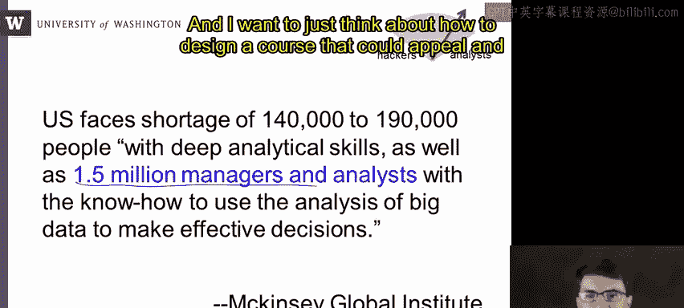

# 课程1：大规模数据科学（大数据操作） - 黑客与分析师 🧑‍💻 vs. 👨‍💼


在本节课中，我们将探讨数据科学领域中的一个重要维度：参与者所需的技能背景，即“黑客”与“分析师”的区别。我们将理解为何数据科学活动需要不同类型的人才，以及技术如何帮助降低参与门槛。

---

上一节我们讨论了数据科学的其他维度，本节中我们来看看参与者技能背景的差异。


这个最终的维度是关于黑客与分析师的对比。这里的意思是，参与这门数据科学课程以及一般的数据科学活动，是否需要深厚的编程能力？答案是否定的。我认为我们至少需要两种类型的人，实际上是一个广泛的人才谱系。这并非我的原创想法，麦肯锡全球研究所的一份经常被引用的报告也提到了这一点。

你会反复看到这段引述，但引用者往往只关注第一部分，该部分提到了需要14万到19万名具备深度分析技能的人才。然而，引述的第二部分指出，你还需要150万名经理和分析师，他们懂得如何利用大数据的分析来做出有效决策。

这意味着，在这个领域工作的将不仅仅是程序员。因此，我希望思考如何设计一门课程，能够同时吸引并启发这两类人。



---

上一部分我们提到了两类人才的需求，接下来我们看看为何这种界限正在模糊。


这是本部分的最后一张幻灯片。我认为存在“黑客与分析师”之分的另一个原因是，如今他们之间的界限正在变得模糊，而技术实际上可以在这方面提供帮助。在某些情况下，操作大型数据集甚至不需要计算机科学的博士学位或学士学位。

为了支持这一观点，我举一个我工作中的例子。我们曾致力于让数据库对生物学家等用户更易使用。下面是一个非常复杂的SQL查询，如果你仔细看，会发现它实际上是在对基因序列进行区间运算。

```sql
-- 示例：一个进行基因序列区间运算的复杂SQL查询
SELECT ... FROM ... WHERE ... -- （此处代表复杂的查询逻辑）
```

即使对专家而言，这也是一个相当难理解的查询。然而，这个查询是由一个完全不做任何编程的人编写的。她不写Python，不写Perl，也不写R，但她能够编写这些处理庞大数据集的SQL查询。

这个事实表明，如果你理解正在发生的事情，能够用一些抽象概念进行思考，并且足够了解你的问题，那么即使没有深厚的软件工程背景，你也可以参与操作大型数据集和进行数据科学的活动。这就是为什么我希望将指针向这个方向（分析师一侧）推动一些。

我可能把它放在中间。我并非只关注分析师，我只是想确保他们被包含在内。

---

本节课中，我们一起学习了数据科学中“黑客”与“分析师”角色的区别。我们了解到，数据科学需要具备深度分析技能的专业人士，也同样需要懂得利用分析结果进行决策的管理者和分析师。同时，现代技术正在降低数据操作的门槛，使得更多领域专家能够直接参与数据科学工作。下一节课，我们将探讨最后一个维度。