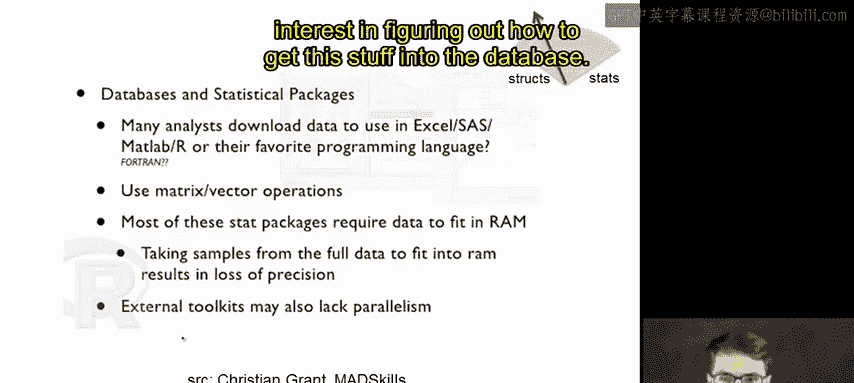

# 杜克大学《大规模数据科学》第1课：结构与统计 📊

在本节课中，我们将要学习数据科学中一个核心的权衡维度：“结构”与“统计”。我们将探讨为什么数据操作（处理数据结构和格式）在实际项目中往往比复杂的数学模型更为基础和重要。

---

上一节我们介绍了描述本课程设计理念的四个维度中的三个。本节中，我们来看看最后一个维度，即我所说的“结构”与“统计”。

这指的是**数据操作**与**深层数学**之间的相对重要性。你可以看到，我在这里将“指针”稍微偏向了左侧（即数据操作）。在接下来的几分钟里，我将尝试解释这样做的动机。

我们已经在第一段中看到了一个例子。当时我列举了一些数据科学的近期实例，其中之一是**内特·西尔弗对2012年美国总统选举选举人团票数的预测**。如果你还记得，这个预测本质上是通过**计算每个州民意调查的平均值**来实现的。它并不需要一个复杂的统计模型，却产生了巨大的影响。

以下引言很好地总结了这一点，它来自Weebi数据公司的**亚伦·金博尔**。他说：“**80%的分析工作实际上只是求和与平均**。”他的意思是，如果你能正确地完成这些求和与平均，并且能在任何规模、任何数据上做到这一点，那么你总是可以在此基础上构建更高级的技术。一切最终都可以归结为求和与平均。

我认为这解释了为什么关注数据操作如此重要。数据操作通常与表达求和和平均值的能力相关，例如，在数据库查询中就能做到这一点（我们将在接下来的几节课中讨论）。掌握这些，你就能解决80%的问题。

另一种看待这个问题的方式是，一个数据科学项目主要涉及三项任务。以下是这三项任务：

*   **准备运行模型**：包括收集、清理、整合、重构、转换、加载数据等。
*   **运行统计模型**：选择并执行实际的统计模型。
*   **解释与传达结果**：将结果可视化、沟通和解释。

我从与亚伦·金博尔的交谈中得知，**80%的工作实际上都集中在第一步**，即处理数据。这里列出的所有动词（收集、清理等）都是困难的部分。实际上，选择模型甚至运行模型在实践中往往不会让人彻夜难眠。

这里的玩笑是，另外的“80%”工作（暗示数据科学的工作量是正常的180%）在于解释结果，即结果的可视化、沟通和解释。

这就是为什么在本课程中，我想重点关注与这第一项任务相关的**数据操作任务**。

还有另一个原因支持这个重点。以下是看待这个问题的另一种角度，引用自**道格·莱尼**。这份大约12年前的文献首次提出了大数据的“3V”概念（体量、速度、多样性）。他写道：“**有效数据管理的最大障碍将是不兼容的数据格式、非对齐的数据结构和不一致的数据语义。**”数据库领域（也就是我的领域）称之为**数据集成问题**。他认为这是最困难的部分。他在2001年这样说，而我认为这在今天仍然成立。在“3V”的背景下，他指的是“多样性”比“体量”或“速度”更难处理。我们将在后续章节中详细解释这些“V”的含义。

好了，另一个小插曲是我们喜欢询问与我们合作的科学家（天文学家、海洋学家和生物学家）的问题。我们会非正式地问他们，他们花费多少时间在“处理数据”上，而不是在“做科学”上。我们让他们自己理解这两个引号的含义。对他们来说，“做科学”绝对包括选择统计方法或设计统计模型。而“处理数据”指的是所有其他杂事，比如格式转换等等。你认为最常见的答案是什么？你可以先猜一下。

他们甚至不假思索，给出的答案通常是**90%**。这个数字应该引起我们的深思。纳税人的钱通过联邦资助机构拨给博士后研究员，而她却要花费90%的时间去做她甚至不认为是科学的事情。因此，我认为作为数据科学家，专注于解决这个问题至关重要。

你可能会说，这只是科学领域的情况。那么商业领域呢？但正如我将在整个课程中试图阐明的，商业和科学领域正在发生的事情之间，**一致性正日益增强**。我们将在后续章节中更多地讨论这一点。

如果90%的问题在于处理数据，那么，天哪，我们确实应该在这方面投入大量精力。

好了，另一个论点延续了我展示的第一张幻灯片的内容，即“结构”——特别是数据操作平台和数据库——实际上在表达更高级的内容方面也能发挥很大作用。这不仅仅是“如果你有求和与平均，你就能表达任何东西”的问题。即使是**相当先进的技术**，人们也越来越有兴趣研究如何将它们融入数据库。

---

**本节课总结**

在本节课中，我们一起学习了数据科学中“结构”与“统计”的权衡。我们了解到，基础的数据操作（如求和、平均）和数据处理任务（收集、清理、整合）在实际项目中占据了绝大部分（约80%-90%）的工作量和重要性。复杂的统计模型固然重要，但构建模型的基础——干净、结构良好的数据——往往是更大的挑战和成功的关键。因此，本课程将重点关注数据操作和管理的技术与原理。