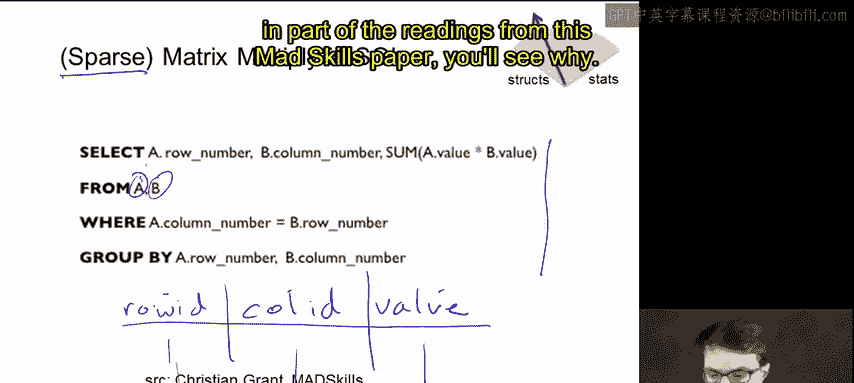

# 大规模数据科学（大数据操作，第1课／共3课） - P15：14_结构与统计（续） 📊➡️🗄️

在本节课中，我们将探讨传统统计工具在处理大规模数据集时面临的挑战，并了解数据库系统如何提供一种可扩展的替代方案。我们将通过一个具体的例子——在SQL中表达矩阵乘法——来展示数据库在处理特定计算任务时的潜力。

---

上一节我们讨论了数据结构和统计的关系，本节中我们来看看当数据规模超出单机内存容量时，传统统计工具面临的困境。

这张幻灯片引用了Christian Gr的观点。他指出，如果对比数据库和SAS、MATLAB、R或SPSS等统计软件包，会发现一个常见做法：用户经常需要将数据下载到他们偏爱的统计软件中使用。他们通常认为这是理所当然的，甚至是唯一能有效表达分析的方式。

大多数统计软件包的第一步操作是从磁盘读取数据并将其加载到内存中，然后开始调用函数进行处理。然而，越来越多的数据集根本无法装入单台机器的内存，尤其是在个人笔记本电脑上。

面对这种情况，通常有几个选择：
*   转向这些工具的某种高级集群版本（例如SPSS和MATLAB有此类版本，但通常价格昂贵）。
*   对数据进行采样，只处理能够装入内存的子集。这种做法非常普遍，几乎成了标准流程。

但关键在于，如果使用不同的工具包，这种限制并非必需。这里的论点是，如果你能使用数据库，并学会如何在数据库中执行你的任务，你就能免费获得可扩展性。

此外，这些统计工具包本身不一定具备并行处理的概念。如今购买的机器至少拥有四个核心，可能更多，如8个、12个甚至16个。能够利用所有这些核心来处理问题是你在选择一个工具包时会寻求的特性，而这是数据库可以自动完成的。虽然并非所有数据库都支持（例如你可能熟悉的MySQL和PostgreSQL通常不支持），但其他数据库可以，我们后续会详细讨论。

因此，如果你能使用数据库，就可以免费获得并行处理能力，以及超越主存大小的可扩展性。当然，这或许是一个很大的“如果”，我们也会讨论这一点。

---

现在，让我给你举一个例子，这实际上也是你们作业的一部分。问题是：你能用SQL表达矩阵乘法吗？如果可以，那么我认为，任何能用矩阵乘法表达的公式，或许都可以通过反复应用SQL来实现。答案是肯定的，而且最简单的版本相当直接。

如果你从未见过SQL，不用担心，我们稍后会详细讲解。如果你熟悉SQL，请耐心听我解释。假设你有两个矩阵A和B。

这里，每个矩阵的表示形式是一个关系，包含行ID（`rid`）、列ID（`cid`）和值（`value`）。如果你的矩阵是稠密的，这是一个非常低效的关系表示。让我解释一下原因，你也可以再思考一下。

一个隐式的表示只需要存储值本身。例如，一个5行6列的矩阵只需要30个值（5 * 6）。但在这里，你需要存储30个行ID、30个列ID和30个值，相当于将数据大小增加了约三倍。那么为什么要这样做呢？

实际上，很多现实中的矩阵是**稀疏的**。在稀疏矩阵中，并非所有单元格都有值，因此你不需要存储它们。这种显式存储行ID、列ID和值的表示方式，在这种情况下反而非常高效。事实上，稀疏矩阵求解器内部使用的正是这种表示。

因此，如果你有一个稀疏矩阵，并在数据库中以此形式表示它，那么表达矩阵乘法就不算太难。你需要做的是：对于矩阵A中的每个列号，找到矩阵B中对应的行号，然后对所有贡献值进行求和。稍后我会展示一个示意图。

实际上，我现在不打算深入太多细节，因为在布置相关作业时，我会详细讲解。现在，我希望你记住的关键点是：在数据库中表示矩阵听起来很不寻常，但这实际上并非一个糟糕的想法。通过阅读“Mad skills”论文的部分内容，你会明白原因。目前，你只需要知道这是可以做到的，并且不一定是个坏主意。

---

本节课中我们一起学习了传统统计软件在处理大数据集时的局限性，以及数据库系统如何通过其并行处理和磁盘存储能力提供可扩展的解决方案。我们还初步探讨了在关系数据库中表示和操作矩阵（即使是复杂的运算如矩阵乘法）的可能性，这为在数据库内执行更广泛的统计计算打开了思路。