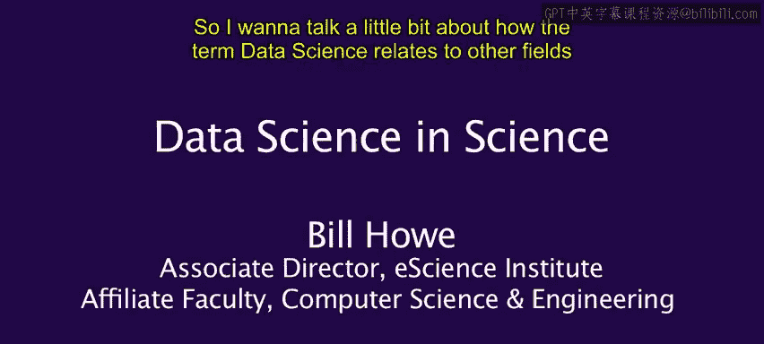
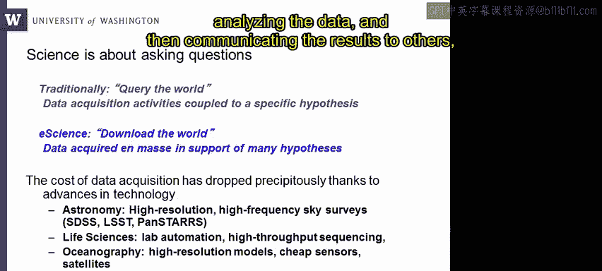

# 课程1：大规模数据科学（大数据操作，第1课／共3课） - P16：科学的第四范式 🧪➡️💻

在本节课中，我们将探讨“数据科学”这一术语如何与其他科学领域相关联，并重点介绍“电子科学”的概念。我们将回顾科学探究方法的演变历程，并理解大规模数据分析如何成为现代科学研究的“第四范式”。

---

## 科学的四种探究范式

数千年来，科学探究一直是经验性的。科学家观察自然世界，或在实验室的受控环境中复现自然现象，并据此进行观察记录。

在过去的几百年里，科学界接受了理论模型作为一种有效的探究方法。新理论会启发新的实验，而理论本身则有助于解释从实验中获得的观测数据。

---

## 计算模拟的兴起

大约在过去的50年里，高性能计算催生了一种全新的科学探究方法。科学家可以在计算机中模拟那些无法直接观测、也无法在实验室复现的现象。即使理论模型变得过于复杂，无法用纸笔解析求解，也可以从初始条件开始运行模拟来获得结果。

这种方法被应用于恒星内部、板块运动、宇宙演化或物种灭绝对生态的影响等领域。

---

## 第四范式：数据密集型科学

至此，我们介绍了三种探究方法。但在过去十年左右，出现了可以被认为是第四种科学探究的方法。

这种方法是从仪器或模拟中获取海量数据集，然后使用新算法和新基础设施来探索这些数据集。电子科学的核心正是处理大规模且复杂的数据，其数据量之大，以至于必须依赖自动化或半自动化分析，无法直接人工检视。

以下是电子科学（或数据科学）所涉及的相关工具：
*   **数据库**
*   **数据可视化**
*   **横向扩展计算**
*   **NoSQL系统**
*   **机器学习技术**
*   **网络服务**

---

## 从“先提问”到“先获取数据”

关于这第四范式，阅读清单中的一本书和一些文章有详细论述。这个故事有多种讲述方式，我倾向于从“提问”的角度来理解。

传统上，科学一直是关于向世界提问。数据采集活动（实验或实地研究）通常与非常具体的假设紧密相连。科学家先有问题，然后去收集数据。

然而，电子科学在一定程度上改变了这一模式。现在，科学家常常先大规模地下载数据，将世界“存入”计算机的某种表示形式中，然后通过查询这个数据库来检验假设。在某些情况下，数据的获取可以独立于任何特定假设。

---

## 数据爆炸与分析瓶颈

这种转变部分源于数据获取成本的急剧下降。例如，现代望远镜能以极高分辨率获取海量数据；生命科学领域的实验室自动化和高通量测序技术；海洋学中越来越便宜的传感器。

得益于摩尔定律和计算技术的进步，模拟运行的规模和分辨率越来越高，从而产生越来越庞大的数据。数据产生的速度已远远超过我们分析数据或提出相关问题的速度。

因此，**发现、整合、分析数据并将结果传达给他人的成本，成为了新的瓶颈**。这个故事听起来应该与我们一直在讨论的数据科学的核心挑战非常相似。

---

## 总结

本节课中，我们一起学习了科学探究方法的演变：从**经验观察**，到**理论建模**，再到**计算模拟**，最终发展到今天的**数据密集型科学（第四范式）**。我们理解了电子科学与数据科学在工具和挑战上的共通性，并认识到在数据爆炸的时代，如何高效地管理和分析海量数据已成为推动科学发现的关键。