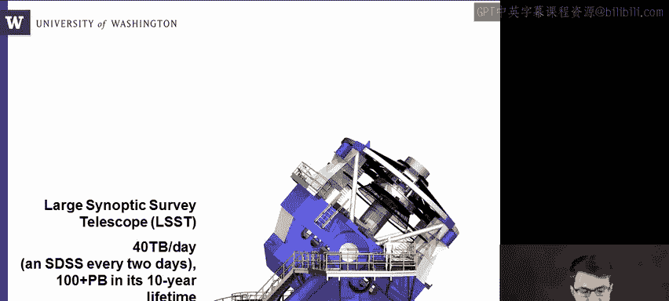
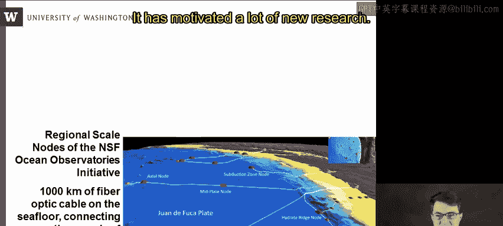
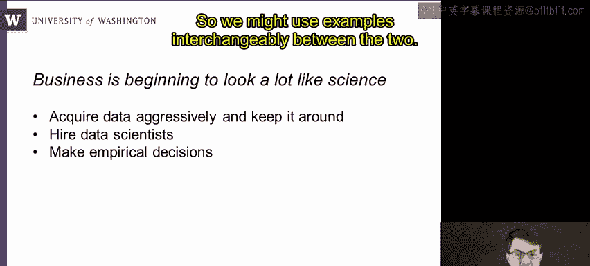

# 大规模数据科学（大数据操作，第1课／共3课）🚀

## 概述

在本节课中，我们将要学习数据密集型科学（E-Science）的几个具体实例，并探讨其带来的挑战。这些实例展示了科学领域如何从数据匮乏转向数据丰富，以及由此催生的新技术和研究方向。我们还将看到，商业领域的大数据挑战与科学领域正变得越来越相似。

---

## 数据密集型科学实例

上一节我们介绍了数据密集型科学的背景，本节中我们来看看几个具体的领域实例，它们都面临着传统技术栈难以应对的挑战。

### 大型综合巡天望远镜（LSST）🔭

问题在于，同样的技术栈，甚至在某种程度上同样的方法，都难以应用于大型综合巡天望远镜这个案例。

这个望远镜产生如此多数据的原因，不仅在于其分辨率更高、能观测到天空更深的区域，还在于它会频繁地（每三天）返回天空的同一位置进行观测。这使得科学家能够研究随时间变化的天体，例如小行星、彗星或超新星等。

通过比较这些时间序列中的图像，科学家可以提出各种新的科学问题。

因此，无论是出于其科学目标、巨大的数据规模，还是数据采集细节的复杂性，之前的解决方案都已不再适用。这推动了一个全新研究领域的诞生，旨在研究支持此项目的数据管理技术和数据分析技术。

### 生命科学🧬

在生命科学领域，这些高通量测序仪在连续运行时，每天能够产生数TB的数据。从事此项工作的主要实验室，例如联合基因组研究所，同时运行着25到100台这样的机器，持续不断地产生海量数据。

这些机器处理各种样本，可能是单个生物体，甚至是来自环境的样本（其中并不存在某个特定的生物体，而是整个种群）。出于多种用途，这些设备能够输出大量数据。

### 海洋学🌊

在海洋学领域，美国国家科学基金会海洋观测计划（OOI）的区域尺度节点是一个由华盛顿大学领导的项目。海洋观测计划是一个多机构合作项目，其区域尺度节点部分由华盛顿大学负责运行。

该项目在海底铺设了长达1000公里的光纤电缆，连接了数千个化学、物理和生物仪器。

以下是连接的传感器类型：
*   数千个化学、生物和物理传感器。
*   包括来自海底的实时视频，用于监测火山活动。

同样，支持这项努力所需的数据集和数据基础设施非常庞大，这并非一个关系型数据库能简单应对，也因此推动了大量新的研究。

### 信息空间与网络🌐

在信息空间领域，有大量科学研究可以直接在网络本身上进行。仅就网络而言，一台计算机每秒可以从一个磁盘读取30到35兆字节的数据，这意味着仅仅读完整个网络的内容就需要大约四个月的时间。

总结一下，E-Science是关于数据分析的科学，即从海量数据中自动或半自动地提取知识。因此，寻找答案的主要工具是算法和技术，而非直接的人工检查，因为数据量太大，人力无法逐一审视。

---

## 大数据的三V特征

但挑战不仅仅在于数据量，正如我们将在下一部分讨论的。这也与商业领域正在发生的事情紧密相连，即“大数据”概念及其“三V”特征。我们下次会详细讨论，但在此先简要提及。

以下是“三V”的具体含义：
*   **数据量（Volume）**：指数据的行数或字节数，即纯粹的规模。
*   **多样性（Variety）**：可能指列数或维度数。例如在生命科学中，许多实验需要访问多个公共数据库、多个传感器、自己收集的数据以及同事的数据。将这些数据整合在一起的任务是一个重大瓶颈，即使数据本身的规模不一定特别大。这就是数据的复杂性。
*   **速度（Velocity）**：正如我们在大型综合巡天望远镜案例中看到的，尽管规模本身已经巨大，但每两天收集40TB数据的事实意味着基础设施需要跟上这个速度。仅仅将数据从望远镜设施传输到数据分析设施就是一项工程挑战。

你还会看到其他“V”，例如**真实性（Veracity）**——我们能否真正信任这些数据？关于这些，我们下次再详谈。

---

## 总结与商业领域的关联

本节课中我们一起学习了数据密集型科学的多个实例及其核心挑战。

总结来说，科学正在经历一代人的转变：从数据匮乏（永远没有足够的数据）转向数据丰富（数据多到不知如何处理）。因此，数据分析已经取代数据采集，成为科学发现的新瓶颈。问题不在于出去获取数据的成本，而在于分析已有数据的成本。

但这与商业领域（可能也是许多同学的背景和兴趣所在）有什么关系呢？我们看到，商业领域正开始变得与科学领域长期以来的情况非常相似。

以下是商业与科学的趋同点：
*   企业正在积极地获取数据并无限期地保存，以备将来之用。
*   它们开始招聘拥有类似科学领域长期重视的技能组合的人才，特别是数学深度。
*   它们开始基于这些数据做出非常经验性的决策，总是希望用基于数据的清晰案例来支持每一个决定。

因此，我认为可以将科学中获得的经验教训应用于商业，反之亦然。因为科学在一个方面落后于商业，那就是对技术的采用。科学领域在IT基础设施上的投入比例远低于商业领域。所以，现在正是两个领域思想交叉融合的大好时机。

回到我展示的第一张幻灯片，**E-Science（数据密集型科学）和数据科学本质上拥有共同的一切**。因此，我们可能会在两者之间互换使用示例。