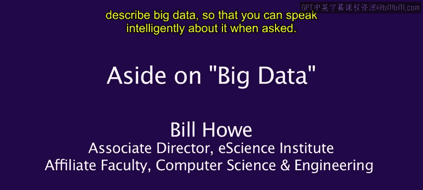
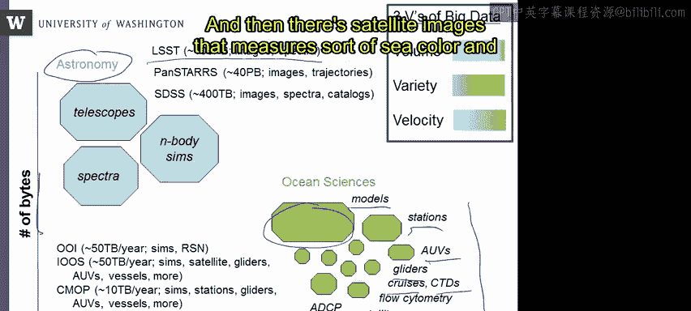

# 课程1：大规模数据科学（大数据操作，第1课／共3课） - 🧠 理解大数据与3V

在本节课中，我们将要学习“大数据”这一概念的核心内涵，特别是被称为“3V”的三个关键维度。掌握这些术语将帮助你在讨论大数据时，能够清晰、准确地表达自己的观点。

---

## 📊 大数据的3V概念

上一节我们提到了大数据，本节中我们来看看描述大数据时最常被提及的“3V”模型。这“3V”分别是：**数据量（Volume）**、**处理速度（Velocity）** 和 **数据多样性（Variety）**。

以下是这三个维度的详细解释：

1.  **数据量（Volume）**
    *   含义：指数据的规模大小。
    *   衡量方式：可以用字节数、数据行数、对象数量等来表示。这本质上是数据的“垂直”维度，即数据的多少。

2.  **处理速度（Velocity）**
    *   含义：指数据处理的速度与数据活动需求之间的延迟关系。
    *   核心：它关注的是数据产生的速度与需要被消费（处理）的速度之间的匹配度。在许多应用中，交互式的响应时间变得越来越重要。当处理速度成为瓶颈和挑战时，这个维度就变得尤为关键。

3.  **数据多样性（Variety）**
    *   含义：指数据来源和格式的多样性。
    *   挑战：对于任何特定任务，需要整合的数据源类型越来越多。例如，你可能需要同时处理ASI文件、从网络下载的数据、从传统数据库提取的数据以及来自NoSQL系统的数据等。整合这些异构数据源是一个重大问题，往往会耗费大量时间。之前提到的研究人员将90%的时间花在“处理数据”上，其中大部分时间就消耗在应对数据多样性上。

在数据科学任务中，这三个维度都至关重要。

---

## 🌌 不同科学领域的3V挑战

为了更直观地理解3V，我们可以通过一个坐标系来观察不同科学领域面临的挑战。这个坐标系以**数据量（字节数）** 为Y轴，以**数据源多样性（如单表中的列数、跨多表的列数或不同数据源的数量）** 为X轴。

通过这个坐标系，我们可以将不同研究领域或问题映射出来：

*   **天文学**：主要挑战在于**巨大的数据量（高Y轴）**。例如，大型综合巡天望远镜等基础设施能产生数百PB的数据。然而，其数据源类型相对较少（低X轴），主要是望远镜、光谱图像和星系模拟。
*   **海洋科学与生命科学**：主要挑战在于**极高的数据多样性（高X轴）**。虽然其数据总量可能不及天文学，但用于采集数据的仪器类型繁多且不断增长。
    *   例如在海洋科学中，数据来源包括：
        *   **滑翔机系统**：可长时间在水下巡游，在四个维度（X, Y, Z, T）上采集数据。
        *   **自主水下航行器**：用于短期任务，观测更精细尺度的现象。
        *   **海洋考察航次**：使用温盐深仪等设备，在固定水平位置、不同深度和时间进行剖面测量。
        *   **数值模型**：尺度范围很大，从整个北半球模型到特定海湾、河口模型，多样性很高（因此在图中用较大的圆圈表示）。
        *   **固定观测站**：在固定位置部署传感器进行时间序列测量。
        *   **声学多普勒流速剖面仪**：利用声波测量海水流速剖面。
        *   **卫星图像**：测量海色、波浪破碎等现象。

图中每个领域图标的大小，代表了它在这个“数据量-多样性”空间中所占据的范围。

---

本节课中我们一起学习了描述大数据的核心框架——“3V”模型，即**数据量（Volume）**、**处理速度（Velocity）** 和 **数据多样性（Variety）**。我们还通过不同科学领域的例子，看到了这些维度如何在实际研究中构成不同的挑战。理解3V是进行大规模数据操作和分析的重要基础。