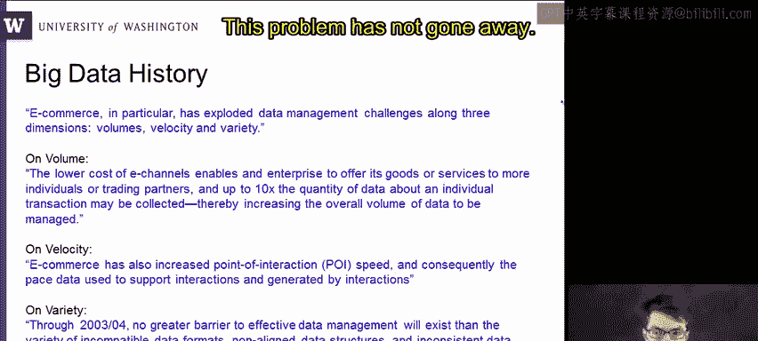

# 课程1：大规模数据科学 - 第1课：大数据定义 📊

在本节课中，我们将学习“大数据”这一核心概念的定义、历史背景及其关键特征。我们将探讨为何“大”是相对的，并理解数据管理中的实际挑战。

---

上图展示了数据在**规模**与**多样性**两个维度上的分布。蓝色区域可能代表**高数据量但多样性相对较低**的数据集，而绿色区域则代表其他组合。这个例子来自科学领域，但同样适用于企业问题。

很多时候，企业面临的问题可能是整合数百个电子表格。即使数据总量不大（例如少于10,000行），这个过程也可能耗时三周。相比之下，一个数百TB的数据仓库，其真正的挑战在于管理它所需的基础设施。

---

## 什么是大数据？ 🤔

上一节我们看到了数据管理的复杂性，本节中我们来看看“大数据”这个术语更精确的含义。

加州大学伯克利分校的Mike Franklin提出了一个我认同的观点：**大数据是相对的**。它指的是**任何管理成本高昂且难以从中提取价值的数据**。因此，“大”并不取决于一个特定的数据量阈值（例如，PB级算大，TB级算小，GB级因为能放入机器内存就算很小）。关键在于你试图用数据做什么，以及你拥有什么样的资源和基础设施来处理问题。

从某种意义上说，“困难的数据”或许才是大数据的真正含义。重点不在于“大”，而在于其带来的**挑战性**。记住“大是相对的”这一点非常重要。

关于这一点，我想再补充一点。在许多大数据领域的演讲中，人们常常倾向于抛出最大的数字，例如“我们数据库里有60 PB数据”或“我们的仪器每晚收集40 TB数据”。单凭这些数字本身并不能传达真正的挑战是什么。如果你能通过简单方法立即将数据规模缩减到更小、更易管理的程度，那么这可能并不是一个巨大的挑战。所以，再次强调，**“大”是相对的**。

---

## 术语的历史 📜

前面我们讨论了“大数据”的现代定义，现在让我们追溯一下这个术语的历史。

我能找到的最早概念来自1989年的Eric Larson。他在《Harper's》杂志（后来收录到一本书中）写道：“大数据的守护者说他们是为了消费者的利益，但数据总有办法被用于最初意图之外的目的。”他的观点完全与技术无关，只是指出数据被收集用于一个目的，却被重新用于另一个目的——这是我在本课程最开始部分提到并会反复回归的一个主题。

我认为他这个观点是正确的。他真正的重点是关于消费者隐私数据开始被商品化，这在当时是绝对正确且相当有先见之明的，因为如今这已成为一个大问题。尤其令人印象深刻的是，这发生在互联网兴起之前，却已经预示了大数据中非常热门的问题，如**伦理、隐私和敏感性**等，我们稍后会讨论一些。但这并不完全是我们现今所说的大数据含义，因为它缺乏技术层面的讨论，没有涉及**实际管理这些数据集的挑战**。

---

## 3V模型：现代定义 🎯

了解了历史背景后，现在我们来看看当今更常用的大数据定义框架。

另一个参考点是近年来一些咨询公司提出的**3V模型**，但真正的源头是Gartner公司在2001年由Doug Laney撰写的一份报告。我们谈到了**规模、速度和多样性**，但让我给你机会看看这些引述。

以下是报告中关于三个维度的核心描述：

*   **规模**：他主要谈论企业对企业。考虑到2001年左右是互联网泡沫时期，人们试图弄清楚这个新技术时代、互联网除了向客户提供网页之外，还能带来什么，如何与供应链或供应商互动。报告中提到：“**关于单笔交易，可能收集多达10倍的数据量**。”这绝对正确，我们多次提到的“数据废气”正在导致收集的数据规模越来越大。
*   **速度**：报告指出“**提高了交互点的速度**”。这就是对**交互性**的需求，过去并不那么必需，但随着所有业务和交易速度的提升，处理它们的基础设施所面临的约束也增加了。
*   **多样性**：我非常喜欢这一点。报告预测（直到2003-2004年）：“**有效数据管理的最大障碍将是各种不兼容的数据格式、未对齐的数据结构和不一致的数据语义。**”这说得太好了。他即使说这是直到2015年的情况，也 arguably 是正确的。**这个问题至今仍未消失**。

---

## 总结 📝

本节课中，我们一起学习了“大数据”的定义。我们明白了“大”是一个**相对**的概念，核心在于数据管理的**难度和成本**，而非绝对的数据量。我们回顾了该术语从1989年侧重于**数据重用与隐私**的早期概念，发展到2001年Gartner报告提出的现代**3V模型**——即**规模、速度和多样性**。理解这些维度有助于我们把握大数据带来的真正挑战，尤其是在数据格式、结构和语义的多样性方面，这仍然是当今数据管理的关键障碍。