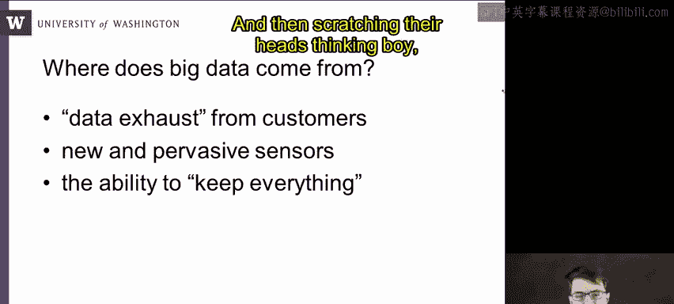
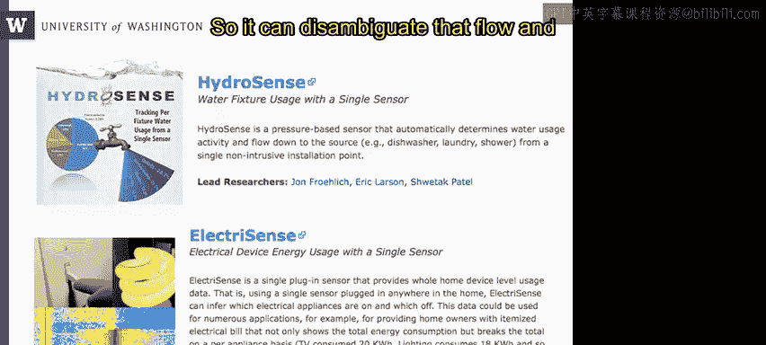

# 大数据操作（第1课/共3课）📊：大数据来源

在本节课中，我们将学习“大数据”这一概念的历史背景、其核心挑战，以及大数据的主要来源。我们将探讨技术瓶颈如何推动大数据领域的发展，并了解数据是如何通过现代传感器和系统被大量收集的。

---

## 大数据的历史背景与挑战

上一节我们提到了“大数据”这一术语的演变。本节中，我们来看看其发展历程中的一个关键观点。

约翰·马西（John Masey）曾提出，大数据将成为下一代基础设施压力的主要来源。他认为，技术的真正推动力来自于我们感受到“痛点”的地方，而当时的瓶颈在于**输入/输出（I/O）接口**。

具体来说，磁盘容量正在飞速增长，但**数据读取的延迟**并未同步提升。公式可以简单表示为：
**数据增长速率 >> 数据访问速率**

这意味着，虽然我们可以廉价地存储海量数据（例如购买一块3TB的硬盘），但要从头到尾读取这块硬盘上的所有数据，可能需要数小时。因此，我们虽然能“保存”数据，却难以有效地“处理”数据，因为数据传输的“管道”太窄了。

约翰·马西的论点围绕着一个核心：大规模的数据及其处理将成为基础设施的应力点。尽管他认为“大数据”是一个通用术语，自己并非其首创者，但他早期的论述确实精准地预示了当今大数据处理的核心挑战。

---

## 大数据的当代意义与价值

上一节我们讨论了技术瓶颈，本节中我们来看看大数据在当今时代的核心价值。

大数据处理的必要性和从中提取信息的渴望，已成为所有科学领域乃至商业领域的**关键主题**。可以说，它是我们这个时代的核心科学议题之一。

其核心价值在于：**从大数据中提取价值**。无论是在科学研究还是商业决策中，关键问题都是如何“解锁”大数据中隐藏的信息。

---

## 大数据的三大来源

理解了大数据的重要性后，我们来看看这些海量数据究竟从何而来。大数据主要有三个来源：

以下是数据来源的具体分类：

1.  **客户数据废气**
    企业如今追踪的客户交互信息远多于过去。这不仅仅是记录订单，还包括监控点击流、广告点击率、广告位置的影响，以及订单在系统中流转的精确时间日志。本质上，企业与客户的每次互动细节都被记录下来，从而产生了用于研究的庞大数据集。

2.  **新型普及化传感器**
    新出现的、无处不在的传感器使我们能够获取以往无法看到的数据源。这不仅仅适用于科学研究，在商业中同样如此。

3.  **数据存储技术的进步**
    磁盘容量上升，每字节存储成本下降。这催生了一种“保存一切”的能力或观念，无论当前是否需要。因此，人们开始保留过去可能会丢弃的数据，并思考如何利用这些数据做出更好的预测和商业决策。

---

## 传感器数据来源实例

上一节我们概述了大数据来源，本节将通过具体例子，深入了解传感器如何创造新的数据源。

以下是几个新型传感器带来大数据潜力的例子：

*   **汽车黑匣子**：所有新车都将配备类似航空黑匣子的设备，用于事故调查。它们记录大量驾驶数据。保险公司也提供可自愿安装的设备，用于追踪车速和驾驶习惯以调整保费。这些数据最初为特定目的（如事故鉴定、风险评估）收集，但未来很可能被重新用于其他未知用途，这也引发了隐私方面的思考。
*   **水感与电感设备**：华盛顿大学的什韦蒂克·帕特尔教授团队开发了`Hydrosense`和`Electrosense`设备。`Hydrosense`可夹在家庭主水管上，通过监测水压变化来识别并记录每个用水设备（如淋浴、冲马桶）的独特“签名”。`Electrosense`原理类似，通过分析电力信号负载来识别家中每个电器的能耗情况。这些传感器让以往难以获取的详细资源消耗数据变得可得。

这些例子体现了一个大数据的重要主题：我们正在收集新的信息源，而**无需预先确知未来将如何利用它们**。

---

## 课程总结

本节课中，我们一起学习了“大数据”概念的发展脉络，理解了**数据访问速度滞后于存储容量增长**这一核心瓶颈。我们探讨了大数据在当代科学与商业中**提取核心价值**的重要意义。最后，我们详细分析了大数据的三大来源：**客户交互的全面记录**、**新型传感器带来的新数据可见性**，以及**存储成本下降催生的“保存一切”趋势**，并通过汽车黑匣子和智能家居传感器等实例加深了理解。