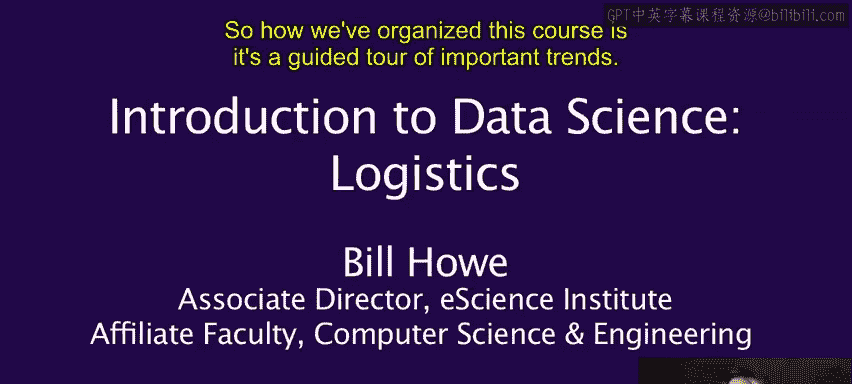
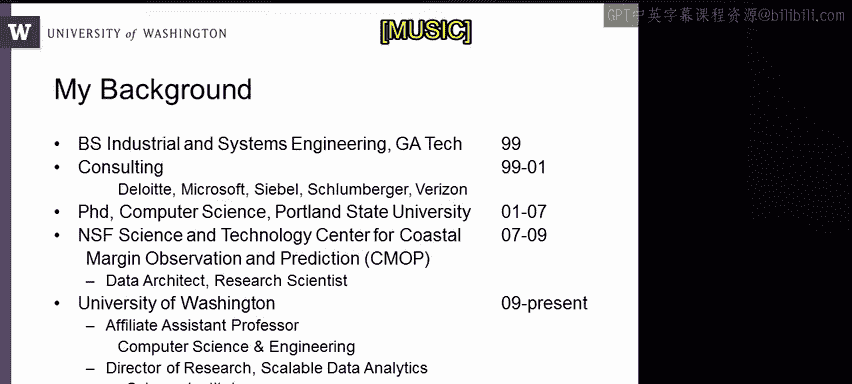

# 📚 课程介绍与后勤安排（第1课）

在本节课中，我们将了解《大规模数据科学》课程的整体结构、学习目标、先修要求以及评估方式。课程旨在通过理论讲解与实践操作相结合的方式，帮助初学者建立对数据科学领域的广泛认识。

---

## 🎯 课程结构与设计理念

课程的组织方式是对重要趋势的引导性介绍，并结合特定主题的深入探讨。

课程包含一系列实践作业，旨在培养具体的技能与经验。这是课程中最重要的部分。

课程设计的挑战在于，既要广泛覆盖我们想要的主题，又要足够包容，避免为特定群体定制内容。因此，部分内容对某些学习者可能较难，而另一些学习者可能觉得某些方面比较常规。如果有人觉得全部内容都很常规，我会感到惊讶，因为那样的话你可能不会选择这门课。

---

## 📝 先修要求

课程的先修要求相对宽松，因为我们希望吸引广泛的学习者，但这些要求确实很重要。

以下是具体的先修知识：
*   **编程经验**：具备某种语言的编程经验至关重要。
*   **统计学基础**：需要了解大学基础或高中高级统计学术语。例如，当我提到线性回归时，你应该知道其含义。
*   **数据解读能力**：能够查看数据可视化图表并理解其传达的信息。
*   **数据库概念**：最具挑战性的一点是，需要对数据库和数据库概念有所了解。课程中的许多讨论将围绕数据库及其关系展开，因此了解其基本概念会很有帮助。

---

## 💻 作业安排

课程作业旨在提供多样化的实践体验。

以下是作业的具体内容：
*   **SQL作业**：将涉及编写SQL。如果你从未写过SQL但了解一些数据库知识，你很可能可以完成这项作业。如果你是SQL专家，作业的某些部分可能仍然对你有启发。
*   **Python作业**：有两项作业涉及编写Python。
*   **可选的大数据处理作业**：一项可选作业涉及使用亚马逊云服务处理大数据。这项作业可选的原因之一是学习者技能水平各异，另一个原因是你需要自费使用云资源（费用预计低于10美元）。即使你不完成这项作业，仍然可以获得课程的全部学分。
*   **Kaggle竞赛参与**：另一项作业涉及在Kaggle.com上参与一个竞赛项目，你可以使用任何你喜欢的工具。这项作业不一定涉及编程，你完全可以使用Excel等图形化工具参与。

---

## 🧭 学习目标

本课程的核心目标是让学习者能够清晰地谈论数据科学的概念、工具、算法和技术全景。

这将成为你深入探索特定领域的跳板。例如，这不是一门机器学习课程，但你可以借此深入机器学习；这也不是一门数据库课程，但你可以借此深入学习数据库。

课程还旨在提供操作数据的实践经验，为没有编程经验的学习者打下基础，并为有经验的学习者提供特定的新体验。例如，第一项Python作业将涉及使用Twitter数据进行情感分析。如果你已经懂Python，学习Python本身可能不是这项作业的主要收获，但这可能是你第一次处理实时的Twitter数据流。

最终，我们希望你能在各种数据科学主题上达到“高级初学者”的水平。鉴于数据科学涵盖领域广泛，挑战在于如何超越浅层了解。我们认为课程设计得不错，但这需要由你来评判。

---

## 🔗 课程哲学与定位

需要强调的是，本课程的哲学在于：数据科学家所需的技能横跨多个不同领域，包括统计学、编程、数据库、分布式系统和可视化。

这些主题的传统组织方式是纵向的，并不利于获得数据科学的入门知识。为了在所有领域获得入门级知识，你通常需要学习七门不同领域的入门课程。

我们的目标是尝试揭示并简化这些不同领域之间的联系，而不是专注于它们各自的独特性。

完成本课程后，你不会成为统计学、机器学习、数据库或NoSQL方面的专家，也不会精通所有相关编程语言。

然而，你将使用所有这些工具，理解它们的基本概念，并应用其中的许多工具。

---

## 📊 课程评估方式

课程的评估将通过多种方式进行。

以下是具体的评估形式：
*   **课堂小测验**：讲座期间会有在线小测验（你已经看到了一些“手指练习”测验）。这些是完整在线作业的一部分。
*   **作业评分**：部分编程作业将自动评分。
*   **同伴互评**：不适合自动评分的作业将使用同伴评估工具。例如，你需要撰写一份关于Kaggle解决方案的描述，其他学生将评估其是否清晰易懂。

---

## 👨‍🏫 讲师背景

最后，介绍一下我的背景。

我拥有工业系统工程学士学位，曾在多家软件公司从事咨询工作数年。

之后我重返研究生院，获得了计算机科学博士学位，期间与海洋学家等研究人员进行了大量合作。

随后几年，我更加直接地与海洋学家合作，担任他们系统的数据架构师，工作内容主要是结合大规模海洋模型与观测网络。

目前我在华盛顿大学任职，是计算机科学与工程系的附属助理教授，并在数据科学与工程研究所领导一个可扩展数据分析小组。

---

## ✨ 总结

本节课中，我们一起学习了《大规模数据科学》课程的后勤安排与整体设计。我们了解了课程以广度介绍和深度探讨相结合的结构，明确了编程、统计和数据库基础的先修要求，并预览了包含SQL、Python、云服务和Kaggle竞赛在内的多样化实践作业。课程的目标是帮助你建立对数据科学领域的全景认识，成为连接不同技术领域的“高级初学者”，并为后续深入学习打下坚实的基础。