# 📘 课程名称：大规模数据科学（大数据操作，第1课／共3课有视频）｜Data Science at Scale - P22：Twitter作业入门

在本节课中，我们将学习如何开始第一个作业。该作业要求你访问Twitter的程序化API来收集数据，进行情感分析，并分析结果。我们将从设置环境开始，逐步完成数据收集的初始步骤。

---

## 🛠️ 第一步：设置环境

上一节我们介绍了作业的整体目标，本节中我们来看看如何设置一个包含Python和Git的环境，以便获取起始代码。

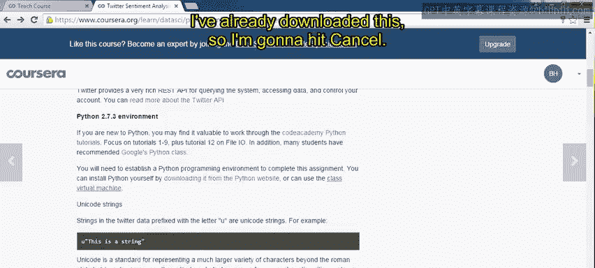

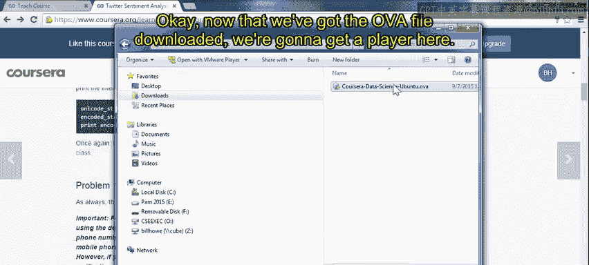

你可以使用任何可访问的环境（Mac、Linux或Windows），也可以选择使用课程提供的虚拟机。本教程将使用虚拟机进行演示。

以下是设置虚拟机的步骤：

1.  点击课程页面上的链接，下载OVA文件（约2.3GB）。
2.  下载完成后，需要安装一个虚拟机播放器（如免费的VirtualBox）。
3.  在VirtualBox中导入下载的OVA文件。
4.  启动导入的虚拟机。

启动虚拟机后，大部分工作将在终端中进行。

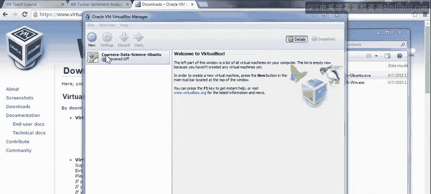

---

## 📥 第二步：获取起始代码

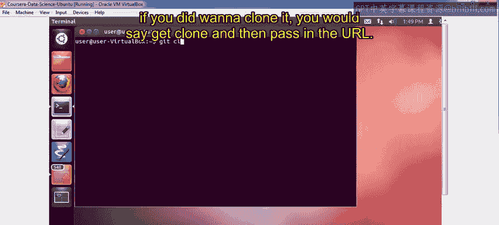

环境准备就绪后，下一步是克隆包含起始代码的GitHub仓库。

在虚拟机终端中，使用以下命令克隆仓库。仓库URL可以在作业说明页面找到。

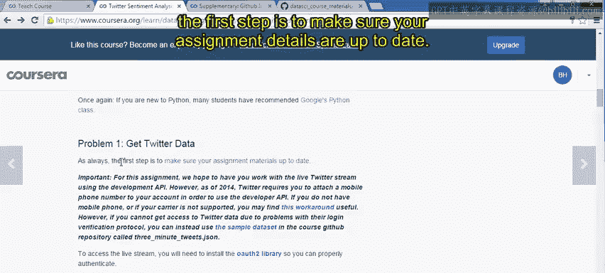

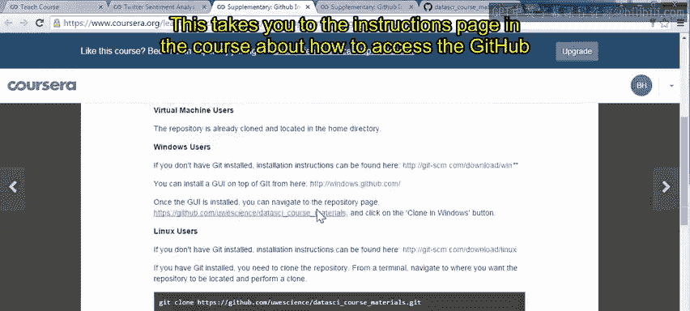

```bash
git clone [GitHub仓库URL]
```

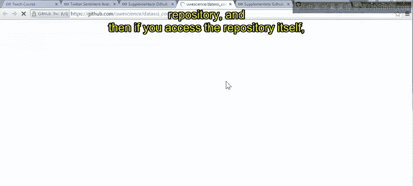

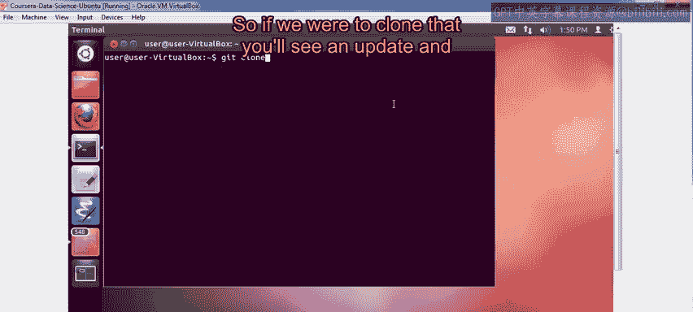

克隆完成后，进入作业目录并确保代码是最新的。

```bash
cd data-science-course-materials
git pull
```

---

## ✅ 第三步：检查环境依赖

在开始编码前，需要确保系统已安装必要的工具和库。

首先，检查是否已安装Git和Python。

```bash
git --version
python --version
```

接下来，安装Python包管理工具`pip`（如果尚未安装），然后使用`pip`安装本作业所需的`oauth2`库。

```bash
# 安装pip（如果需要）
sudo apt-get install python-pip

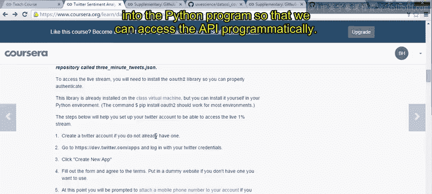

# 使用pip安装oauth2库
pip install oauth2
```

如果环境已预装这些组件，相应步骤可以跳过。

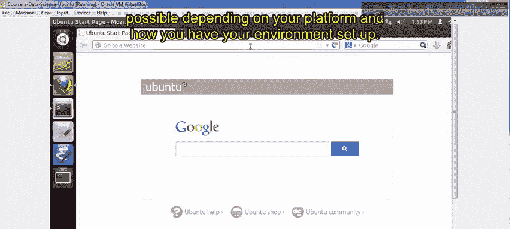

---

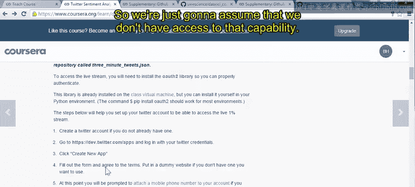

## 🔑 第四步：连接Twitter API

现在，我们将设置Twitter应用程序，以获取访问API所需的密钥。

首先，在虚拟机的浏览器中访问 `https://dev.twitter.com/apps`，并使用你的Twitter账户登录（可以为此专门创建一个账户）。

以下是创建应用程序的步骤：

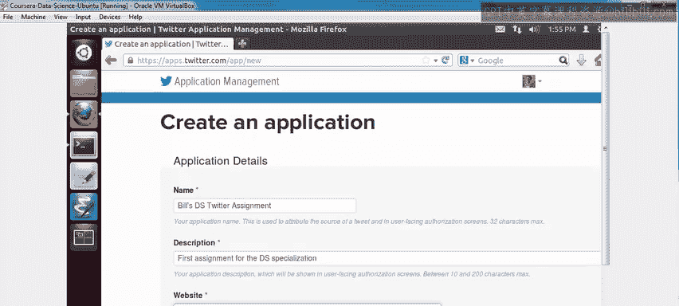

1.  点击“Create New App”按钮。
2.  填写应用程序详情：
    *   **Name**: 需要一个全局唯一的名称（例如 `yourname_data_science_app`）。
    *   **Description**: 填写描述，如“First assignment for data science”。
    *   **Website**: 可以填写一个占位URL，例如 `http://www.example.com`。
3.  同意条款并创建应用。

应用创建成功后，进入“Keys and Access Tokens”标签页。

你需要获取两组密钥：

*   **Consumer Key (API Key)** 和 **Consumer Secret (API Secret)**
*   **Access Token** 和 **Access Token Secret**（可能需要点击“Create my access token”按钮生成）

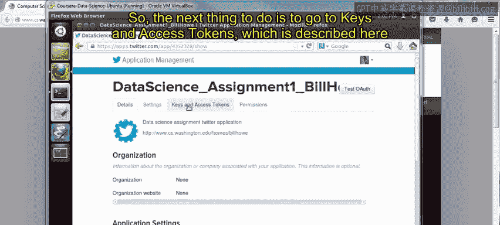

请妥善保存这四组密钥，下一步将用到它们。

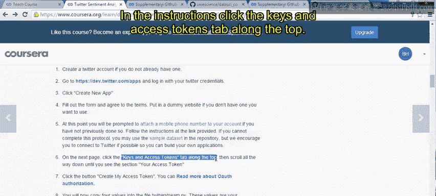

---

## 📝 第五步：配置Python程序

我们已经获得了API密钥，现在需要将它们填入Python脚本中，以便程序能够认证并访问Twitter。

在作业目录中，找到并编辑 `twitter_stream.py` 文件。文件开头有四个变量需要填写：

```python
# 在 twitter_stream.py 文件中找到并修改以下变量
api_key = "你的Consumer Key (API Key)"
api_secret = "你的Consumer Secret (API Secret)"
access_token_key = "你的Access Token"
access_token_secret = "你的Access Token Secret"
```

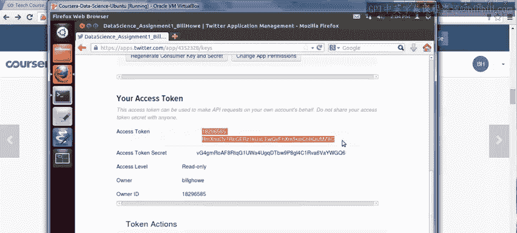

使用从Twitter开发者页面复制的密钥，分别替换上述四个变量的值。

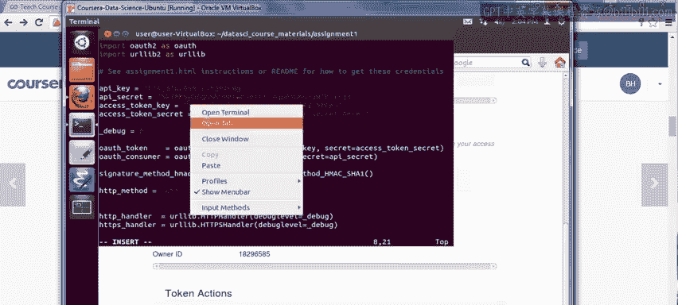

保存文件后，你可以运行该脚本测试连接是否成功。

```bash
python twitter_stream.py
```

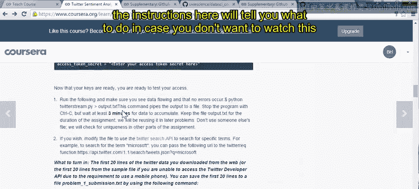

如果配置正确，终端将开始实时显示Twitter流数据。按 `Ctrl+C` 可以停止流。

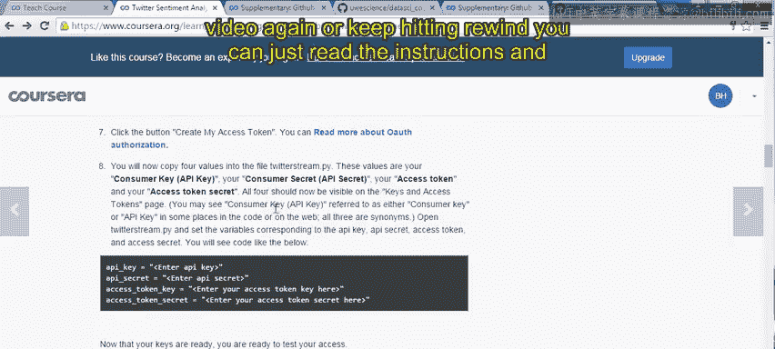

---

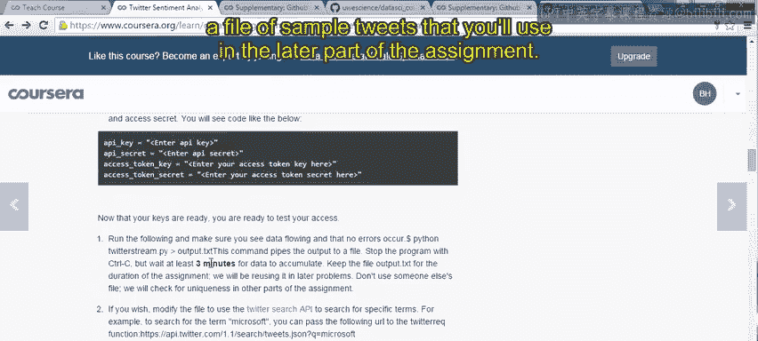

## 💾 第六步：收集样本数据

测试成功后，下一步是运行脚本一段时间，以收集用于后续分析的样本推文数据。

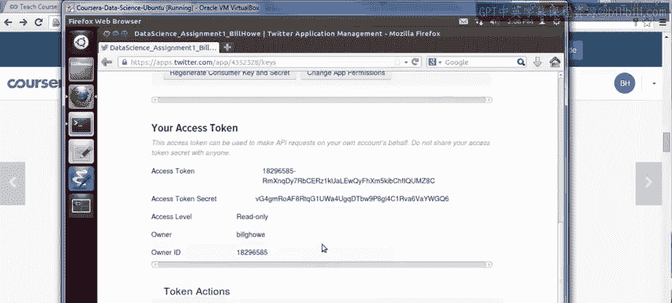

根据作业要求，让脚本运行约3分钟，并将输出重定向（管道）到一个JSON文件中。

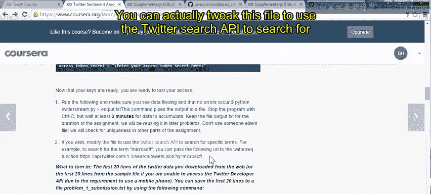

```bash
# 运行脚本并将输出保存到 output.json 文件
python twitter_stream.py > output.json
```

让命令运行足够的时间（约3分钟），然后按 `Ctrl+C` 终止。此时，当前目录下会生成一个包含推文数据的 `output.json` 文件。

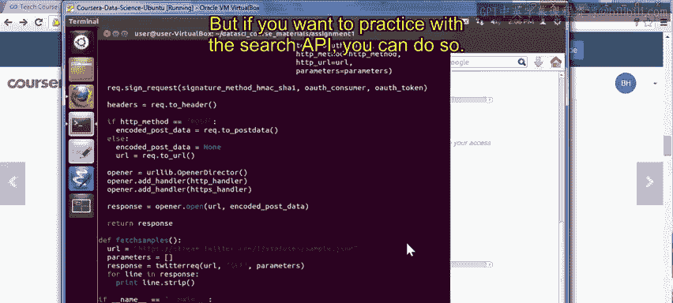

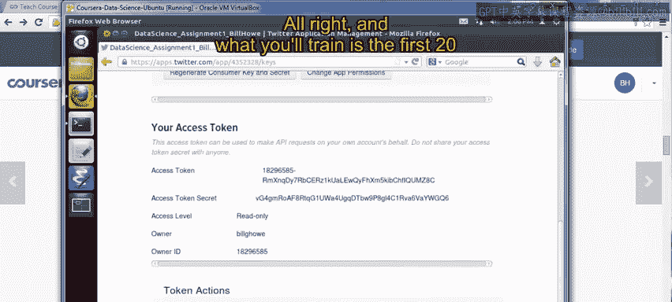

（可选）你也可以修改 `twitter_stream.py` 文件，使用Twitter搜索API来收集包含特定关键词的推文，而不仅仅是样本流。

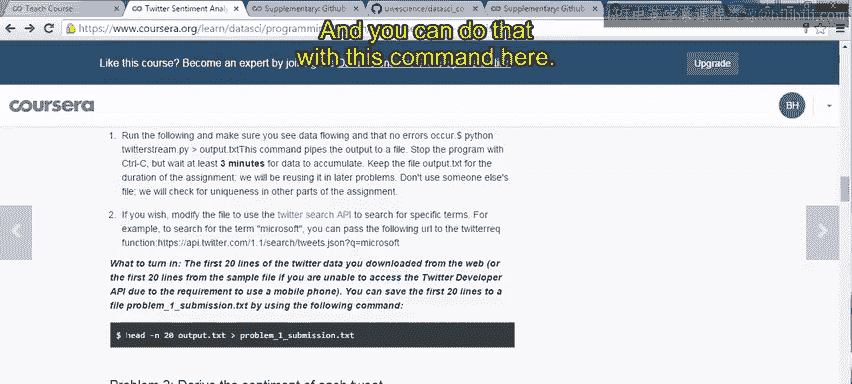

---

## 📤 第七步：准备作业提交

数据收集完成后，需要提取生成文件的前20行，作为作业第一部分提交。

使用以下命令提取 `output.json` 文件的前20行，并保存到另一个文件中。

```bash
head -n 20 output.json > problem1_submission.txt
```

现在，你可以打开 `problem1_submission.txt` 文件查看内容，并通过Coursera的作业提交界面提交该文件。

如果虚拟机内提交有困难（如显示问题），可以通过电子邮件、Dropbox或配置虚拟机共享文件夹等方式，将文件传输到主机再进行提交。

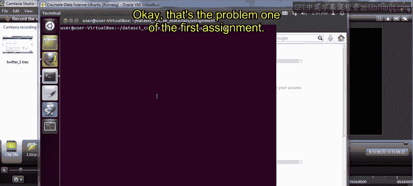

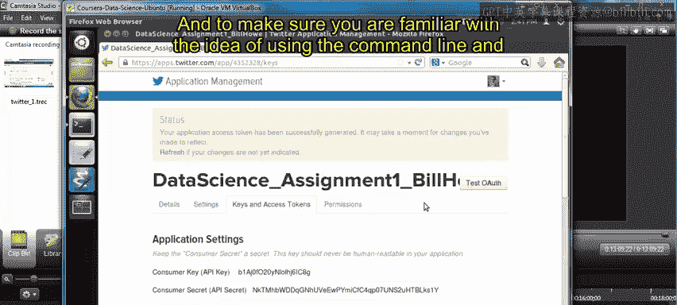

---

## 🎯 总结

本节课中我们一起学习了第一个Twitter数据科学作业的初始步骤。我们完成了从设置虚拟机环境、克隆代码、安装依赖、创建Twitter应用并获取API密钥、到配置Python脚本并成功收集推文样本数据的全过程。你现在已经准备好开始修改Python文件，以完成作业后续的情感分析等任务。

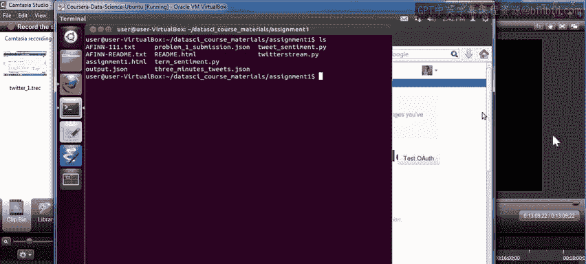

对于Python新手，这可能有些挑战，但请坚持并善用课程论坛寻求帮助。对于有经验的开发者，请确保不要过度复杂化问题，通常简单的解决方案就足够了。