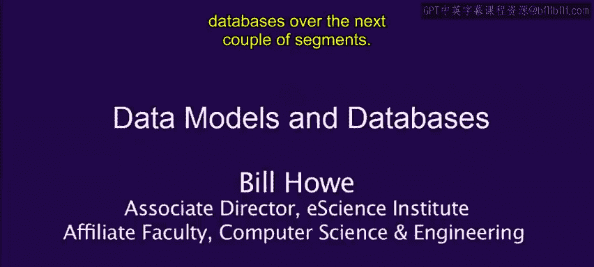
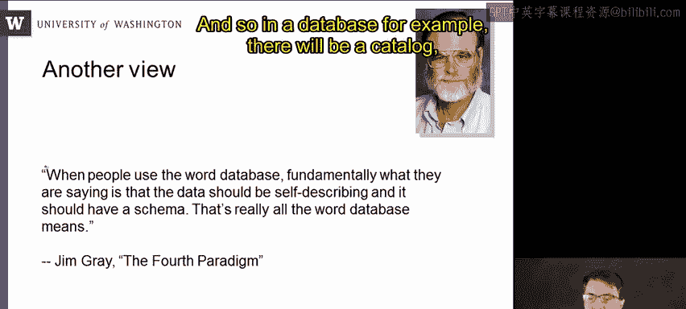

# 数据科学大规模应用（第1课）📊：数据模型术语

在本节课中，我们将学习数据模型的核心概念。理解数据模型是理解数据库如何组织和操作数据的基础。我们将探讨数据模型的定义、组成部分，以及它与数据库的关系。

---

## 数据存储的逻辑视角

上一节我们提到了数据存储的技术层面。本节中，我们来看看数据存储的逻辑组织方式。

一个更偏向逻辑的视角是询问我们使用的**数据模型**是什么。数据模型不仅仅是磁盘或文件中的比特位，它描述了数据的逻辑组织方式。

例如，在你的个人电脑上，数据可能以**分层嵌套的文件夹**形式存储，这是一种类似树状的数据模型。另一种常见方式是**行和列**，这是本课程将重点讨论的表格形式。数据也可能以网格、非结构化形式或图的形式存在。

关键在于，每当思考数据时，都应考虑其应用的数据模型。

---

## 数据模型的三大组成部分

一个数据模型通常包含三个核心组成部分，理解它们对于掌握数据模型至关重要。

以下是数据模型的三个关键部分：

1.  **结构**
    *   定义了数据如何组织。例如，在表格模型中，结构是行和列；在图模型中，结构是节点和边。

2.  **约束**
    *   定义了哪些结构是合法的。例如，在表格模型中，一个常见的约束是所有行必须拥有完全相同的列数。另一个约束可能是某一列中的所有值必须是整数，或者必须在特定数值范围内（例如代表一年中的天数）。

3.  **操作**
    *   定义了可以对数据结构执行哪些操作。虽然有时被视为独立部分，但我认为操作是数据模型不可或缺的一环。它涵盖了这些结构所支持的实际功能。

---

## 数据模型示例

让我们通过具体例子来巩固对数据模型三大组成部分的理解。

以下是不同数据模型的示例：

*   **表格模型**
    *   **结构**：行和列。
    *   **约束**：所有行具有相同的列数；某一列的所有值类型相同。
    *   **操作**：查找特定列等于特定值的所有行（例如，`last_name = 'Jordan'`）。

*   **键值对模型**（在NoSQL运动中流行）
    *   **结构**：键值对。
    *   **约束**：（可能）键是唯一的。
    *   **操作**：给定一个键`X`，返回其对应的值。

*   **分层模型**（如文件系统）
    *   **结构**：父子节点（如文件夹和文件）。
    *   **约束**：一个子节点不能有两个父节点（例如，一个文件不能同时位于两个文件夹中）。
    *   **操作**：遍历目录树、打开/关闭文件。

*   **原始文件**
    *   **结构**：字节序列。
    *   **约束**：通常较少。
    *   **操作**：获取下一个字节、移动到文件内另一个位置、打开/关闭文件。

总之，当你看到任何数据（尤其是在非易失性存储中），都可以思考它支持哪些操作、对结构有何约束，这能帮助你理解其背后的数据模型。

---

## 什么是数据库？

理解了数据模型后，我们自然要问：什么是数据库？

一个我认为相当充分的定义是：**数据库是一个为支持高效检索而组织起来的信息集合**。

这是一个非常通用的定义，它没有提及表格或关系。因此，当你想到数据库时，不必假设它一定是关系型数据库。谈论一个与关系无关的数据库是完全合理的。

但数据库也不仅仅是一堆数据。它的核心在于“为支持高效检索而组织”。

另一种观点来自Jim Gray在《第四范式》一书中的引述：
> “当人们使用‘数据库’这个词时，根本上他们是在说数据应该是**自描述的**，并且应该有一个**模式**。这就是‘数据库’这个词的全部含义。”

这又回到了数据模型的概念。模式定义了结构和约束，而数据本身需要是自描述的，这意味着仅通过查看数据，你就能理解如何读取它。例如，对于一个表格数据文件，你应该能够通过检查得知它有哪些列、有多少行等信息。在数据库中，通常会有一个明确的**目录**或**模式**来实现这种自描述性。

---

## 总结

本节课中，我们一起学习了数据模型的核心术语。我们首先从逻辑视角探讨了数据存储，然后深入分析了数据模型的三大组成部分：**结构**、**约束**和**操作**。接着，我们通过表格、键值对、分层等模型示例巩固了这些概念。最后，我们探讨了数据库的定义，并将其与数据模型和自描述性的**模式**概念联系起来。理解这些基础术语是后续学习数据库和大数据操作的关键第一步。