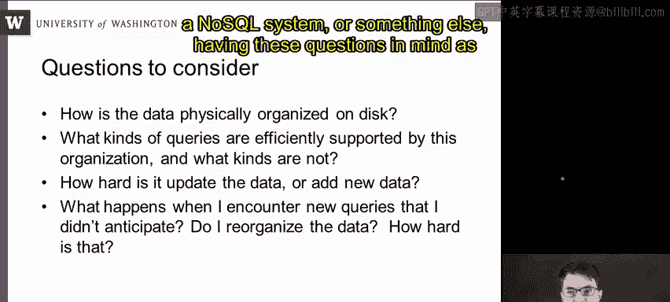

# 大规模数据科学（大数据操作，第1课／共3课） - P24：从数据模型到数据库 🗄️

在本节课中，我们将探讨“数据库”这一核心概念，理解其本质、解决的问题以及在实际数据科学任务中如何评估和选择合适的数据存储方案。

---

## 数据库的另一种视角

上一节我们介绍了数据库通常被视为配备了模式（Schema）的自描述数据。本节中，我们来看看为什么我们需要数据库，它们解决了哪些实际问题。

以下是数据库可以帮助解决的四个主要问题：

1.  **数据共享**：当多个用户需要访问同一份数据时，就需要某种基础设施或接口来管理并发访问。可以说，所有真正的数据库都提供了这种能力。
2.  **数据模型强制**：无论是行列表（Rows and Columns）还是层次模型（Hierarchical），都需要有软件来强制执行这种结构。数据库可以做到这一点。数据模型不仅包括原始结构（如父子关系、行列），还包括更高级的约束，例如：
    *   某个字段必须是1到5之间的数字。
    *   某个字段必须是一周中的某一天。
    *   某个字段必须是另一个表中已存在的客户ID。
    这类约束在应用层很难强制执行，我们稍后会进一步讨论。
3.  **处理规模（Scale）**：当数据量超过一定规模，或者数据模型的实例数量变得非常庞大时，我们需要专门的算法来处理。自己编写所有遍历大型数据集的算法会成为瓶颈。数据库可以组织这些算法，并通过方便的机制（即复杂性隐藏接口）提供访问。数据库为大规模数据提供了一个复杂性隐藏的接口。
4.  **灵活性**：你可能编写了特定软件以特定方式访问你的文件集。但一旦需要以你未预料到的方式访问数据，你就必须重写大量代码。数据库试图做的是，预测并支持一系列不同的数据访问和处理方式。

我在这里的讨论比较抽象，这是有意为之的。以上几点对于我们将要讨论的关系型数据库（Relational Databases）无疑是正确的，但我认为任何配得上“数据库”这一称谓的系统都应具备这些特性，其他类型的系统（如NoSQL、键值存储、图数据库）也是如此。因此，在思考NoSQL系统、键值存储、图数据库等时，我们也应牢记这些要点，这不仅仅是关系型数据库的事，范围更广。

---

## 评估数据存储层

一般来说，当我们审视这些不同的系统，思考数据存储层（这也是我们本次关于数据科学的对话以及本课程的起点）时，需要考虑以下几点：

*   数据在磁盘上是如何物理组织的？
*   某种特定的组织方式将高效支持哪些类型的查询和操作？哪些不支持？

一个直接的问题是（至少与第三点相关）：更新数据或添加新数据困难吗？这是划分所有数据操作的一种快速方法：读操作（Reads）与写操作（Writes）。在许多情况下，你会发现，便于高效读取数据的组织方式，与便于高效写入数据的组织方式并不相同。这种权衡是数据库及其他大规模系统中许多设计挑战的核心。

当然还有其他类型的操作，例如：你想通过键（Key）查找，还是想通过其他字段查找？我们将在未来的章节中讨论这些。

然后，如果我遇到了未曾预料到的新查询，会发生什么？我需要完全重组数据吗？我需要编写一堆新代码吗？这有多困难？

这些就是你在为数据科学任务选择平台时将要使用的评估标准。以下是一些需要考虑的问题（可能不是全部）：

*   如果大致上你的选择是一堆文件、一个现成的数据库、一个NoSQL系统或其他东西。

在评估各种方案的优缺点时，心中牢记这些问题将非常重要。

---

## 总结

本节课中，我们一起学习了数据库的核心价值。我们了解到，数据库不仅仅是存储数据的容器，它更是为了解决**数据共享**、**模型与约束强制**、**大规模数据处理**以及**访问灵活性**等关键问题而设计的系统。在评估数据存储方案时，我们需要从数据物理组织、读写效率、查询支持以及应对未来变化的灵活性等多个维度进行考量，为数据科学任务选择最合适的工具。