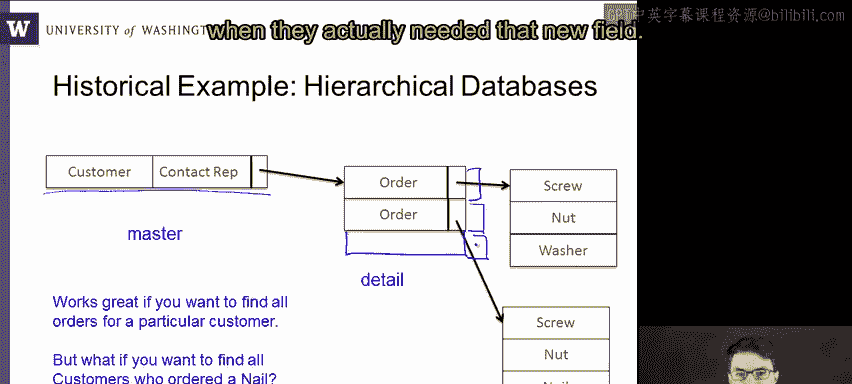

# 大规模数据科学（大数据操作，第1课／共3课） - P25：前关系型数据库 📚

在本节课中，我们将学习关系型数据库出现之前的数据组织方式。我们将探讨早期数据模型的设计思路、它们如何应对查询需求，以及这些设计存在的局限性。理解这些历史背景，有助于我们更好地评估现代NoSQL系统的设计权衡。

上一节我们讨论了数据模型，并用它们引出了数据库的广义概念。本节中，我们将以此为基础，具体探讨关系型数据库出现之前的几种数据组织方式。我们将使用一系列问题来分析不同的数据组织方法，并对照实际需求进行评估。这些分析最终将帮助我们理解关系模型的诞生动机。

## 分析数据系统的关键问题 🔍

在评估任何数据系统时，我们可以提出以下几个核心问题：
*   **数据在磁盘上如何物理组织？** 这关系到数据的存储效率。
*   **系统高效支持哪些类型的查询？** 这决定了系统的适用场景。
*   **如何进行数据更新？** 这影响了系统的可维护性和扩展性。

## 网络数据库（或文件系统）示例 📁

首先，我们来看一个被称为“网络数据库”的早期示例，它本质上更接近于直接使用文件系统。假设我们使用“零件与订单”模型。

**数据物理组织**
数据以记录形式存储在磁盘上。一个“订单记录”会包含一个地址字段，该字段**物理指向**与该订单关联的第一个“零件记录”。接着，这个零件记录又指向下一个零件，以此类推。订单记录中可能还有另一个字段，指向下订单的“客户记录”。

**高效查询**
如果我想查找**某个订单关联的所有零件**，效率很高。因为只要找到该订单记录，就可以顺着指针链遍历收集所有零件。

**低效查询**
然而，如果我想查找**包含某个特定零件（例如垫圈）的所有订单**，效率就很低。此时我必须扫描数据库中的每一个订单记录来寻找它。虽然可以通过添加“反向指针”等方法来缓解，但这增加了复杂性。

**更新与扩展问题**
这种基于文件的“原型数据库”模型在数据变更时面临挑战。例如，如果我想增加一个“账单客户”字段（区别于“收货客户”），我就在记录中增加了一个新字段，从而**扩展了记录的长度**。这可能导致该记录之后的所有数据都需要移动。更重要的是，所有**遍历此结构的程序**现在都需要知道这个新字段，它们都必须被重写以适应这个额外的数据。

**多访问路径问题**
此外，如果我们想支持不同的数据访问方式（例如，通过零件查找所有订单），最终可能不得不创建数据库的**完整第二个副本**。当更新数据时，我需要同时更新所有副本。可以想象，随着可能的访问路径增多，副本的数量和同步的复杂性会变得非常大。

## 分层数据库：部分解决方案 🌳

针对上述问题，出现了一种部分解决方案：**分层数据库**，其典型代表是IBM的IMS系统（至今仍有用户）。

**核心思想**
数据被组织成“段”。虽然逻辑模型仍然具有我们在网络模型中看到的层次化特征，但物理上数据被分割开了。例如，我将顶层访问路径设为“客户”，那么逻辑上，“订单”只位于“客户”之下，“零件”只位于“订单”之下。

**改进之处**
由于数据存在于独立的“段”中，我可以修改一个段（例如为订单增加字段），而**无需破坏访问其他段的所有代码**。更新也更容易，我可以将一个订单添加到存储在其他位置的段中，而不会影响所有其他结构。

**遗留问题**
然而，一个显著的缺点依然存在：**应用程序开发者仍然需要理解这个层次结构才能找到任何数据**。他们必须确切知道数据是如何组织的（例如，订单出现在客户之下）。因此，你仍然必须预先判断用户需要哪些访问方式，并为此进行设计。

**数据独立性的萌芽**
在这种模型上构建的软件层，能够在一定程度上将应用程序与底层数据结构的变更隔离开来，提供了一定的可靠性。例如，新增的字段只会在客户端真正需要时才会传递给它。这带来了某种程度的**数据独立性**，我们稍后会进一步讨论这个概念。

本节课中，我们一起学习了关系型数据库出现前的两种主要数据组织方式：网络（文件）模型和分层模型。我们分析了它们在数据物理组织、查询效率和更新维护方面的特点与局限。这些早期系统的经验，特别是对“数据独立性”和灵活访问路径的需求，直接推动了关系数据模型的诞生。下一节，我们将深入探讨关系模型如何解决这些问题。